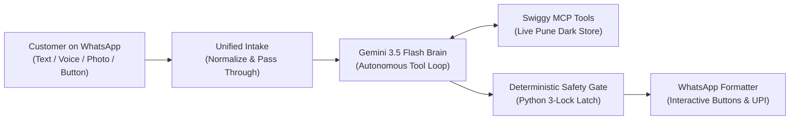

# Session Handoff: V2 Architectural Reset & The Grand Simplification

## 1. Why We Are Doing This Reset (The Root Reasons)

1. **The "Defensive Pile-up" Trap**:
   Over the project's history, code was built reactively. Every time a bug or edge case appeared, instead of simplifying, a new defensive layer was slapped on top:
   - Feared Gemini might drop an item -> added `item_drop_guard.py` (a second LLM).
   - Feared Gemini might hallucinate -> added `claim_check.py` (a third LLM).
   - Feared street names would match groceries -> added regexes and a hardcoded food blacklist in `address_tools.py`.
   - Feared Swiggy fees were wrong -> added a 6-bucket English fee word list in `cart_parsers.py`.
   - Feared button taps -> added an `action_map` dictionary in `preflight_handler.py`.
   The result was a **15-stage obstacle course across 25 fragmented files** with **18 regexes**. Every user message had to dodge 15 tripwires just to add milk to a cart.

2. **The Inverted Roles Failure**:
   - Python was trying to do natural language processing (parsing Indian addresses with regexes, filtering cities, blacklisting words). Python is terrible at natural language.
   - Gemini was forced to act like a bureaucratic bouncer (refusing medical items without tools, predicting dark store stock in its head).
   This created a "double-bureaucracy" where neither layer trusted the other, leading to real bugs:
   - Band-Aids was rejected because the prompt told Gemini to refuse medical items without calling tools.
   - Late Night Fee (₹5.90) broke checkout because Python's fee whitelist didn't include the word "night".

3. **The 10,000-User Reality**:
   Real users speak in messy Hinglish ("dedh kilo", "ek pav"), change their minds mid-checkout, send voice notes with traffic noise, and ask questions alongside groceries. A rigid state machine and string-matching filters will break on 1,000 new edge cases in production.

---

## 2. Product Mission & Invariants (`GROCER_V2_MASTER_SPEC.md`)
- **Product Definition**: Swiggy Instamart with a WhatsApp interface. Zero dark-store dashboards, zero generic open-ended chitchat.
- **The Sangvi Principle**: Never assume geography. Ground delivery strictly in customer's real saved Swiggy addresses (`session.saved_addresses`).
- **Customer Advocate Engine**: Auto-apply best valid coupons, beat delivery fee thresholds, proudly display savings.
- **Zero Regex & Zero Keyword Dictionaries for Domain Logic**: The live Swiggy dark-store catalog is the single source of truth for what exists and what is allowed.
- **1-Tap Mobile UPI**: Dynamic `upi://pay` deep links formatted into WhatsApp interactive buttons for instant GPay/PhonePe checkout.

---

## 3. Real-World Environmental Realities & Constraints
1. **Swiggy MCP Realities**:
   - `update_cart` replaces the entire cart (it is absolute, not additive). Python must preserve existing items.
   - Product search returns 20 SKU variants.
   - Checkout is strictly non-idempotent: never blind-retry; check `get_orders` on failure.
   - Live dark store inventory is fluid (items sell out, surge fees fluctuate in real time).
2. **Meta WhatsApp API Realities**:
   - Max 1024 characters for interactive message bodies.
   - Max 3 quick-reply buttons (max 20 characters per button title).
   - Max 10 rows per interactive list.
3. **Payment Asynchrony**:
   - Users take minutes to complete UPI payments on their phone.
   - Background polling (every 15s) must be crash-proof and survive server restarts.

---

## 4. Target Architecture: The Clean 3-Pillar Pipeline

- **Pillar 1: Unified Ingestion**: Read text, voice, photos, or button taps. Zero keyword interceptors or early drop filters.
- **Pillar 2: Autonomous Gemini Brain**: Single-turn tool-calling loop equipped with native Swiggy MCP tools (`search_products`, `manage_basket`, `select_delivery_address`, `apply_coupon`). Let Gemini reason, select variants, and translate messy intent.
- **Pillar 3: The 3-Lock Safety Gate (Python Muscle)**: Python sits strictly at final checkout:
  - *Lock 1*: Did the user explicitly confirm this exact bill?
  - *Lock 2*: Is grand total <= user's budget?
  - *Lock 3*: Is the dark store cart serviceable and in stock?
  If confirmed -> call Swiggy checkout -> return dynamic UPI link.
  If not confirmed -> return formatted receipt card with 1-tap "Confirm Order" button.
- **Pillar 4: Outbound & Payment Engine**: Clean WhatsApp cards, 1-tap mobile UPI links, and durable 15s poller resilient to reboots.

---

## 5. Current Code State
- **Branch**: `feat/architecture-v1` (Git commit `a3df957`, working tree clean, synced to GitHub).
- **Tests**: All 101 unit and integration tests passing in 8.04s (`pytest --ignore=backend/tests/test_whatsapp_postgres_e2e.py`).
- **Live Infrastructure**: Connected to live Supabase PostgreSQL (`db.rxaqlqvhdoiduadikjeb.supabase.co`), Google Gemini 3.5 API, and live Swiggy MCP endpoint for customer `cust_c23625efe2658a26` in Sangvi, Pune.
- **Immediate Fixes Included**: Band-Aids unblocked, Late Night Fee dynamic math parsing verified, formatter `InteractiveAction` import crash fixed, SHA-256 schema bug fixed, food blacklist removed.

---

## 6. Next Actions in the Fresh Session
1. Open new chat and prompt: *"Let's execute the V2 architectural reset from .scratch/HANDOFF.md"*.
2. Review the consolidated file map (collapsing 25 files in `backend/agent/` to 4 high-cohesion modules).
3. Safely delete obsolete defensive files (`claim_check.py`, `item_drop_guard.py`, `preflight_handler.py`, `address_tools.py`, etc.).
4. Implement the clean 3-pillar pipeline and verify with 101 tests + real WhatsApp end-to-end testing.
