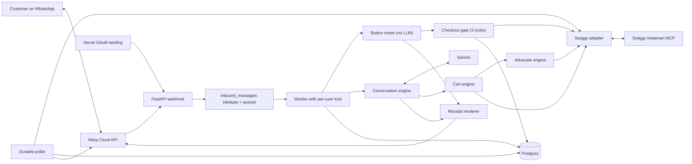
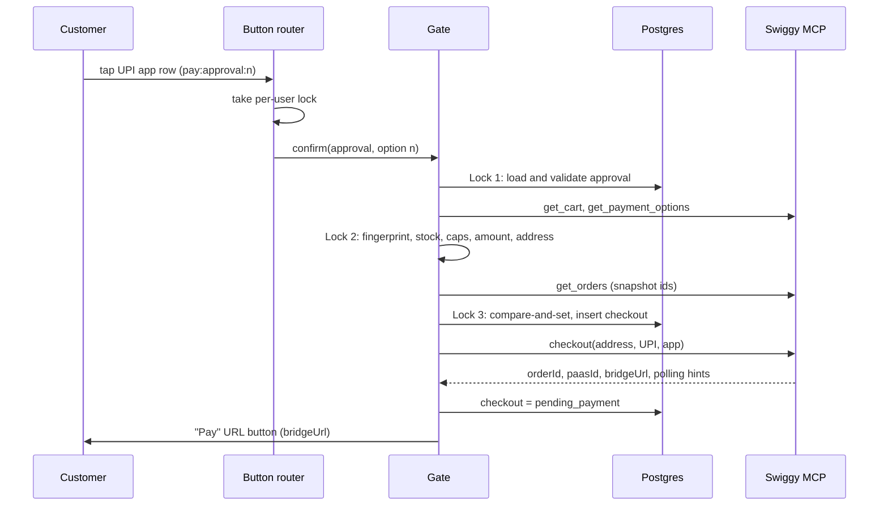
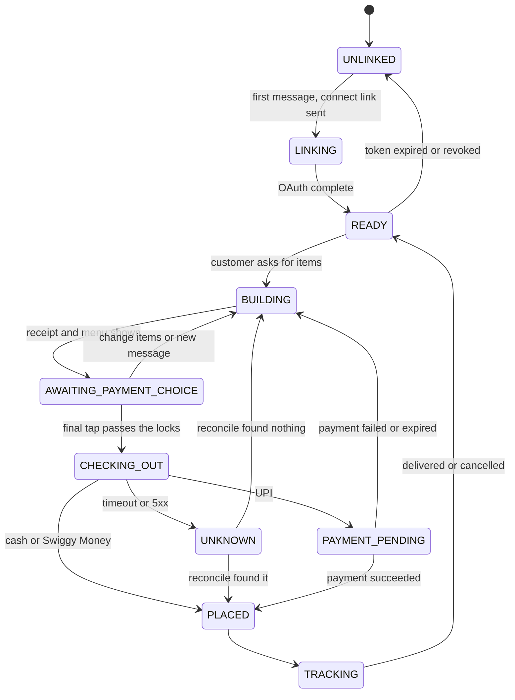

# ARCHITECTURE.md — Grocer Technical Architecture (v4.0)

> **Status:** Replaces v2.0 (and my earlier v3.0 draft). PRD v2.0 says *what* Grocer does; this file says *how*. Where they differ on mechanism, this file wins and the change is logged in §24.
> **Product:** Swiggy Instamart concierge on WhatsApp.
> **Stack:** Python / FastAPI · Gemini · Swiggy Instamart MCP · Meta WhatsApp Cloud API · PostgreSQL · Render · a small Vercel OAuth landing page.

## 0. Basis of this document

- **Swiggy facts** come from Swiggy Builders Club's official documentation (Instamart reference, payment stage, authenticate, access, rate limits, errors, ship-to-production, data and compliance) and Swiggy's public issue tracker, read on 25 Oct 2026.
- **WhatsApp limits** come from Meta's interactive-message documentation and BSP documentation that quotes it.
- **Response field formats** are parsed in exactly one place (`cart_parsers.py`, `order_parsers.py`, `payment_parsers.py`) and locked by fixtures captured from Swiggy's staging in Phase 0 (§23). That is an implementation step, not an open question.
- **Where Swiggy's own docs disagree** (the reference lists 20 Instamart tools; an October issue reported only 16 were served), the design detects capabilities at runtime (§6.3) instead of assuming.

## 1. What changed from v2.0

| # | v2.0 | v4.0 | Why (source) |
|---|---|---|---|
| 1 | Tool `get_go_to_items` | `your_go_to_items`. `recommend_address` is a geocoder used to validate addresses, not a default picker | Swiggy reference |
| 2 | Refresh Swiggy tokens | Tokens last **5 days and Swiggy issues no refresh tokens in v1.0**. Re-link just in time and replay the parked message | Swiggy authenticate docs |
| 3 | `update_cart` "merges" | It **replaces the entire cart** and takes `spinId + skuId + quantity`. The merge happens in Grocer (§9) | Swiggy reference |
| 4 | Cart is the customer's cart | Carts are server-side and **per address**. The MCP cart is not guaranteed to appear in the Swiggy phone app, and reads can revert. Grocer never tells anyone to "pay in the app" | Swiggy issue tracker |
| 5 | `upi://pay` link built by Grocer | `checkout` returns `bridgeUrl` (https) and `upiIntentUrl`. Grocer sends `bridgeUrl` as a URL button | Swiggy checkout reference |
| 6 | Poller calls `track_order` every 15 s | `check_payment_status` is a **long-poll (~19 s)** driven by Swiggy's `pollingIntervalInMs` and `maxTimeToPollForInMs`. On terminal success Swiggy confirms the order server-side. Order status uses `get_delivery_status` | Swiggy payment docs |
| 7 | Coupons: rank by value, undo if worse | `list_coupons` returns **no discount amounts**, there is **no remove-coupon tool**, and the tools may be absent for an account. Grocer uses bounded trial-and-reset (§10) | Swiggy reference |
| 8 | Savings parsed from bill labels | Savings are **measured**: item MRP minus price, plus (total before coupon − total after) | Avoids label parsing |
| 9 | `float` rounding for fingerprints | Integer paise and canonical JSON | Stability |
| 10 | 3 locks: confirm, budget, fingerprint | Authority, Truth, Exactly-once (§12), plus a post-checkout total check and Swiggy's own `confirmDuplicate` guard | Swiggy checkout docs |
| 11 | No dedupe, no per-user lock | Unique WhatsApp message id plus per-user lock, also for button taps | Meta retries webhooks |
| 12 | Confirm by tap **or** text | Button tap only | A text "yes" is a model decision |
| 13 | Payment buttons fixed | Methods come from `get_payment_options` (UPI apps, QR, Cash, Swiggy Money), shown within WhatsApp's 3-button limit | Swiggy payment docs, Meta limits |
| 14 | Multi-store ignored | One checkout can create **one order per store with partial success**. Handled per order (§13) | Swiggy checkout reference |
| 15 | Data kept freely | **Data-processor rules:** minimal retention, no addresses or order history stored, no analytics or training on Swiggy data, a signed DPA before production, Swiggy branding visible | Swiggy compliance docs |
| 16 | Production directly | **Staging first**, then production only after the allowlist step. Default order cap ₹1000, Swiggy's minimum order ₹99 | Swiggy access docs |
| 17 | Voice and photos in v1 | v1.1 (your decision) | Scope |
| 18 | Graph API `v20.0` hard-coded | Version in config | Meta versions expire |
| 19 | "Zero mocked project code" | Fakes only at Swiggy, Gemini and Meta edges | Real orders cannot run in CI |

## 2. Principles

1. **Swiggy is the source of truth** for cart, prices, stock, bill, coupons, payment and order status. Grocer stores conversation state, approvals and order bookkeeping, never a cart it trusts.
2. **Gemini proposes; Python and buttons dispose.** Gemini can search and edit the cart. It cannot spend money, delete addresses or clear the cart.
3. **The receipt shows Swiggy's numbers verbatim.** Grocer never recomputes money. Gemini never states a price.
4. **Capabilities, not instructions.** Safety comes from what Gemini is given (a code-level allowlist), not from what the prompt asks.
5. **Every write is followed by a read**, because Swiggy's carts can revert.
6. **Every side effect is idempotent or guarded.** Cart writes send the full target list. Checkout is exactly-once by construction.
7. **No silent drops.** Python computes requested minus applied and appends it to the receipt.
8. **Real data every time.** No cross-turn caching of catalog, price, stock, address or coupon data.
9. **No keyword dictionaries or regex in domain logic** (enforced by test). Regex is allowed in transport parsing.
10. **Money in integer paise** inside Grocer, parsed once.
11. **Minimal personal data.** Hold only what the current session or an in-flight order needs.
12. **Boring infrastructure.** One instance, Postgres for everything durable, no Redis or Celery.

## 3. Swiggy contract (what Grocer relies on)

### 3.1 Tools Grocer uses

| Tool | Arguments | What Grocer reads | Notes |
|---|---|---|---|
| `get_addresses` | page | id, label, display text. 10 per page with a `pagination` object | Coordinates are optional in Grocer's model |
| `create_address` | address text, name, phone, category | new address id | Open to every authenticated user; coordinates optional, Swiggy geocodes |
| `recommend_address` | free text | coordinates and formatted address | Validates text before `create_address` |
| `delete_address` | `addressId` | | Mutating |
| `search_products` | `addressId`, `query`, `offset?` | products, each with variants (`spinId`, `skuId`, pack size, price, stock) | You add **variants** to the cart |
| `your_go_to_items` | `addressId` | frequently or recently ordered items with variants | Swiggy's recommended reorder path |
| `update_cart` | `selectedAddressId`, `items[{spinId, skuId, quantity}]` | full cart, `removedOutOfStockItems[]`, `reducedQuantityItems[]` | **Replaces the entire cart.** Same arguments are safe to resend |
| `get_cart` | none | items (`spinId`, `skuId`, `productId`, `storeId`, `itemName`, `itemVariant`, `quantity`, `isInStockAndAvailable`, `mrp`, `discountedFinalPrice`, `maxQuantity`), `billBreakdown.lineItems[{label,value}]`, `billBreakdown.toPay`, `cartTotalAmount`, `selectedAddressDetails`, `unserviceableItems[]`, `cartWarning` | Read-only |
| `clear_cart` | none | | Mutating |
| `list_coupons` | `addressId` | `availableCoupons[{couponCode, title, description, isApplicable, applicabilityStatus, applicabilityMessage}]` | No discount amount. May be absent |
| `apply_coupon` | `couponCode` | updated cart | May be absent. No remove tool exists |
| `get_payment_options` | none | `allMethods`, `platforms.mobile.methods` (UPI apps), `platforms.desktop.methods` (QR), `cod`, `swiggyMoney`, `paymentAmount` | Offer only what it returns |
| `checkout` | `addressId`, `paymentMethod` (`"UPI"`, `"Cash"`/`"COD"`, `"SwiggyPay"`), `intentApp`, `generateUPIQR`, `confirmDuplicate` | Cash and Swiggy Money: `orderId`, `status`, `cartTotal`. UPI: `orderId`, `transactionId`, `paasId`, `upiIntentUrl`, `bridgeUrl`, `isQrFlow`, `pollingIntervalInMs`, `maxTimeToPollForInMs`, `status: PENDING_PAYMENT`. Multi-store: `orders[]` plus `successCount` and `allSucceeded` | One order **per store** |
| `check_payment_status` | `paasId`, `orderId` | `SUCCESS`, `PENDING`, `FAILED` or `REFUND-INITIATED`; on terminal success `confirmed: true` | Long-poll (~19 s). Success is already confirmed server-side |
| `confirm_order` | `orderId`, `paasId` | | Idempotent. Only needed if Grocer's own polling cap is reached while still pending |
| `get_orders` | none | order history and active orders | Read-only |
| `get_order_details` | `orderId` | items, bill, status, refunds | May be absent |
| `get_delivery_status` | `orderId`, `addressId` | ETA and delivery state | Structured polling |
| `track_order` | `orderId`, `lat`, `lng` | status, ETA, delivery partner location, store info | Needs coordinates |
| `report_error` | summary | a readable summary plus a `mailto` link | For support |

Every tool returns `{success, data, message}` or `{success: false, error: {message}}`.

### 3.2 Operating constraints

| Topic | Fact |
|---|---|
| Endpoints | Production `https://mcp.swiggy.com/im`. Staging `https://mcp-staging.swiggy.com/im` with seeded data and no real orders |
| Access | Invite-based. Staging first. Production after staging has been green for 48 hours and Swiggy confirms. A signed DPA is needed before production |
| Transport | MCP Streamable HTTP with a Bearer token. A fresh session per operation is a working pattern |
| Auth | OAuth 2.1 with PKCE S256. Endpoints `/auth/authorize`, `/auth/token`, `/auth/logout` on `https://mcp.swiggy.com`. Redirect URIs are exact-match https; changes are requested by email to builders@swiggy.in |
| Token life | Access token 5 days. **No refresh tokens in v1.0** (rolling refresh is planned for v1.1) |
| Rate limits | Not enforced at the MCP layer today. Planned: 120 requests per minute per user per server. Upstream shedding appears as `UPSTREAM_ERROR` |
| Errors | Classify by HTTP status and `error.message`. 400 `Invalid`/`Missing`: fix, never retry. 502/503: backoff, at most 5. 500: backoff once, then `report_error`. HTTP 200 with `success: false`: a domain failure, usually terminal. Auth failure: JSON-RPC `-32001` |
| Order rules | Builders Club orders are capped at **₹1000** (documented for Food; Grocer applies it by default). Instamart minimum order **₹99**. Cancellation is by phone only: **080-67466729**. No tool cancels an order |
| Carts | Server-side and per address. Changing address means clearing the cart first. The MCP cart is not guaranteed to match the phone app's cart, and reads can revert |
| Data | Swiggy is the Data Fiduciary; Grocer is a Data Processor. Do not keep personal data longer than needed. No analytics, ads or model training on Swiggy data without explicit consent and a DPA. Data-subject requests about Swiggy data go to the Swiggy app |
| Brand | Users must know they are using Swiggy services. No dark patterns, no hiding Swiggy's brand, no resale of access |
| Payments | Never ask for a UPI ID or VPA. Use only methods `get_payment_options` returns. Show the order-placed message from `checkout` as returned |

## 4. System context



| Component | Responsibility |
|---|---|
| FastAPI webhook | Verify signature, insert message row, return 200 |
| Worker | Pull rows, take the per-user lock, dispatch |
| Button router | Deterministic handling of taps |
| Conversation engine | One bounded Gemini tool-calling turn, then the receipt |
| Cart engine | Search, selection, full-cart writes, read-after-write |
| Advocate engine | Coupons, budget, minimum-order and threshold suggestions, savings |
| Checkout gate | Three locks, then `checkout` |
| Swiggy adapter | The only module that knows MCP tool names and shapes |
| Poller | Payment and order status, pushes, resume after restart |
| Token vault | Encrypted Swiggy tokens |
| Vercel landing | Receives Swiggy's redirect and hands code and state to the backend |

## 5. Capability matrix

| Action | Gemini (tools) | Button router | Poller |
|---|---|---|---|
| Search, read cart, read go-to items | yes | no | no |
| Edit cart (`modify_cart`) | yes | exact-product adds only (reorder and suggestion taps) | no |
| Apply coupon | `apply_best_coupon` (guarded) | no | no |
| Select / create address | yes | yes | no |
| **Delete address** | propose only | **executes** | no |
| **Clear cart** | propose only | **executes** | no |
| **Checkout** | **never** | **executes via the gate** | no |
| Payment status / `confirm_order` | never | yes | yes |
| Order status / tracking | yes (read) | yes | yes |

**Three layers keep Gemini away from `checkout`:**

1. `tool_registry.py` builds Gemini's declarations from an explicit allowlist.
2. `SwiggyAdapter.checkout()` needs a `ConsumedApproval`, a type only `approval.consume()` can create. Swiggy's scopes are per server, not per tool, so this is the only hard guard.
3. Invariant tests (§20) fail the build if the allowlist or the call sites change.

Customer text, product names and coupon descriptions reaching Gemini are untrusted data. Prompt injection can at worst change the cart, never place an order.

## 6. Runtime and concurrency

### 6.1 Process model
One Render instance, one uvicorn worker, one async worker loop. An in-process `asyncio.Lock` per user is therefore enough. Scale-out path (later): Postgres advisory locks plus a worker process using `FOR UPDATE SKIP LOCKED`. The schema already supports it.

### 6.2 Rules
- Every inbound message, text or tap, runs under `user_lock(user_id)`. A tap that arrives during a Gemini turn waits, then re-validates against a fresh cart.
- Turn wall-clock cap: 40 s. Gemini round: 20 s. Swiggy reads: 10 s, cart writes: 15 s, checkout: 20 s.
- Swiggy reads and cart writes may be retried (Swiggy says the same arguments are safe to resend) on 502/503 with backoff, at most 3 times inside a turn. **Checkout is never auto-retried.**
- Per-turn Swiggy call budget: 30. Search fan-out semaphore: 5. This keeps one user far under Swiggy's planned 120 requests per minute.
- Boot recovery: requeue messages stuck in `received` or `processing` for over 60 s when `attempts < 3`. A stuck confirm tap is never replayed. It is marked `failed` and the customer is asked to tap again.
- Per-phone rate limit: 20 messages per minute.

### 6.3 Capability detection
On linking, and again at each boot for a sample account, the adapter calls `tools/list` and records which tools this account gets: `list_coupons`, `apply_coupon`, `get_order_details`, `create_address` and the payment-stage tools. Features degrade quietly when a tool is missing:

| Missing | Behavior |
|---|---|
| `list_coupons` or `apply_coupon` | No coupon step, no savings from coupons. Nothing is promised to the customer |
| `get_order_details` | Reorder uses `your_go_to_items` and the order list only |
| payment-stage tools | Cash only, and the receipt says UPI isn't available right now |
| `checkout` | The assistant tells the customer ordering is unavailable. Nothing else runs |

A boot check fails fast if the required core (`get_addresses`, `search_products`, `update_cart`, `get_cart`, `checkout`) is missing.

## 7. Inbound pipeline

```
POST /api/whatsapp/webhook
  1. Read RAW body bytes.
  2. Verify X-Hub-Signature-256 = "sha256=" + HMAC_SHA256(app_secret, raw_body), constant-time compare. 401 on mismatch.
  3. Parse (whatsapp_parser.py). Ignore delivery and read status callbacks.
  4. INSERT INTO inbound_messages (wa_message_id, ...) ON CONFLICT DO NOTHING. Duplicate = skip.
  5. Return 200. The worker picks the row up.
GET /api/whatsapp/webhook -> verify handshake (hub.verify_token, hub.challenge).
```

**Message kinds in v1:** `text`, `button` (`interactive.button_reply.id`), `list` (`interactive.list_reply.id`), `location` (latitude and longitude), `unsupported`. For `unsupported` (voice, image, sticker) reply once: "I can read text, buttons and location pins for now. Voice notes and photos are coming soon." Do not call Gemini.

**Identity:** the customer is the `wa_id` in the verified Meta payload. Nothing in message text can change it.

**WhatsApp limits the UI is built around** (Meta documentation): plain text body up to 4096 characters; interactive body up to 1024; reply buttons 1 to 3 with titles up to 20 characters and ids up to 256; list messages up to 10 rows in total with a button label up to 20 characters; a URL button message carries exactly one `cta_url` button; one interactive type per message.

**Button id grammar** (opaque server-side lookups, never trusted state):

```
pay:<approval_id>:<option_no>     more:<approval_id>
change:<approval_id>              clear:<approval_id>:<nonce>
addr:<address_id>                 deladdr:<address_id>:<nonce>
add:<token>                       reorder:<token>
```

A tap is valid only if the row it names exists, belongs to this user, and is in a state that allows the action.

**24-hour window:** free-form messages are allowed only within 24 hours of the customer's last inbound message (`users.last_inbound_at`). Check before any proactive send. If closed, skip and log. Template messages are out of scope for v1.

**Stale input:** a message older than 15 minutes on arrival gets one "I was offline, please resend" notice and is not processed.

## 8. Conversation engine (Gemini)

One turn is one bounded tool-calling loop. Python then renders the receipt.

```
turn(user, message):
  load session (budget cap, notes, address id, last 12 turns)
  loop up to 6 rounds, 20 s each, temperature 0.2:
      Gemini -> text and/or tool calls
      validate each call: name in allowlist, args pass Pydantic, candidate ids exist in this turn's registry
      execute -> structured tool result -> Gemini
  if the cart was touched or the customer asked to see it:
      orchestrator (not Gemini): get_cart -> advocate -> budget -> approval -> receipt -> payment menu
  send: Gemini's text (optional) -> receipt -> payment menu
  persist a one-line turn summary
```

**Tool allowlist (everything else is invisible to Gemini)**

| Tool | Arguments | Effect |
|---|---|---|
| `modify_cart` | `operations[]`: `{op: add\|set_qty\|remove, request_text?, quantity?, item_ref?, candidate_id?, specificity: generic\|specific}` | Cart engine (§9). Returns `applied[]`, `not_found[]`, `unavailable[]`, `reduced[]`, `blocked[]`, `candidates{}`, `cart_refs[]` |
| `show_cart` | none | Read; flags "render receipt" |
| `apply_best_coupon` | none | Advocate (§10); returns applied or reason |
| `show_usual_items` | none | `your_go_to_items` to a list message (taps become `add:` buttons) |
| `show_past_orders` | none | `get_orders` to a list message (taps become `reorder:` buttons) |
| `set_budget` | `cap_rupees: number\|null` | Session write |
| `set_notes` | `text` | Session write (free-text preferences, best effort) |
| `list_addresses` / `select_address` | `address_id?` | Read / session write |
| `create_address` | `address_text, category, name?, flat?, landmark?` | §15 |
| `propose_delete_address`, `propose_clear_cart` | id | Creates a confirm button only |
| `track_order` | `order_ref?` | Read (§13) |
| `report_error` | `summary` | Logs, calls Swiggy `report_error`, returns the readable summary and support number |

**Prompt contract (`prompts.py`)**

- Reply in plain, natural English. Hinglish grocery words (*doodh, dahi, atta, aloo*) are understood.
- Never state a price, total or saving. The receipt carries numbers.
- Vague request ("milk"): the default is added, and "Change items" exists. Specific request ("almond milk", "Amul Gold 1 L"): never substitute. If the result doesn't match, say so and use `candidates`.
- Always report `not_found`, `unavailable`, `reduced` and `blocked` items.
- At most one question per reply. Prefer acting on a sensible default.
- Say "Swiggy Instamart" where a service is named. Never tell the customer to open the Swiggy app to pay or to check their cart. Never ask for a UPI ID.
- Groceries and household shopping only. For symptoms: no diagnosis or dosing, suggest a doctor, offer OTC first-aid items only when asked.
- Never claim an order was placed. System messages do that.

**Hard rules in code:** if the catalog response carries a category or classification field, products classed Pharmacy or Prescription are blocked (`blocked[]`). No word lists. The field's presence and name are locked by staging fixtures.

**Session context:** last 12 turns (user text, assistant text, one-line tool summaries), `budget_cap_paise`, `notes`, `address_id`, last approval id. History expires after 24 hours of inactivity. The cart is never stored.

**Model configuration:** `GEMINI_MODEL` and `GEMINI_FALLBACK_MODEL` in env. Two failures on the primary mean the fallback for that turn. Both failing means a plain "assistant unavailable" and the cart is untouched. Gemini must be used on a plan whose terms exclude training on your prompts (paid or enterprise tier), because cart and address data come from Swiggy. Declare Gemini as a sub-processor in the Swiggy application.

## 9. Cart engine (`composite_cart.py`)

**`modify_cart` algorithm**

1. **Preconditions:** the user is linked and `session.address_id` is set (§15).
2. `get_cart` for the live baseline. If the live cart belongs to a different address than the session's and has items, stop and ask (button) whether to **move the cart**. Moving clears it and re-searches each item by name at the new address, then reports anything unavailable. Swiggy says never swap address mid-cart without clearing.
3. **Journal:** each operation has `op_key = hash(wa_message_id, index)`. Skip keys already in `cart_ops`.
4. **Search** each `add` in parallel (`asyncio.gather`, semaphore 5) with `search_products(addressId, query)`. Identical queries in one turn share one call. Candidates are the variants of returned products: `{candidate_id, name, variant, spinId, skuId, price, in_stock}`. Page 2 (`offset`) is fetched only when page 1 has no in-stock variant.
5. **Select:** the default is the first in-stock variant of the first product Swiggy ranks that has one. If `candidate_id` is given it must exist in this turn's registry. No results means `not_found`. All variants out of stock means `unavailable` with in-stock siblings offered as `candidates`.
6. **Hard blocks:** category rule from §8.
7. **Build the full target list** from the live cart (`spinId`, `skuId`, `quantity`): `add` increments, `set_qty` is absolute, `remove` drops. Quantities are clamped to `maxQuantity`, and clamping is reported (`reduced`). Live lines that are out of stock or unserviceable are left out and reported as no longer available.
8. If the target equals the live cart, skip the write.
9. `update_cart(selectedAddressId, items=target)`. It replaces the whole cart, so the full list is always sent. Read `removedOutOfStockItems` and `reducedQuantityItems` from the response.
10. **Read-after-write:** `get_cart`, then diff target against actual by (`spinId`, `skuId`). A shortfall is reported with Swiggy's reason, or "Swiggy didn't keep this item". If the cart looks reverted to its pre-write state, resend once, then read again. If it still isn't applied, say so plainly and show no pay buttons (the receipt shows the cart as it is).
11. Record `cart_ops`. Return the structured result.

**Existing items (decision: merge).** Whatever `get_cart` returns is the cart, including items added earlier on the website or in a previous session. They are kept and labelled "Already in your cart". The budget cap counts them.

**Multi-store carts:** lines carry `storeId`. If there is more than one store, the receipt says "N orders, N delivery fees". One approval covers all.

**Minimum order:** Swiggy requires at least ₹99. If the item subtotal is below that, the receipt carries a plain note and the advocate offers `your_go_to_items` suggestions as tappable adds. If `checkout` still rejects it, the error is mapped to plain English.

**Reorder paths**
- *Usual items:* `your_go_to_items` returns variants with `spinId` and `skuId`. A tap runs `add_exact` (the same engine, no search, no LLM).
- *Past orders:* `get_orders` lists recent orders. A tap loads the order: with `get_order_details` when the account has it. Lines that carry `spinId` and `skuId` go straight to `add_exact`. Lines that don't are re-searched by item name at the current address and added only when Gemini picks a candidate id from the results. Anything unavailable is reported, never swapped.

**Zero silent drops:** `requested − applied` is computed in Python and printed on the receipt as "Not added", whatever Gemini said.

**Clear cart:** `propose_clear_cart` sends a button. The router runs `clear_cart` on tap.

## 10. Advocate engine (`customer_advocate.py`)

All logic is Python.

**Coupons (only when the account has `list_coupons` and `apply_coupon`)**

Swiggy gives no discount amounts and no way to remove a coupon, so Grocer measures and resets.

1. Baseline `B` = `toPay` from the live cart, in paise.
2. `list_coupons(addressId)`. Keep entries with `isApplicable: true`, in Swiggy's order. Take at most 3.
3. For each: `apply_coupon(code)`, read `toPay`. Remember the lowest value below `B`.
4. Settle the final state:
   - A best coupon exists and it isn't the last one applied: reset (`clear_cart`, then `update_cart(target)`), apply the best once, read, and require `toPay` to equal the measured value.
   - No coupon lowered the total: if any trial left a coupon on the cart, reset and require `toPay == B`.
5. **Guardrail:** the final `toPay` must be ≤ `B`. If it isn't, reset to no coupon. If a reset fails, the receipt still shows the true total, a `coupon.state_uncertain` event fires, and the customer is told plainly.
6. Worst case is about 9 Swiggy calls. The advocate runs only when the cart changed this turn.

**Savings badge:** `Saved` = Σ over in-stock lines of `quantity × (mrp − discountedFinalPrice)` + (`B` − final `toPay`) when a coupon was applied. Both come from numeric fields or Grocer's own measurements. Shown only when above zero. Never estimated, never parsed from labels.

**Budget:** `budget_cap_paise` applies to `toPay` (fees and taxes included). Over the cap there are no pay buttons. Grocer sends a list: *Remove an item*, *Raise limit to ₹X* (X = the current total), *Clear cart*. Raising the cap takes effect on tap, followed by a fresh receipt and approval.

**Cheaper-total suggestions (`ENABLE_THRESHOLD_SIMULATION`, on once flow tests pass):** when `toPay − Σ(quantity × discountedFinalPrice)` is above zero (there are charges beyond items), the advocate tries up to 2 cheap in-stock items from `your_go_to_items`: add, read `toPay`, then restore the original cart and verify. An item is offered only if the total with it is lower than without. Offer text: "Add X (+₹a): your total drops to ₹b". A tap runs `add_exact`. The try-and-restore sequence runs under the user lock inside `try/finally`.

## 11. Receipt and payment-choice UX (`formatters.py`)

**Per-turn sends:** Gemini's short text (optional), the receipt (plain text, up to 4096 characters), then the payment menu (interactive, body up to 1024).

**Receipt (Python, Swiggy's numbers verbatim)**

```
Swiggy Instamart · your cart
Delivering to: <label and address line from get_cart, shown, not stored>
<"N orders, N delivery fees" when multi-store>

Already in your cart:        (only if any)
 - <name, variant> x <qty>   <line price>
Added now:
 1. <name, variant> x <qty>   <line price>

<each billBreakdown line: label, value, exactly as Swiggy returns it>
To pay   <toPay value>
Saved    <amount>             (only if above zero)

Not added: <item> - <true reason>    (only if any)
Unavailable now: <item>              (only if any)
```

Line prices come from `quantity × discountedFinalPrice`. Everything under the items is Swiggy's own bill, unaltered. Grocer states that "Grocer is an independent assistant that uses Swiggy Instamart" in the first message of a session, so the service is never misattributed.

**Bill consistency check (advisory, with one hard case):** if every bill line value parses as a signed number and their sum differs from `toPay` by more than ₹1, checkout is blocked and the event `bill.mismatch` fires. If any value isn't numeric (for example "FREE"), the check is advisory only and logged. Swiggy's bill is displayed as returned either way.

**Payment menu**
- `get_payment_options` runs when the receipt is built. The result is stored on the approval as numbered options: UPI apps, QR, Cash, Swiggy Money, each with Swiggy's `id` and display name. Only returned, enabled methods are offered.
- Top-level actions are the available methods plus "Change items". With up to 3 actions they are reply buttons, for example **Pay with UPI**, **Pay on delivery**, **Change items**. With 4, the buttons are the first method, **More ways to pay** and **Change items**, and the extra methods appear in a list message.
- **Pay with UPI** opens a list of the account's UPI apps (and "Show QR code" if a QR option exists). A tapped app row is the final action: `pay:<approval_id>:<option_no>`.
- Cash and Swiggy Money taps are final actions directly.
- Grocer never asks for a UPI ID.
- The receipt and the final tap together satisfy Swiggy's rule to show items, total, address and payment method before `checkout`.

**Payment link message:** a `cta_url` button "Pay ₹X" pointing at `bridgeUrl` (https). `upiIntentUrl` is not sent: WhatsApp URL buttons take https. If the response says `isQrFlow`, the text says the page shows a QR to scan with another device.

**Success message:** the order-placed text returned by Swiggy (from `checkout` or `check_payment_status`) is sent as returned, so the "Instamart order placed successfully" line and any payment-success line appear unaltered.

**Typing and latency:** target p50 of 8 s for a 5-item list. After 5 s, send "Checking Instamart..." once, or use the WhatsApp typing indicator.

## 12. Checkout gate: the three locks (`approval.py`, `checkout_executor.py`)

### 12.1 Approvals

Every receipt creates an `approvals` row and supersedes the user's earlier `shown` rows. It stores the fingerprint, a snapshot of the parsed cart, `to_pay_paise`, `address_id`, the numbered payment options and `expires_at` (10 minutes).

**Fingerprint input** (canonical JSON, sorted keys, no whitespace, integers only):

```
{ "address_id": ..., "stores": [sorted storeIds],
  "items": [ {"spin":..., "sku":..., "qty":..., "unit_paise":...} sorted by spin+sku ],
  "bill": [ {"label":..., "value_paise":...} in Swiggy's order ],
  "to_pay_paise": ... }
```

Labels are whitespace-normalized. `cartId`, ETAs and timestamps are excluded.

### 12.2 The locks

**Lock 1, Authority.** A button tap (never text). The approval exists, belongs to this user (from the verified `wa_id`), has status `shown`, is the latest, is unexpired, and the chosen option number exists. The Swiggy link is healthy.

**Lock 2, Truth.** Re-read the live cart and recompute the fingerprint. It must equal the approval's. Then all of:
- every line is in stock and `unserviceableItems` is empty;
- the bill consistency check (§11) hasn't blocked it;
- `toPay` is within the budget cap (if set) and within `ORDER_CAP_PAISE` (default 100000);
- `get_payment_options` still offers the chosen method, and where it returns `paymentAmount` it equals the approved total;
- the approved address is still present and is the cart's address.

Any mismatch means no order. Supersede the approval, send a fresh receipt, and explain what changed.

**Lock 3, Exactly-once.**
- Before calling Swiggy, snapshot the ids from `get_orders` into the `checkouts` row.
- Compare-and-set `UPDATE approvals SET status='consuming' WHERE id=$1 AND status='shown' RETURNING ...`. Only the winner continues.
- Insert the `checkouts` row (unique on `approval_id`). A partial unique index allows only one in-flight checkout per user.
- Call `checkout(addressId, paymentMethod, intentApp | generateUPIQR)` once. **Never auto-retry.** `confirmDuplicate` is never set automatically.
- If Swiggy rejects it as a probable duplicate, tell the customer plainly to check their recent orders. A "Place anyway" button appears only when the rejection text itself allows `confirmDuplicate`. It creates a new approval, re-runs all locks, and only then sets the flag.

### 12.3 After the call

- **Result per order:** a multi-store response has `orders[]` with per-order results. Each becomes an `orders` row. Partial success is reported order by order ("2 of 3 orders placed; the third failed because ...").
- **Total check:** compare the response's `cartTotal` to the approved `to_pay_paise`. A mismatch sends a plain alert with the order id and customer care number, and fires `checkout.total_mismatch`. Grocer cannot cancel, because no tool exists for it.
- **Unknown outcome (timeout, 5xx):** call `get_orders` and diff against the snapshot ids. New ids are our orders: link them and continue. No new ids means nothing was placed: mark failed, tell the customer, show a fresh receipt. If `get_orders` itself fails, say: "I can't tell whether it went through. Please check your Swiggy orders before trying again", and block a new checkout for 2 minutes.

### 12.4 Sequence



### 12.5 Failure messages

| Cause | Message (plain English) |
|---|---|
| Cart changed | "A price or item changed since I showed you the bill. Here's the updated one." |
| Approval expired | "That confirmation expired. Here's a fresh bill." |
| Over budget | "This is ₹X over your limit." and the over-cap list |
| Over order cap | "Swiggy limits orders placed through this integration to ₹X. Please remove some items." |
| Below minimum | "Swiggy Instamart needs at least ₹99 in your cart." |
| Address not serviceable | "Swiggy Instamart doesn't deliver to this address." |
| Item out of stock | Named item, true reason, alternatives |
| Swiggy down | "Swiggy's system is temporarily down. Nothing was ordered." |
| Unknown outcome | The §12.3 sentence |

## 13. Payment and order lifecycle



`sessions.state` is advisory. For the cart, Swiggy is the truth. For money and orders, the `checkouts` and `orders` rows are.

**UPI payment**
- `checkout` returns `PENDING_PAYMENT` with `orderId`, `paasId`, `bridgeUrl`, `pollingIntervalInMs` and `maxTimeToPollForInMs`. The row stores them with `poll_deadline = now + maxTimeToPollForInMs`.
- The poller calls `check_payment_status(paasId, orderId)`. It is a long-poll (~19 s). Calls are spaced by at least `pollingIntervalInMs`.
- `SUCCESS`: Swiggy has already confirmed the order server-side (`confirmed: true`), so Grocer does **not** call `confirm_order`. The row becomes `placed` and the customer gets Swiggy's message.
- `FAILED`: the order is finalized as failed. "That payment didn't go through. Nothing was ordered."
- `REFUND-INITIATED`: "Your payment was received but the order couldn't be placed. A refund has been started by Swiggy."
- Grocer's own deadline reached while `PENDING`: call `confirm_order(orderId, paasId)` once (idempotent, safe to retry), then check once more. If it still isn't placed, tell the customer: "I couldn't confirm your payment. If money left your account, Swiggy reconciles it automatically. Please check your Swiggy orders or call 080-67466729."

**Cash and Swiggy Money:** the order is placed at once. Swiggy Money debits inline with no polling. A failed debit means nothing was placed: tell the customer to check their Swiggy Money balance in the Swiggy app and offer other methods. Grocer does not retry Swiggy Money until the customer asks again.

**Durability:** the poller is table-driven over `checkouts` with `status = 'pending_payment'` and `poll_deadline > now()`, and over `orders` with `status = 'placed'`. It claims rows with `FOR UPDATE SKIP LOCKED` and resumes after restarts.

**Order status and pushes**
- After placement the poller calls `get_delivery_status(orderId, addressId)` every 60 s until the response says the delivery state is terminal, or for 3 hours at most.
- It pushes **every distinct change** of status text, using Swiggy's own words and ETA. Grocer does not classify statuses.
- "Where's my order?" is answered with `track_order(orderId, lat, lng)` when the address record carries coordinates, otherwise with `get_delivery_status`.
- Before every push the 24-hour window is checked (§7). If closed, skip and log.
- Cancellation: never call a tool. Say: "To cancel your order, please call Swiggy customer care at 080-67466729."

## 14. Auth and onboarding

**Link flow (OAuth 2.1 with PKCE S256)**

1. An unlinked or expired user messages. If the message is text, it is **parked** (`inbound_messages.status = 'awaiting_link'`). Create `oauth_states` (128-bit random `state`, server-side PKCE verifier, 10-minute expiry, single use) tied to this `user_id`.
2. Reply with a `cta_url` button "Connect Swiggy" to `<API>/oauth/start?state=...`. The backend redirects to `https://mcp.swiggy.com/auth/authorize` with the challenge, `state`, scope and your registered redirect URI.
3. Swiggy's OTP login runs, then redirects to the **Vercel callback page**, which is already on Swiggy's exact-match allowlist.
4. The page POSTs `{code, state}` to `<API>/api/oauth/complete` (CORS limited to the Vercel origin). The backend validates the state, calls `POST /auth/token` with the verifier, stores the tokens, marks the user `linked`, and sends a WhatsApp confirmation.
5. The backend requeues parked text messages received within the last 30 minutes. Parked button taps are never replayed. The customer is asked to tap again.

**Token lifecycle (v1.0 reality):** the access token lasts 5 days and no refresh token is issued. Store `expires_at = now + expires_in`. Treat a token within 60 s of expiry as expired. On expiry, a 401 or JSON-RPC `-32001`, set `needs_reauth` and run the link flow just in time, with the parked message so the customer doesn't lose their request. When Swiggy ships rolling refresh tokens (planned for v1.1), the vault refreshes silently and this flow becomes the fallback. Tell the customer at link time that the link lasts about 5 days.

**Token vault (`token_vault.py`):** AES-256-GCM, a fresh 12-byte nonce per record, associated data = `user_id || key_version`. Keys come from `TOKEN_VAULT_KEYS="1:<key>,2:<key>"`: new writes use the newest, reads use the stored version. Tokens are never logged and are redacted from exceptions.

**Unlink:** `unlink` calls `/auth/logout` with the token and deletes it.

**Pending orders and expiry:** an order that is already placed does not depend on the token. If a token expires mid-poll, the poller marks `needs_reauth`, stops polling and mentions it on the next message. Swiggy reconciles payments server-side.

**Account mismatch:** the Swiggy login phone may differ from the WhatsApp number. v1 allows it. The first address picker shows the account's saved address labels so the customer can see whose account is linked.

## 15. Address management

- `get_addresses` is paginated (10 per page, `pagination.hasMore`). The adapter reads all pages for the picker.
- Grocer stores only the chosen `address_id` in the session. Labels and address lines are shown from live responses and not persisted.
- **None:** ask for a location pin or typed address.
- **One:** use it. The receipt shows it.
- **Several:** list message (max 10 rows; "More addresses" row when there are more). The pick goes in `sessions.address_id`.
- **Creating an address:** a pin gives latitude and longitude; Gemini asks for flat or building and a landmark, one question at a time. `recommend_address(text)` validates and formats the text, and the customer confirms with buttons (**Looks right** / **Edit**). Category comes from buttons (**Home** / **Work** / **Other**). Name defaults to the WhatsApp profile name and phone to the `wa_id`. Then `create_address`. Coordinates are optional because Swiggy geocodes from the address.
- **Deleting:** `propose_delete_address` sends a button (`deladdr:<id>:<nonce>`). The router calls `delete_address` on tap.
- **Per-address carts:** changing the active address with items in the cart triggers the move-cart flow (§9).
- **Not serviceable:** Swiggy's "address not serviceable" error becomes "Swiggy Instamart doesn't deliver to this address", and the customer is offered another address.

## 16. Data model (PostgreSQL)

Money is integer paise. Timestamps are `timestamptz`. Swiggy ids are `text`. **No address text, order history or item-level order data is stored beyond the retention rules in §18.**

```sql
create table users (
  id uuid primary key default gen_random_uuid(),
  wa_phone text unique not null,                 -- wa_id from the verified Meta payload
  link_status text not null default 'unlinked',  -- unlinked | linking | linked | needs_reauth
  last_inbound_at timestamptz,                   -- 24-hour window checks
  created_at timestamptz not null default now()
);

create table swiggy_tokens (
  user_id uuid primary key references users(id) on delete cascade,
  key_version int not null,
  access_token_enc bytea not null,
  expires_at timestamptz not null,               -- no refresh token exists in v1.0
  capabilities jsonb not null default '{}',      -- tools this account has (§6.3)
  updated_at timestamptz not null default now()
);

create table oauth_states (
  state text primary key,                        -- 128-bit random, single use
  user_id uuid not null references users(id) on delete cascade,
  code_verifier_enc bytea not null,
  expires_at timestamptz not null,
  used_at timestamptz
);

create table inbound_messages (
  wa_message_id text primary key,                -- dedupe key
  user_id uuid references users(id),
  kind text not null,                            -- text | button | list | location | unsupported
  payload jsonb,                                 -- nulled 24 h after completion
  status text not null default 'received',       -- received | processing | awaiting_link | done | failed | dropped
  attempts int not null default 0,
  received_at timestamptz not null default now(),
  finished_at timestamptz
);
create index on inbound_messages (status, received_at);

create table sessions (
  user_id uuid primary key references users(id) on delete cascade,
  state text not null default 'ready',           -- advisory only
  address_id text,
  budget_cap_paise bigint,
  notes text,
  history jsonb not null default '[]',           -- last 12 turns; cleared after 24 h idle
  updated_at timestamptz not null default now()
);

create table cart_ops (                           -- replay safety for modify_cart
  op_key text primary key,                       -- hash(wa_message_id, op index)
  user_id uuid not null references users(id) on delete cascade,
  applied_at timestamptz not null default now()
);

create table approvals (
  id uuid primary key default gen_random_uuid(),
  user_id uuid not null references users(id) on delete cascade,
  fingerprint char(64) not null,
  snapshot jsonb not null,                       -- deleted after 24 h
  to_pay_paise bigint not null,
  address_id text not null,
  payment_options jsonb not null,                -- numbered options from get_payment_options
  status text not null default 'shown',          -- shown | consuming | consumed | superseded | expired
  created_at timestamptz not null default now(),
  expires_at timestamptz not null
);
create index on approvals (user_id, created_at desc);

create table checkouts (
  id uuid primary key default gen_random_uuid(),
  approval_id uuid not null unique references approvals(id),
  user_id uuid not null references users(id),
  payment_method text not null,                  -- upi | cod | swiggypay
  address_id text not null,
  known_order_ids jsonb not null default '[]',   -- get_orders ids before the call
  status text not null,                          -- attempting | unknown | pending_payment | placed | failed | partial
  swiggy_order_id text,
  paas_id text,
  polling_interval_ms int,
  poll_deadline timestamptz,
  approved_to_pay_paise bigint not null,
  response_total_paise bigint,
  created_at timestamptz not null default now(),
  updated_at timestamptz not null default now()
);
create unique index one_inflight_checkout on checkouts (user_id)
  where status in ('attempting', 'unknown', 'pending_payment');

create table orders (                             -- one row per Swiggy order (one per store)
  id uuid primary key default gen_random_uuid(),
  checkout_id uuid not null references checkouts(id) on delete cascade,
  user_id uuid not null references users(id),
  swiggy_order_id text not null,
  address_id text not null,
  status_text text,                              -- Swiggy's latest wording
  terminal boolean not null default false,
  last_status_sent text,
  poll_until timestamptz,
  created_at timestamptz not null default now(),
  updated_at timestamptz not null default now()
);

create table audit_log (                          -- append-only, redacted, kept 90 days
  id bigint generated always as identity primary key,
  user_id uuid,
  kind text not null,
  payload jsonb not null,
  at timestamptz not null default now()
);
```

The app role has DML only. Migrations run under a separate role.

## 17. Errors and degraded modes

| Situation | Behavior |
|---|---|
| Duplicate webhook | Ignored at insert |
| Gemini error | Retry, then fallback model, then "assistant unavailable". Cart untouched |
| Swiggy 502/503 | Backoff, at most 3 inside a turn. Then "Swiggy's system is temporarily down" |
| Swiggy 500 | Backoff once, then call `report_error`, log `reportLink`, and tell the customer plainly |
| Swiggy 400 `Invalid`/`Missing` | A Grocer bug. Never retried. Logged with the tool and arguments (redacted) |
| `success: false` domain failure | Mapped to plain English by one function with fixture tests: out of stock, address not serviceable, minimum order, cart expired |
| Auth failure (401, `-32001`) | `needs_reauth`, just-in-time link flow (§14) |
| A tool missing for this account | Capability fallback (§6.3) |
| Cart reverted or not applied | §9 step 10 |
| Meta send 5xx or 429 | Retry with backoff (3 tries). On final failure log and mark the message `failed` |
| Window closed on a push | Skip and log |
| Bill mismatch (all lines numeric) | Block checkout, tell the customer the bill couldn't be verified |
| Checkout unknown outcome | §12.3 |
| Repeated Swiggy errors | Circuit breaker: 5 failures in 60 s opens it. Reply "Swiggy is down" without calling Gemini and probe every 30 s |

## 18. Security, privacy and Swiggy compliance

**Security**
- **Webhook:** HMAC on the raw body, verify-token handshake, nothing else accepted.
- **Secrets:** env only, never logged. Rotation procedure for the WhatsApp token and vault keys.
- **Rate limits:** 20 messages per minute per phone, 150 Gemini turns per user per day, and a provider-side Gemini spend cap.
- **Dev tooling:** the simulator exists only with `ENABLE_SIMULATOR=1` plus a secret header. Off in production.
- **CORS:** only the Vercel origin, only `/api/oauth/complete`.
- **Database:** least-privilege role, TLS.
- **Logs:** redact tokens, address text, coordinates and message bodies. Phones appear as last four digits plus a hash. The correlation id is the WhatsApp message id.
- **Supply chain:** pinned dependencies, `pip-audit` in `verify.ps1`.

**Compliance (Swiggy's data-processor terms)**
- Grocer is a Data Processor. Swiggy is the Data Fiduciary. A signed DPA is a release gate for production.
- **Retention:** `sessions.history` cleared after 24 h idle. `approvals.snapshot` deleted after 24 h. `inbound_messages.payload` nulled 24 h after completion. `audit_log` kept 90 days, redacted. `checkouts` and `orders` keep ids, amounts, status and timestamps for 90 days for dispute handling, with no item names or address text.
- **No secondary use:** no analytics, advertising or model training on Swiggy-originated data. Evals use synthetic messages only. Real conversations are never added to eval sets.
- **Gemini** is declared as a sub-processor and used on a no-training plan (§8).
- **Data requests:** "delete my data" deletes the user's rows in Grocer (cascade), keeping only redacted audit metadata. Requests about Swiggy-held data go to the Swiggy app.
- **Branding:** receipts carry "Swiggy Instamart". The first message of a session says Grocer is an independent assistant using Swiggy Instamart. Swiggy's order-placed text is shown as returned. No dark patterns.
- **First contact:** one short notice of what Grocer keeps and how to delete it.

## 19. Observability

- **Logs:** JSON lines with `cid` (message id), hashed `user`, `stage`, `ms`, `ok`.
- **Events:** `webhook.dup`, `turn.start/end` (with Gemini rounds), `mcp.call{tool,ms,ok}`, `gate.reject{lock,reason}`, `checkout.attempt`, `checkout.unknown`, `checkout.total_mismatch`, `coupon.state_uncertain`, `bill.mismatch`, `payment.status`, `push.skipped_window`, `link.expired`, `breaker.open`.
- **Errors:** one error tracker.
- **Health:** `/health` returns DB ping, capability check result, and poller heartbeat. An external pinger watches it.
- **Alert on:** any `checkout.unknown` or `checkout.total_mismatch`; token-link failures; breaker open over 5 minutes; poller heartbeat older than 2 minutes.
- **Weekly review:** median turn latency, gate rejection reasons, turns hitting the 6-round cap, out-of-stock rate, coupon success rate, share of messages parked for re-link.

## 20. Testing and verification

**Fakes only at the three external edges.** `FakeSwiggy` is a stateful in-memory Instamart behind the adapter interface. It models the documented behavior: `update_cart` replaces the cart, carts are per address, `apply_coupon` has no undo, and the payment stage has `PENDING`, `SUCCESS`, `FAILED` and `REFUND-INITIATED`. It can inject a reverted cart, a 5xx, a partial multi-store result and missing tools. `FakeGemini` plays scripted tool calls. `FakeMeta` captures sends. Your own modules are never mocked.

| Layer | What | In `verify.ps1` |
|---|---|---|
| Unit | fingerprint canonicalization, paise parsing, bill consistency, budget and cap gates, button grammar, signature check, parsers on real Meta payloads | yes |
| Contract | adapter and parsers against **recorded staging responses** (Phase 0 fixtures) | yes |
| Flow | webhook to reply through the real engine with the three fakes | yes |
| Invariant | architecture rules below | yes |
| Evals | ~60 synthetic messages scored on tool-call correctness | `verify.ps1 -Evals`, non-blocking |
| Staging smoke | cash checkout on staging end to end (no real order) | `verify.ps1 -Staging`, before every release |

`verify.ps1` exits 0 with zero failures and zero skipped tests across the first four layers, plus type checks, lint (including the Vercel page) and `pip-audit`.

**Mandatory flow scenarios:** cash checkout · UPI app flow through to `SUCCESS` · UPI `FAILED` · `REFUND-INITIATED` · UPI `PENDING` until Grocer's deadline, then `confirm_order` · Swiggy Money success and failure · QR flow · duplicate webhook · two rapid messages · tap during a running turn · double tap · stale approval · price drift between receipt and tap · cart reverts between receipt and tap · item out of stock · specific item not found · reduced quantity · budget overflow then raise · order over the cap · below ₹99 · coupon trial-and-reset (including "no coupon helps") · account without coupon tools · multi-store with partial success · checkout 5xx where the order exists · checkout 5xx where it doesn't · `confirmDuplicate` rejection · token expiry mid-conversation with parked-message replay · parked tap not replayed · address change with items in cart (move cart) · token expiry during polling · Gemini outage · Gemini calls a forbidden tool · candidate id outside the registry · existing cart items · push skipped when the window is closed.

**Invariant tests**
1. The Gemini allowlist excludes `checkout`, `get_payment_options`, `check_payment_status`, `confirm_order`, `delete_address`, `clear_cart`.
2. An AST scan finds `.checkout(` only in `checkout_executor.py`.
3. `ConsumedApproval` cannot be built outside `approval.py`.
4. No `import re`, word lists, or drug, symptom or city dictionaries in `agent/` (PRD invariant 7).
5. No `float(` on money paths.
6. A canary token sent through every flow never appears in captured logs.
7. Every tool name the adapter calls exists in the recorded `tools/list` fixture.
8. A webhook with a bad signature gets 401 and writes nothing.
9. Nothing in `agent/` or `channels/` persists address text.

## 21. Deployment and configuration

- **Hosting:** one Render web service on an always-on plan (free tiers sleep and would miss webhooks). One instance, one uvicorn worker.
- **Database:** Supabase Postgres (Mumbai). Use the direct or session connection. With a transaction pooler, disable prepared statements (asyncpg: `statement_cache_size=0`).
- **Migrations:** Alembic at release. **Retention jobs** run on boot and daily inside the app.
- **Boot checks:** DB reachable; capability detection finds the required core tools; Meta credentials valid.
- **Vercel:** a static callback page only (§14). No secrets.
- **Release gates for production:**
  1. Staging green for 48 hours and Swiggy's confirmation of production access.
  2. DPA signed with Swiggy.
  3. Production redirect URI allowlisted.
  4. WhatsApp business verification and display name approved, with a privacy-policy URL.
  5. Meta's commerce policy checked for OTC health items before they are offered.
  6. `ORDER_CAP_PAISE` left at 100000 unless Swiggy confirms a higher limit in writing.

| Env var | Purpose |
|---|---|
| `WHATSAPP_VERIFY_TOKEN`, `WHATSAPP_APP_SECRET`, `WHATSAPP_ACCESS_TOKEN`, `WHATSAPP_PHONE_NUMBER_ID` | Meta webhook and sending |
| `GRAPH_API_VERSION` | A current Meta version, reviewed each quarter |
| `GEMINI_API_KEY`, `GEMINI_MODEL`, `GEMINI_FALLBACK_MODEL` | Model access |
| `DATABASE_URL` | Postgres |
| `TOKEN_VAULT_KEYS` | `id:key` list for AES-GCM |
| `SWIGGY_ENV` (`staging`\|`production`), `SWIGGY_MCP_BASE_URL`, `SWIGGY_AUTH_BASE_URL` | Endpoints |
| `SWIGGY_CLIENT_ID`, `SWIGGY_REDIRECT_URI`, `SWIGGY_SCOPES` | OAuth |
| `API_PUBLIC_URL`, `OAUTH_ALLOWED_ORIGIN` | Connect link and CORS |
| `ORDER_CAP_PAISE` (100000), `APPROVAL_TTL_SECONDS` (600), `TURN_TIMEOUT_SECONDS` (40), `MAX_GEMINI_ROUNDS` (6) | Tunables |
| `ENABLE_THRESHOLD_SIMULATION`, `ENABLE_SIMULATOR`, `SIMULATOR_SECRET` | Feature and dev switches |
| `SENTRY_DSN` | Error tracking |

## 22. Directory layout

```
backend/
├── main.py
├── core/
│   ├── config.py            # env, versions, tunables
│   ├── db.py
│   ├── locks.py             # per-user asyncio lock registry
│   ├── logging.py           # JSON logs, redaction, correlation id
│   └── money.py             # paise and Decimal helpers
├── db/
│   ├── models.py
│   ├── retention.py         # §18 retention jobs
│   └── migrations/
├── agent/
│   ├── engine.py            # one Gemini turn plus post-turn orchestration
│   ├── state.py
│   ├── gemini.py            # client, fallback, timeouts
│   ├── prompts.py
│   ├── schemas.py           # Pydantic argument models and Gemini declarations
│   ├── tool_registry.py     # THE allowlist
│   ├── tools.py
│   ├── composite_cart.py    # search, select, full-cart write, read-after-write, move cart
│   ├── customer_advocate.py # coupons (trial and reset), budget, savings, suggestions
│   ├── approval.py          # approvals, fingerprint, ConsumedApproval
│   ├── checkout_executor.py # three locks, checkout, reconcile, total check
│   ├── button_router.py     # deterministic taps, under the user lock
│   └── formatters.py        # receipt, payment menu, lists
├── api/
│   ├── whatsapp.py
│   ├── oauth.py             # /oauth/start, /api/oauth/complete
│   ├── health.py
│   └── simulator.py         # dev only
├── channels/
│   ├── whatsapp_parser.py
│   ├── whatsapp_sender.py   # Graph API sends, retry, window check
│   ├── whatsapp_formatter.py# interactive payload builders and limits
│   ├── poller.py            # durable: payment long-poll, order status, pushes
│   └── whatsapp_media.py    # v1.1: voice and photos
├── integrations/commerce/
│   ├── swiggy_client.py     # MCP Streamable HTTP, bearer token, timeouts
│   ├── swiggy_adapter.py    # the only module that knows tool names
│   ├── capabilities.py      # tools/list detection (§6.3)
│   ├── cart_parsers.py
│   ├── order_parsers.py
│   ├── payment_parsers.py
│   ├── oauth.py             # PKCE, token exchange, logout
│   └── token_vault.py
└── tests/
    ├── unit/  contract/  flows/  invariants/
    ├── fakes/               # fake_swiggy.py, fake_gemini.py, fake_meta.py
    └── fixtures/            # recorded staging responses, real Meta payloads
evals/                       # synthetic labelled messages and scorer
web/                         # Vercel callback page
verify.ps1
```

## 23. Phases

| Phase | Scope | Exit criteria |
|---|---|---|
| 0 | **Access and fixtures:** staging credentials, redirect URI check, WhatsApp test number and webhook. Record one real response for every tool in §3.1 plus `tools/list` as fixtures | Fixtures committed; capability detection test passes |
| 1 | Webhook, signature, dedupe, per-user lock, worker, DB, echo bot | Duplicate and rapid-message flow tests pass |
| 2 | OAuth link, token vault, just-in-time re-link with parked-message replay | A staging account links from WhatsApp and re-links after a forced expiry |
| 3 | Addresses, `modify_cart`, read-after-write, receipt. **No checkout** | Receipt matches Swiggy's cart on staging |
| 4 | Approvals, three locks, payment menu, cash checkout on staging, then UPI with the durable poller, then Swiggy Money if offered | All gate and payment scenarios pass |
| 5 | Advocate (coupons, savings), reorder paths, tracking pushes, delete address, clear cart, move cart, cheaper-total suggestions | Full scenario list green |
| 6 | Hardening and the production gates in §21. Soft launch with fewer than 10 people | A week with no `checkout.unknown` or `checkout.total_mismatch` |
| v1.1 | Voice notes and photos; silent token refresh when Swiggy ships it; templates for out-of-window pushes | Separate spec |

Out of scope (unchanged): prescription drugs, autonomous ordering, background replenishment (ADR 0001), warehouse or fleet tooling, open-ended chat.

**Limits Grocer accepts in v1 (and states honestly to customers when relevant):** the Swiggy cart Grocer builds may not appear in the customer's phone app; the Swiggy link lasts about 5 days; coupons depend on the account having the coupon tools; orders are capped at ₹1000 by default; orders can't be cancelled through Grocer.

## 24. Architecture decision log

| ADR | Decision | Consequence |
|---|---|---|
| 0001 | No background replenishment or subscriptions (PRD) | No cron features |
| 0002 | One instance, in-process per-user locks | Simple and correct now; scale-out path in §6.1 |
| 0003 | Gemini proposes, buttons execute (checkout, delete address, clear cart) | Irreversible actions need a tap |
| 0004 | Money is confirmed by button only | Text "yes" never places an order |
| 0005 | Approvals plus three locks (Authority, Truth, Exactly-once) | Supersedes v2.0's locks |
| 0006 | Send Swiggy's https `bridgeUrl` as a URL button; do not build `upi://` links | Amends PRD invariant 6 |
| 0007 | Swiggy is the source of truth; every write is followed by a read; full-cart writes | Handles replace semantics and reverts |
| 0008 | Integer paise and canonical JSON fingerprints | No float drift |
| 0009 | Default-apply Swiggy's top in-stock variant, return candidates, correct by id | Fewer round trips, no invented products |
| 0010 | Fakes only at Swiggy, Gemini and Meta edges | Replaces "zero mocked project code" |
| 0011 | Vercel is a thin OAuth landing; the backend exchanges the code | No secrets in Vercel |
| 0012 | Allowlist plus `ConsumedApproval` plus invariant tests | Three layers keep Gemini from `checkout` |
| 0013 | Durable table-driven poller using `check_payment_status` and `get_delivery_status` | Restarts can't strand an order |
| 0014 | Voice and photos deferred to v1.1 | Smaller v1 |
| 0015 | Swiggy's bill is shown verbatim; Grocer never recomputes money | No arithmetic drift; the consistency check is only a tripwire |
| 0016 | Coupons by bounded trial-and-reset; savings measured, not parsed | Works without discount amounts or an undo tool |
| 0017 | Just-in-time re-link with parked message replay | Handles 5-day tokens with no refresh |
| 0018 | Capability detection per account | Tools missing for an account degrade features, not the product |
| 0019 | Data-processor retention rules; synthetic evals only; no-training Gemini plan | Meets Swiggy's compliance terms |
| 0020 | Staging first; production behind written release gates | Real orders only after Swiggy confirms |

## 25. Risks

| Risk | Impact | Mitigation |
|---|---|---|
| Swiggy production access, DPA or cap terms change | Product-ending | Thin adapter; capability detection; keep Swiggy informed through builders@swiggy.in |
| 5-day tokens with no refresh | Customers must re-link often | Just-in-time re-link, parked-message replay, clear messaging; silent refresh when Swiggy ships it |
| Carts not mirrored in the phone app; reads can revert | Customer confusion | Never reference the app cart; Lock 2 re-reads; revert detection after every write |
| Tools missing for some accounts | Reduced features | Runtime capability detection |
| Coupon engine side effects (no undo) | Wasted calls, cart resets | Bounded trials (3), deterministic reset, final-state verification |
| Wrong product picked | Wrong cart | Receipt shows everything; candidates; "Change items"; evals |
| Duplicate or lost orders | Severe | Locks, unique indexes, id-diff reconciliation, no auto-retry, Swiggy's duplicate guard |
| Payment link behavior on some phones | Dead end at pay step | `bridgeUrl` page handles app or QR; test on real phones in staging |
| WhatsApp policy (verification, quality rating, health products) | Number restricted | Release gates in §21 |
| Single instance down during deploy | Short outage | Meta retries plus boot recovery |
| Gemini outage or plan change | No service | Fallback model; plain error; nothing touches the cart |
| Privacy complaint | High | §18 retention, delete-my-data, DPA |
