# ARCHITECTURE.md — Grocer Technical Architecture (Clean-Slate v1.0)

> **Status:** Agreed technical design. Current state and known gaps live in `STATUS.md`.  
> **Product Goal:** Swiggy Instamart grocery concierge and account manager on WhatsApp.  
> **Stack:** Python 3.12 + FastAPI • Groq `openai/gpt-oss-120b` primary for development and tests; Gemini optional (ADR 0012) • Swiggy Instamart MCP (20 tools) • Meta WhatsApp Cloud API • PostgreSQL (one Supabase project; `grocer` schema in `postgres`, separate `grocer_test` database for tests) • Render backend • Vercel landing page
> **Live checkout:** `LIVE_CHECKOUT_ENABLED=false` until Karan approves a specific order.  

---

## 1. Executive Summary & Core Philosophy

Grocer brings the complete Swiggy Instamart quick-commerce service directly into WhatsApp chat. It is not limited to pasting shopping lists—it manages the full Instamart shopping, address, and order tracking lifecycle.

It rejects two fatal quick-commerce software traps:
1. **The "AI Hallucination" Trap:** Letting an LLM calculate totals, guess inventory, or call checkout endpoints.
2. **The "Rigid Bouncer" Trap:** Writing brittle regex interceptors and sticky database state machines that gag the LLM and trap users in endless confirmation loops.

Instead, Grocer operates on a clean, decoupled **Brain vs. Muscle** architecture:

* **The LLM (The Conversational Brain):**
  - Sits behind one provider adapter (ADR 0012). Groq `openai/gpt-oss-120b` is primary for development and tests. Gemini stays optional. A provider that cannot serve normal traffic cannot be the primary.
  - Reads full multi-turn conversation context (up to 12 turns).
  - Understands customer intent across natural language, typos, Hinglish (*doodh, atta, pyaz, cheeni*), and brand requests.
  - Searches the live Swiggy dark store and **evaluates candidates intelligently** (matching variants against user constraints instead of blindly picking rank #1).
  - Guides address onboarding and answers casual questions naturally without forcing unwanted shopping cart receipts.
  - **Strict Boundaries:** the LLM is FORBIDDEN from calculating prices, calling Swiggy tools itself, modifying database rows, or touching checkout endpoints. It only returns a routing decision: capability, arguments and confidence.
* **Python (The Muscle, Accountant & Security Guard):**
  - Manages deterministic state machines, full-cart target assembly, and read-after-write verification.
  - Computes all math in **strict integer paise** (`100 paise = ₹1.00`). Floating-point math is banned.
  - Intercepts physical button taps (`pay:<id>`, `addr:<id>`, `cart:clear`) without the LLM. Target: under 50ms. Current: the checkout button still calls Swiggy synchronously before replying, so the target is not met (see `STATUS.md` §4).
  - Enforces the **3-Lock Checkout Gate**—an order can ONLY be paid for if the user physically taps a WhatsApp button. Text "yes" never spends money.
* **Swiggy Instamart MCP (The Source of Truth):**
  - All 20 native Instamart MCP tools run live over HTTPS JSON-RPC (`https://mcp.swiggy.com/im`). Production code must not contain fake Swiggy branches; current fixture/catalog branches are listed in `STATUS.md` P1.
* **Meta WhatsApp Cloud API (The Interface):**
  - Interactive buttons (max 3 per message), list pickers (max 10 rows), location pins, and HTTPS payment buttons.

---

## 2. High-Level System Architecture

```mermaid
flowchart TD
    subgraph L1["Layer 1: Channel Ingestion Shield & Button Dispatcher"]
        direction TB
        WA_MSG["Customer WhatsApp Message\n(Text / Location Pin / Button Tap)"] --> WEBHOOK["/api/whatsapp/webhook\n(Verify HMAC-SHA256)"]
        WEBHOOK --> ACK["Target: HTTP 200 <25ms\nCurrent: synchronous"]
        WEBHOOK --> DEDUPE["Postgres Message Deduplication\n(ON CONFLICT DO NOTHING on wa_message_id)"]
        DEDUPE --> ROUTER{"Is Physical Button Tap?"}
        ROUTER -- "Yes (Pay / Address / Clear)" --> FAST_PATH["Button dispatcher\n(no LLM; pay still calls Swiggy)"]
    end

    subgraph L2["Layer 2: Conversational Brain (provider adapter: Groq primary, Gemini optional)"]
        direction TB
        ROUTER -- "No (Text / List / Recipe / Pin)" --> BRAIN["LLM routing decision\n(capability + arguments + confidence)"]
        BRAIN --> INTENT{"Capability chosen"}
        INTENT -- "Grocery Search / List" --> T_SEARCH["Python: search_products(query)"]
        INTENT -- "1-Tap Reorder" --> T_GOTO["Python: your_go_to_items(address_id)"]
        INTENT -- "Address Question / Pin" --> T_ADDR["Python: get_addresses / create_address"]
        INTENT -- "Order History / Status" --> T_ORDER["Python: get_orders / track_order"]
        INTENT -- "Cancellation Request" --> CARE_ROUTER["Python: route to Swiggy Care (080-67466729)"]
    end

    subgraph L3["Layer 3: Parallel Commerce & Cart Reconciliation (Python)"]
        direction TB
        T_SEARCH --> COMPOSITE["composite_cart.py\n- Full Target Cart Assembly\n- Destructive update_cart Overwrite\n- Read-After-Write get_cart Verification\n- Calculate 'Not Added' Items"]
        T_GOTO --> COMPOSITE
        T_ADDR --> SWIGGY_MCP["Swiggy Instamart MCP Gateway\n(20 Native Live Tools)"]
        T_ORDER --> SWIGGY_MCP
        COMPOSITE <--> SWIGGY_MCP
    end

    subgraph L4["Layer 4: Customer Advocate Engine (Wallet Champion)"]
        direction TB
        COMPOSITE --> ADVOCATE["customer_advocate.py\n- Bounded Coupon Trial (Max 2)\n- Net-Savings Guardrail (never increase bill)\n- Pure Integer Paise Math"]
        ADVOCATE --> RECEIPT["composite_cart.py receipt\n- Verified cart or delta\n- Physical [Pay ₹X] CTA URL Button"]
    end

    subgraph L5["Layer 5: 3-Lock Payment Gate (The Vault)"]
        direction TB
        FAST_PATH -- "On [Pay ₹X] Tap" --> LOCK1["Lock 1: Authority\n(Physical button tap required; text 'yes' rejected)"]
        LOCK1 --> LOCK2["Lock 2: Truth\n(Re-read live cart: 0 unserviceable, paise exact match, <= ₹1,000 cap)"]
        LOCK2 --> LOCK3["Lock 3: Exactly-Once\n(Atomic DB CAS prevents double charges)"]
        LOCK3 --> SWIGGY_PAY["Swiggy HTTPS bridgeUrl\n(Customer pays via UPI/Card in mobile browser)"]
        SWIGGY_PAY --> POLLER["5-Minute Background Poller\n(~19s long-poll on check_payment_status)"]
        POLLER -- "On Success" --> TRACK["Live GPS Rider Tracking\n(track_order live map link)"]
    end
```



Layer 2 is provider-agnostic since ADR 0012. The LLM never calls Swiggy; Python does. Every model call goes through `backend/agent/llm.py`. A basket turn makes one routing call, then one candidate-evaluation call per item that has candidates. No provider SDK is imported outside the adapter.

---

## 3. End-to-End Decision & User Flows

### Flow 1: Grocery Shopping, Out-of-Stock Honesty & 1-Tap Pay

```mermaid
sequenceDiagram
    autonumber
    actor User as Customer (WhatsApp)
    participant Ingest as Layer 1 (Ingestion)
    participant Brain as Layer 2 (provider adapter)
    participant Cart as Layer 3 (Cart Engine)
    participant Advocate as Layer 4 (Customer Advocate)
    participant Swiggy as Swiggy Instamart MCP
    participant Gate as Layer 5 (Checkout Gate)

    User->>Ingest: "Add brown bread and 1L toned milk"
    Ingest-->>User: Target: HTTP 200 <25ms (current: synchronous)
    Ingest->>Brain: Forward message in 12-turn session context
    
    Brain->>Cart: modify_basket(add=["brown bread", "1L toned milk"])
    Cart->>Swiggy: search_products("brown bread")
    Swiggy-->>Cart: 5 bread candidates (white, brown, sourdough)
    Cart->>Swiggy: search_products("1L toned milk")
    Swiggy-->>Cart: Milk candidates
    Note over Cart: The LLM picks the variant from the candidate list;<br/>Python validates it and owns every Swiggy call

    Brain->>Cart: modify_basket(add=[Bread, Milk])
    Cart->>Swiggy: get_cart() (Fetch baseline)
    Cart->>Cart: Assemble full target cart locally
    Cart->>Swiggy: update_cart(items=[Bread, Milk])
    Cart->>Swiggy: get_cart() (Read-after-write verification)
    Swiggy-->>Cart: Verified cart state (items, delivery fee, taxes)

    Cart->>Advocate: evaluate_cart(cart)
    Note over Advocate: Runs coupon checks (max 2)<br/>Checks net-savings & small-cart fee thresholds
    Advocate-->>User: Verified receipt card + [Pay ₹115 (UPI / Card)] button

    User->>Ingest: Taps [Pay ₹115] button
    Ingest->>Gate: Execute 3-Lock Checkout (no LLM; not yet 50ms)
    Note over Gate: Lock 1: Physical button verified<br/>Lock 2: Live cart verified (paise match, stock 100%)<br/>Lock 3: Atomic DB CAS claimed
    Gate->>Swiggy: checkout(paymentMethod="UPI")
    Swiggy-->>Gate: Returns orderId, paasId, bridgeUrl
    Gate-->>User: WhatsApp CTA URL button "[Pay ₹115 (UPI / Card)]"

    Note over Gate: Background poller checks check_payment_status (~19s)
    User->>Swiggy: Completes UPI payment in GPay/PhonePe
    Gate-->>User: "🎉 Payment confirmed! Swiggy dark store is packing order #IM-982."
    Gate->>Swiggy: track_order(orderId, lat, lng)
    Swiggy-->>Gate: Rider Ramesh assigned, ETA 11 mins, live map URL
    Gate-->>User: "🛵 Rider Ramesh is on the way! Live Map: https://swiggy.com/track/IM-982"
```

---

## 4. Layer-by-Layer Detailed Specifications

### Layer 1: Channel Ingestion & Fast Button Router (`backend/channels/`)
- **HMAC Verification:** Computes SHA-256 HMAC of raw inbound payload using `WHATSAPP_APP_SECRET`. Compares with `X-Hub-Signature-256` using constant-time string comparison (`hmac.compare_digest`).
- **Immediate Acknowledgment:** Target is HTTP 200 OK to Meta in under 25ms. Current implementation is synchronous: the webhook holds the request while the LLM and Swiggy calls run. Changing this to an ACK-then-work queue is Phase 7 work.
- **Durable Deduplication:** Inbound messages are inserted into `inbound_messages` with `ON CONFLICT (wa_message_id) DO NOTHING`. The user and message rows commit before the turn runs, so a later exception cannot roll the dedupe row back. Fixed in Phase 3.
- **Stale Message Dropping:** Discards any inbound webhook with a timestamp older than 15 minutes. A message that arrives after Render wakes can be dropped with no reply; that is a known UX gap.
- **Per-User Concurrency Lock:** Serializes operations per user using the session-scoped `pg_try_advisory_lock(hashtext(user_id))`. If the lock is busy, the message is marked `concurrency_dropped`, and the customer gets no reply. Changing this to a queue is Phase 7 work.
- **Presence:** Every accepted inbound message is marked read with a 25-second typing indicator (`POST /messages` with `status=read` and `typing_indicator`). The call runs as a fire-and-forget task after dedupe, so a slow Meta call never delays the turn; failures are logged only. Built 2026-10-27.
- **Fast Button Dispatcher (`button_router.py`):**
  - If the incoming message is a physical interactive button tap (`pay:<approval_id>`, `addr:<id>`, `cart:clear`), it **bypasses the LLM**.
  - Target: respond in under 50ms. Current: address and cart buttons are fast; the pay button calls Swiggy checkout synchronously, so it is not fast yet.

---

### Layer 2: Conversational Brain (`backend/agent/`)
- **Capability Router (ADR 0012):** The LLM returns one routing decision per message — a capability from the fixed list, the extracted arguments, and a confidence score. Python validates the capability and makes every Swiggy call.
- **Safety Classes:** Every capability is labelled `read`, `basket`, `account` or `money`. A read capability stops before any write path. This is enforced in Python dispatch, not in the prompt.
- **Safe Path:** Unknown capability, or confidence below the floor, produces read-only options when a concrete product exists, otherwise a clarifying question. Floors: read 0.70, basket 0.80, account 0.85, money 0.95 (`backend/agent/router.py:81`). Nothing is written on a guess.
- **One adapter, no provider SDKs:** routing and candidate evaluation both call `backend.agent.llm.complete_json`. A basket turn makes one routing call, then one candidate-evaluation call per item that has candidates. The legacy second intent call and the direct Gemini calls are gone. Prompts are provider-neutral and use JSON mode.
- **Two-Step Search & Candidate Evaluation (Kills Blind `res[0]`):**
  - Step 1: Python runs `search_products` for each extracted item and collects the top 3–5 in-stock candidates with pack sizes and prices.
  - Step 2: The LLM evaluates candidates against user constraints (brand, dietary, size) and returns the chosen variant plus a confidence score.
  - Step 3: Python applies the safety class. A `read` capability stops at the answer; a `basket` capability writes only after the choice is confident.
  - Step 4: If ambiguous, Grocer asks the user conversationally: *"We have X and Y. Which one do you prefer?"*
- **Smart Kirana Defaults for Vague Staples (ADR 0004):**
  - Unqualified requests (*"milk"*, *"bread"*, *"eggs"*) auto-select the #1 dark-store bestseller and provide a 1-tap `[Change item]` button. Since 2026-10-27 the button works: it searches real alternatives and swaps the old SKU for the chosen one, keeping the quantity and restoring the old item if the swap verify fails.
- **Basket View:** `view_basket` is a `read` capability that answers from the live `get_cart`, with item count and total. It never writes and never requires an add first. Added 2026-10-27.
- **Recipe Plans (ADR 0009, in v1 2026-10-27):**
  - Meal requests (*"Aglio Olio for 2"*) propose an ingredient checklist with pack counts, distinguishing fresh items from assumed pantry staples, with buttons: `[Add all]` and `[Let me pick]`. The plan is a proposal built from `search_products`; nothing is added until the tap. Not built yet; Phase 7.
- **Zero Forced Cart Appends:**
  - If the user asks a question (*"What is my default address?"*, *"Is the store open?"*), the LLM answers conversationally. Python is strictly forbidden from appending old shopping carts.

---

### Layer 3: Commerce & Account Engine (`backend/integrations/commerce/`)
- **20 Native Swiggy Instamart Tools:** All operations run directly against live Swiggy Instamart dark stores (`https://mcp.swiggy.com/im`). Production code must not contain fake Swiggy branches.

| Tool | Grocer use |
|---|---|
| `get_addresses` | List saved addresses, 10 per page |
| `create_address` | Create a delivery address |
| `delete_address` | Delete a saved address after confirmation |
| `recommend_address` | Geocode a pin or free-text address |
| `search_products` | Find products and variants |
| `your_go_to_items` | Reorder usual items |
| `get_cart` | Read the live basket and bill |
| `update_cart` | Replace the full basket |
| `clear_cart` | Empty the basket |
| `list_coupons` | Discover applicable coupons |
| `apply_coupon` | Apply a coupon code |
| `get_payment_options` | Read live payment methods |
| `checkout` | Place the order (not idempotent) |
| `check_payment_status` | Poll an in-flight UPI payment |
| `confirm_order` | Finalize a paid Instamart order |
| `get_orders` | Order history and active orders |
| `get_order_details` | Itemized bill and order detail |
| `track_order` | Rider, ETA and live map |
| `get_delivery_status` | Structured delivery polling |
| `report_error` | Build a Swiggy support report |

- **Tool coverage rule:** every tool above maps to a chat capability with a safety class (`read`, `basket`, `account`, `money`). An unmapped tool is a gap, not a feature. If no tool exists for a request, Grocer says it cannot do that instead of inventing one. The `PRD.md` §3 journeys are examples; this table is the scope. The build never places a live order: checkout proof uses simulated failures and recorded real responses.
- **Instamart checkout contract (authoritative):**
  - `checkout` is **not idempotent**. Before the call, snapshot active order IDs with `get_orders`. On a 5xx or network failure, wait 2–5 seconds, call `get_orders` again, and compare. If a new order exists, treat the original call as success. If not, retry once. Never blind-retry.
  - UPI requires `paymentMethod="UPI"` plus either `intentApp` (the method ID from `get_payment_options`) or `generateUPIQR=true`. Sending UPI without one of those is not a valid real-order request.
  - For Instamart, `confirm_order` takes `orderId` + `paasId`.
  - The cart is server-side. Re-read it at turn boundaries. Do not cache cart state in the agent.
  - Address switch mid-basket: the confirm tap clears the cart, saves the new address, rebuilds the in-stock items at the new store and names anything it could not move.
- **Full Address Lifecycle:**
  - `get_addresses`: Surfaces saved locations with pagination (10/page).
  - `create_address` & `recommend_address`: Two-step pin geocoding onboarding (pin provides coordinates; follow-up asks for flat/building number).
  - `delete_address`: Refused if an active delivery uses the address; always requires the confirmation button `[Confirm Delete: <Label>]`. The guard runs on the real delete path and again on the final tap. Fixed in Phase 5.
  - `recommend_address`: Geocodes free-text or WhatsApp pins to coordinates. Typed-text address add is built and reuses the flat/name/city steps. Fixed in Phase 5.
- **Destructive Cart Overwrite Handling:**
  - Swiggy's `update_cart` replaces the entire cart. Grocer reads `get_cart`, merges items locally, and submits the full assembled cart (`items=[{spinId, quantity}]`).
  - Since 2026-10-27 the merge is cap-aware: each requested quantity is clamped to Swiggy's `maxQuantity`, the cap and its message are printed on the receipt, and an add to a non-empty basket returns a delta line (old count and total, new count) instead of dumping the whole basket as if it were new.
  - `[Keep only new]` clears the old basket, re-adds the items from this turn, and verifies the result. `[Change item]` swaps one vague pick for a real alternative, keeping the quantity and restoring the old item if the verify fails.
  - An idle basket is noticed after 1 hour: the add receipt adds a Keep / Clear prompt. The server-side cart still expires on Swiggy's undocumented TTL; Grocer does not yet answer `CART_EXPIRED` with a specific message.
- **Read-After-Write Verification:**
  - Following `update_cart`, Grocer calls `get_cart` and diffs requested items against actual items. Dropped items are explicitly flagged under **"⚠️ Not added (Out of stock)"**.
- **Address Switching Mid-Basket (ADR 0007):**
  - Target: warn that dark-store inventory differs, clear the cart via `clear_cart`, and attempt to rebuild available items at the new store.
  - Current: the switch clears and rebuilds the cart. Items the new store cannot fill are named in the reply.
- **Order Cancellation Escalation (ADR 0007):**
  - Swiggy MCP does not support automated cancellation. Inbound cancellation requests lookup the active order ID and reply with Swiggy Care's phone number (`080-67466729`).
- **Token Renewal & JIT Re-Auth Latch (ADR 0010):**
  - Target: when the access token expires, refresh silently with the stored refresh token, retry once, then continue. Only if refresh fails, park the active basket or checkout, send a 1-tap `[Reconnect Swiggy]` button, and replay after the OAuth callback.
  - Current: the webhook parks as `awaiting_link`; the OAuth callback stores the token and schedules a replay that re-runs the stored message through the normal pipeline under a fresh `wamid.replay.*` id. A failed replay restores the row instead of losing the list.

---

### Layer 4: Customer Advocate Engine (`backend/agent/customer_advocate.py`)
- **The Wallet Champion Promise (ADR 0003):**
  - Tests up to 2 applicable coupons via `list_coupons` and `apply_coupon`.
  - **Net-Savings Guardrail:** If applying a coupon drops the order below free delivery and triggers a delivery fee that increases the net bill, Grocer cancels the coupon, restores baseline prices, and explains why on the receipt.
  - Target: highlight exact rupee savings on the receipt. Current: the savings message is built but never sent (`backend/agent/customer_advocate.py:251`).
  - Current scope: coupon optimization runs on the add-items path only, not reorder or checkout.
- **Small-Cart Fee Shock Protection (ADR 0009):**
  - Target: when delivery, handling, or small-order fees exceed 35% of the item total, warn the customer and suggest essentials.
  - Current: not built. The dead helper was removed in the 2026-10-27 cleanup; the live flow belongs in Phase 7 Batch 3.
- **Pure Integer Paise Math:**
  - All currency calculations use integer paise (`to_pay_paise: int`, ₹1 = 100 paise). Floating-point math is banned.

---

### Layer 5: The 3-Lock Safety Gate & Checkout (`backend/agent/approval.py` & `checkout_executor.py`)
An order can **never** be placed unless all 3 locks pass simultaneously:

```
+-----------------------------------------------------------------------------------+
|                            THE 3-LOCK CHECKOUT LATCH                             |
+-----------------------------------------------------------------------------------+
| Lock 1 (Authority)    : User physically tapped the WhatsApp button [Pay ₹X].      |
|                         Text "yes", "proceed", or "confirm" is strictly rejected.  |
+-----------------------------------------------------------------------------------+
| Lock 2 (Truth)        : Python re-reads live Swiggy cart:                         |
|                         - Canonical SHA-256 fingerprint matches approved state    |
|                         - 100% items in stock, 0 unserviceable items              |
|                         - Total payable matches approved paise exactly            |
|                         - Price drift check: aborts if store price shifted by ₹1  |
|                         - Total <= ₹1,000 (Default Launch Safety Cap)             |
+-----------------------------------------------------------------------------------+
| Lock 3 (Exactly-Once) : Atomic PostgreSQL CAS (status: 'shown' -> 'consuming').   |
|                         Guarded by UNIQUE constraint on checkouts.approval_id.    |
|                         Snapshot existing order IDs before checkout call.         |
+-----------------------------------------------------------------------------------+
Current caveat: the fingerprint includes the payable paise, so any paise change
fails Lock 2 even though the text says ₹1. The ₹1 threshold is not the binding
check.
```

- **Execution order:** Lock 1 → claim the approval with one atomic `UPDATE` bound to `id + user_id` → Lock 2 live verification → order snapshot → attempt row → Swiggy call → record. Each database step commits on its own. No transaction spans a Swiggy call (`backend/agent/checkout_executor.py`).
- **Claim ownership:** the CAS requires the tapping WhatsApp user to own the approval, and the webhook passes the real `message_type`.
- **Failure reconcile:** the pre-checkout order snapshot is required. On timeout, 5xx or a malformed response, `get_orders` is compared with that snapshot; a new order means success, none means the call is retried once, and an unreachable order list marks the attempt `unknown` so the customer is told not to retry. `reconcile_attempting_checkouts` runs from the payment poller and resolves attempts left by a crash.
- **Payment Link Delivery:**
  - Swiggy's `checkout` response provides an authoritative HTTPS `bridgeUrl`.
  - Grocer delivers this link as a WhatsApp CTA URL button: `[Pay ₹X (UPI / Card)]`. Tapping opens Swiggy's web payment screen where the customer taps to open GPay, PhonePe, Paytm, or cards.
  - UPI sends `generateUPIQR=true`, or `intentApp` when one is supplied. A recovered order (the response was lost but `get_orders` proved it) has no bridge link; the customer is told to pay in the Swiggy app.
- **Payment Lifecycle & Polling:**
  - Target: honor Swiggy's `pollingIntervalInMs` and `maxTimeToPollForInMs` from the checkout response. Use `check_payment_status`; call `confirm_order` once after a successful terminal payment if Swiggy has not auto-confirmed.
  - Current: the payment loop sleeps 15 seconds and the delivery loop sleeps 30 seconds. It does not read Swiggy's interval fields.
  - Milestones: 3 (Packed, On the Way with live map, Delivered). Each order id in a checkout is polled, and `notified_milestones` (migration 004) latches every order+milestone so it fires once. `SwiggyAuthExpiredError` is caught per row, and a pending payment made while Render slept is checked on wake before any stale-failure mark.
- **Post-Payment Session Reset (ADR 0010):**
  - Target: reset the basket and dialogue state after payment confirms.
  - Current: the poller clears session history and `one_time_destination_id`, but does not clear the Swiggy cart.

---

## 5. PostgreSQL Database Schema

The migrations are the source of truth: `migrations/001_initial_schema.sql`, `002_oauth_refresh_token.sql`, `003_checkout_orders_and_address_coords.sql`, `004_checkout_milestones.sql`. This is the current shape, not the original 001-only sketch.

```sql
create schema if not exists grocer;

-- 1. Users
create table grocer.users (
  id uuid primary key default gen_random_uuid(),
  wa_id text not null unique,                   -- normalized phone
  swiggy_customer_id text,
  display_name text,                            -- 002
  created_at timestamptz not null default now(),
  updated_at timestamptz not null default now()
);

-- 2. Token vault (AES-256-GCM)
create table grocer.oauth_tokens (
  user_id uuid primary key references grocer.users(id) on delete cascade,
  key_version int not null default 1,
  encrypted_token bytea not null,
  nonce bytea not null,
  refresh_token bytea,                          -- 002
  refresh_nonce bytea,                          -- 002
  expires_at timestamptz not null,
  created_at timestamptz not null default now(),
  updated_at timestamptz not null default now()
);

-- 3. Inbound messages
create table grocer.inbound_messages (
  id uuid primary key default gen_random_uuid(),
  wa_message_id text not null unique,
  user_id uuid not null references grocer.users(id),
  message_type text not null default 'text',
  raw_payload jsonb,                            -- scrubbed after 24h
  status text not null default 'received',      -- received | processing | done | replayed | concurrency_dropped | awaiting_link
  created_at timestamptz not null default now()
);
create index on grocer.inbound_messages (user_id, created_at desc);

-- 4. Sessions
create table grocer.sessions (
  user_id uuid primary key references grocer.users(id) on delete cascade,
  active_address_id text,
  one_time_destination_id text,
  budget_cap_paise bigint not null default 100000,
  history jsonb not null default '[]',
  delivery_latitude double precision,           -- 002
  delivery_longitude double precision,          -- 002
  onboarding_state text,                        -- 002
  onboarding_context jsonb,                     -- 002
  last_active_at timestamptz not null default now()
);

-- 5. Approvals
create table grocer.approvals (
  id uuid primary key default gen_random_uuid(),
  user_id uuid not null references grocer.users(id) on delete cascade,
  fingerprint char(64) not null,                -- SHA-256 of items, quantities, paise and address
  to_pay_paise bigint not null,
  address_id text not null,
  snapshot jsonb not null,                      -- scrubbed after 24h
  status text not null default 'shown',         -- shown | consuming | consumed | expired
  created_at timestamptz not null default now(),
  expires_at timestamptz not null               -- 10-minute TTL
);
create index on grocer.approvals (user_id, created_at desc);

-- 6. Checkouts
create table grocer.checkouts (
  id uuid primary key default gen_random_uuid(),
  approval_id uuid not null unique references grocer.approvals(id),
  user_id uuid not null references grocer.users(id),
  payment_method text not null,                 -- upi | cod | swiggypay
  address_id text not null,
  known_order_ids jsonb not null default '[]',  -- pre-checkout order snapshot; recovery must read it
  status text not null,                         -- attempting | pending_payment | placed | failed | confirming | out_for_delivery | delivered
  swiggy_order_id text,
  swiggy_order_ids jsonb not null default '[]', -- 003, split orders
  notified_milestones jsonb not null default '[]', -- 004, "<orderId>:<milestone>" latch
  paas_id text,
  bridge_url text,
  approved_to_pay_paise bigint not null,
  response_total_paise bigint,
  created_at timestamptz not null default now(),
  updated_at timestamptz not null default now()
);
create unique index one_inflight_checkout on grocer.checkouts (user_id)
  where status in ('attempting', 'pending_payment');

-- 7. Address coordinates (003)
create table grocer.address_coords (
  address_id text primary key,
  user_id uuid not null references grocer.users(id) on delete cascade,
  latitude double precision not null,
  longitude double precision not null,
  created_at timestamptz not null default now()
);

-- 8. Migration ledger (created at runtime by backend/database.py)
create table grocer.schema_migrations (
  filename text primary key,
  applied_at timestamptz not null default now()
);
```

**Security state:** no RLS policies, no CHECK constraints, and no `updated_at` triggers exist. PII is plaintext except Swiggy tokens. The frontend does not talk to Supabase directly today; that is the only reason the missing RLS is latent rather than active. Test data must use the separate `grocer_test` database, not this one.

---

## 6. Directory Layout (High-Cohesion Architecture)

```
backend/
├── main.py                     # App setup, lifespan, startup migrations, pollers, /health
├── config.py                   # Environment settings and safety caps
├── database.py                 # asyncpg pool and tracked migrations
│
├── channels/                   # WhatsApp transport and deterministic routing
│   ├── whatsapp.py             # Webhook, HMAC, dedupe, per-user lock, turn dispatch
│   ├── whatsapp_crypto.py      # HMAC-SHA256 verification
│   ├── whatsapp_parser.py      # Inbound payload to text, location or button
│   ├── whatsapp_client.py      # Outbound Meta Cloud API messages
│   ├── command_router.py       # Deterministic admin commands (delete my data)
│   ├── button_router.py        # Fast path for pay, cart and address buttons
│   └── swiggy_auth.py          # OAuth PKCE login and callback
│
├── agent/                      # Concierge brain, safety and money
│   ├── router.py               # Capabilities, safety classes, safe path (ADR 0012)
│   ├── llm.py                  # Provider adapter: Groq or Gemini, JSON mode
│   ├── candidate_search.py     # Live catalog search per extracted item
│   ├── candidate_evaluator.py  # Product variant selection
│   ├── read_actions.py         # Read-only capability answers, never writes
│   ├── basket_actions.py       # Clear, remove, quantity with preview and revert
│   ├── order_actions.py        # Reorder from last order or usual items
│   ├── address_actions.py      # Switch and two-tap delete with live guards
│   ├── address_lifecycle.py    # Address list, switch, delete and pin onboarding
│   ├── approval.py             # Paise math, fingerprint, approval latch
│   ├── checkout_executor.py    # 3-lock checkout, settlement, pollers
│   ├── composite_cart.py       # Target cart assembly, read-after-write
│   ├── customer_advocate.py    # Coupons and integer paise math
│   ├── delivery_tracker.py     # Milestone notifications
│   ├── dpdp.py                 # 24-hour scrubber and data deletion
│
├── integrations/commerce/      # Swiggy Instamart gateway (20 tools)
│   ├── swiggy_client.py        # JSON-RPC transport and tool methods
│   ├── token_vault.py          # AES-256-GCM tokens, refresh, PKCE state
│   └── schemas.py              # Pydantic contracts for tool responses
│
└── (backend ends here)

Repository root:
├── migrations/                 # 001..004, applied in order and tracked
├── tests/                      # Contract fixtures, router tests, invariant checks, DB suites
├── app/                        # Next.js landing page + OAuth bridge. Not the product UI.
├── scripts/                    # eval_router, verify_db, drive_grocer
├── docs/                       # ADRs, Swiggy MCP reference, archive/
└── .scratch/                   # Session handoff and local proof artifacts
```

---

## 7. Definition of Done

> Current phase, blockers and acceptance conditions live in `STATUS.md`. This section covers how any task is judged, not what is left to do.

A task or phase is considered complete **ONLY** when:
1. `.\verify.ps1` (or the documented test command) exits 0 with pasted raw terminal output. `verify.ps1 -Db` exits 0 as of 2026-10-27.
2. Production code has no fake Swiggy, WhatsApp, database, or LLM branches.
3. Contract tests use recorded real Swiggy responses. Gate proof uses live calls. Fixtures prove shape; they never count as live proof.
4. DB tests use the `grocer_test` database, never the real one.
5. Git working directory is clean.
