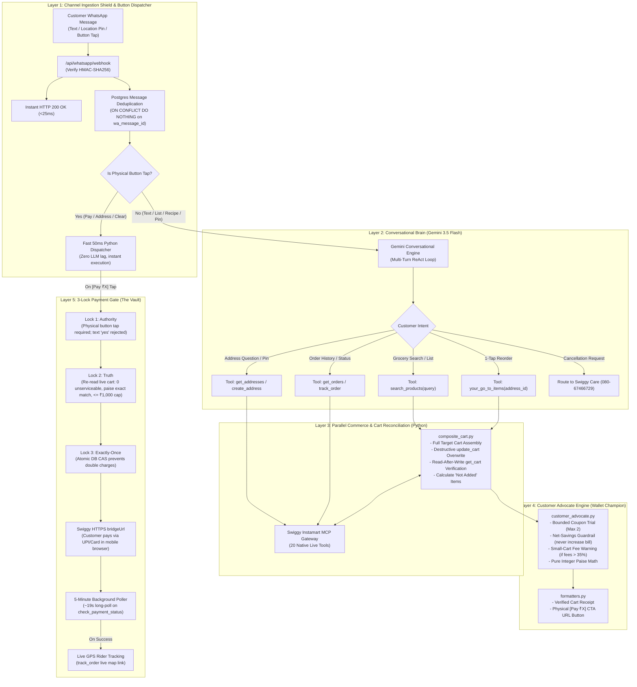
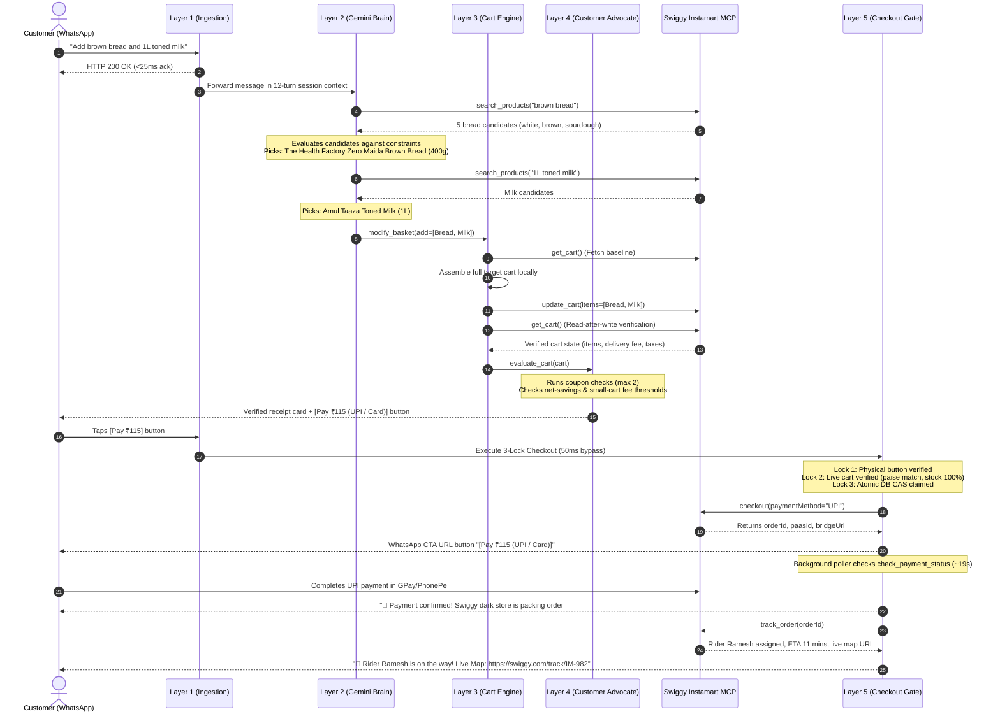

# ARCHITECTURE.md — Grocer Technical Architecture (Clean-Slate v1.0)

> **Status:** Agreed & Authoritative Technical Architecture (Single Source of Truth)  
> **Product Goal:** Production-Grade Swiggy Instamart Grocery Concierge & Account Manager on WhatsApp  
> **Stack:** Python 3.11 + FastAPI • LLM adapter (Groq free tier in development, Gemini supported; winner chosen by measurement, see ADR 0012) • Swiggy Instamart MCP (20 Tools) • Meta WhatsApp Cloud API • PostgreSQL (Supabase) • Render  

---

## 1. Executive Summary & Core Philosophy

Grocer brings the complete Swiggy Instamart quick-commerce service directly into WhatsApp chat. It is not limited to pasting shopping lists—it manages the full Instamart shopping, address, and order tracking lifecycle.

It rejects two fatal quick-commerce software traps:
1. **The "AI Hallucination" Trap:** Letting an LLM calculate totals, guess inventory, or call checkout endpoints.
2. **The "Rigid Bouncer" Trap:** Writing brittle regex interceptors and sticky database state machines that gag the LLM and trap users in endless confirmation loops.

Instead, Grocer operates on a clean, decoupled **Brain vs. Muscle** architecture:

* **The LLM (The Conversational Brain):**
  - Sits behind one provider adapter (ADR 0012). Groq's free tier is used during development; Gemini stays supported; the winner of the evaluation set becomes primary.
  - Reads full multi-turn conversation context (up to 12 turns).
  - Understands customer intent across natural language, typos, Hinglish (*doodh, atta, pyaz, cheeni*), recipes, and brand requests.
  - Searches the live Swiggy dark store and **evaluates candidates intelligently** (matching variants against user constraints instead of blindly picking rank #1).
  - Generates recipe checklists, guides address onboarding, and answers casual questions naturally without forcing unwanted shopping cart receipts.
  - **Strict Boundaries:** the LLM is FORBIDDEN from calculating prices, calling Swiggy tools itself, modifying database rows, or touching checkout endpoints. It only returns a routing decision: capability, arguments and confidence.
* **Python (The Muscle, Accountant & Security Guard):**
  - Manages deterministic state machines, full-cart target assembly, and read-after-write verification.
  - Computes all math in **strict integer paise** (`100 paise = ₹1.00`). Floating-point math is banned.
  - Intercepts physical button taps (`pay:<id>`, `addr:<id>`, `cart:clear`) in under 50ms, bypassing the LLM completely for instant app-like speed.
  - Enforces the **3-Lock Checkout Gate**—an order can ONLY be paid for if the user physically taps a WhatsApp button. Text "yes" never spends money.
* **Swiggy Instamart MCP (The Source of Truth):**
  - All 20 native Instamart MCP tools running live over HTTPS JSON-RPC (`https://mcp.swiggy.com/im`). Zero fake mocks.
* **Meta WhatsApp Cloud API (The Interface):**
  - Interactive buttons (max 3 per message), list pickers (max 10 rows), location pins, and HTTPS payment buttons.

---

## 2. High-Level System Architecture



Layer 2 is provider-agnostic since ADR 0012. The diagram keeps the original "Gemini" label; the actual call goes through `backend/agent/llm.py`.

---

## 3. End-to-End Decision & User Flows

### Flow 1: Grocery Shopping, Out-of-Stock Honesty & 1-Tap Pay



---

## 4. Layer-by-Layer Detailed Specifications

### Layer 1: Channel Ingestion & Fast Button Router (`backend/channels/`)
- **HMAC Verification:** Computes SHA-256 HMAC of raw inbound payload using `WHATSAPP_APP_SECRET`. Compares with `X-Hub-Signature-256` using constant-time string comparison (`hmac.compare_digest`).
- **Immediate Acknowledgment:** Returns HTTP 200 OK to Meta in under 25 milliseconds. Never blocks on external network calls.
- **Durable Deduplication:** Inbound messages are inserted into `inbound_messages` table with `ON CONFLICT (wa_message_id) DO NOTHING`. Retried webhooks are safely dropped.
- **Stale Message Dropping:** Discards any inbound webhook with a timestamp older than 15 minutes.
- **Per-User Concurrency Lock:** Serializes operations per user using PostgreSQL advisory locks (`pg_advisory_xact_lock(user_id)`). Rapid double-taps are handled sequentially, never concurrently.
- **50ms Fast Button Dispatcher (`button_router.py`):**
  - If the incoming message is a physical interactive button tap (`pay:<approval_id>`, `addr:<id>`, `cart:clear`), it **bypasses Gemini completely**.
  - Python deterministically executes the state change or checkout gate and responds in under 50ms.

---

### Layer 2: Conversational Brain (`backend/agent/`)
- **Capability Router (ADR 0012):** The LLM returns one routing decision per message — a capability from the fixed list, the extracted arguments, and a confidence score. Python validates the capability and makes every Swiggy call.
- **Safety Classes:** Every capability is labelled `read`, `basket`, `account` or `money`. A `read` capability can never reach a write path. This is enforced in Python, not in the prompt.
- **Safe Path:** Unknown capability, or confidence below 0.70, produces read-only options when a concrete product exists, otherwise a clarifying question. Nothing is written on a guess.
- **Single-Pass Turn:** The adapter makes one call per message with the last 12 dialogue turns, using the provider's JSON mode.
- **Two-Step Search & Candidate Evaluation (Kills Blind `res[0]`):**
  - Step 1: Python runs `search_products` for each extracted item and collects the top 3–5 in-stock candidates with pack sizes and prices.
  - Step 2: The LLM evaluates candidates against user constraints (brand, dietary, size) and returns the chosen variant plus a confidence score.
  - Step 3: Python applies the safety class. A `read` capability stops at the answer; a `basket` capability writes only after the choice is confident.
  - Step 4: If ambiguous, Grocer asks the user conversationally: *"We have X and Y. Which one do you prefer?"*
- **Smart Kirana Defaults for Vague Staples (ADR 0004):**
  - Unqualified requests (*"milk"*, *"bread"*, *"eggs"*) auto-select the #1 dark-store bestseller and provide a 1-tap `[Change Items]` button.
- **Conversational Recipe Checklists (ADR 0009):**
  - Meal requests (*"Aglio Olio for 2"*) propose an ingredient checklist first, distinguishing fresh items from assumed pantry staples, with buttons: `[Add All Ingredients]` and `[Let Me Pick]`.
- **Zero Forced Cart Appends:**
  - If the user asks a question (*"What is my default address?"*, *"Is the store open?"*), Gemini answers conversationally. Python is strictly forbidden from appending old shopping carts.

---

### Layer 3: Commerce & Account Engine (`backend/integrations/commerce/`)
- **20 Native Swiggy MCP Tools:** All operations run directly against live Swiggy Instamart dark stores (`https://mcp.swiggy.com/im`). Zero fake mocks.
- **Full Address Lifecycle:**
  - `get_addresses`: Surfaces saved locations with pagination (10/page).
  - `create_address` & `recommend_address`: Two-step pin geocoding onboarding (pin provides coordinates; follow-up asks for flat/building number).
  - `delete_address`: Prohibited if active delivery is in flight; always requires WhatsApp confirmation button `[Confirm Delete: <Label>]`.
  - `recommend_address`: Geocodes free-text or WhatsApp pins to coordinates.
- **Destructive Cart Overwrite Handling:**
  - Swiggy's `update_cart` replaces the entire cart. Grocer reads `get_cart`, merges items locally, and submits the full assembled cart (`items=[{spinId, quantity}]`).
- **Read-After-Write Verification:**
  - Following `update_cart`, Grocer calls `get_cart` and diffs requested items against actual items. Dropped items are explicitly flagged under **"⚠️ Not added (Out of stock)"**.
- **Address Switching Mid-Basket (ADR 0007):**
  - Switching delivery address with an active basket warns the user that dark-store inventory differs, clears the cart via `clear_cart`, and attempts to rebuild available items at the new store.
- **Order Cancellation Escalation (ADR 0007):**
  - Swiggy MCP does not support automated cancellation. Inbound cancellation requests lookup the active order ID and reply with Swiggy Care's phone number (`080-67466729`).
- **Token Renewal & JIT Re-Auth Latch (ADR 0010):**
  - When the access token expires, Grocer refreshes silently with the stored refresh token, retries once, then continues. Only if the refresh itself fails does it park the active basket or checkout, send a 1-tap `[Reconnect Swiggy]` button, and replay the request after the OAuth callback.

---

### Layer 4: Customer Advocate Engine (`backend/agent/customer_advocate.py`)
- **The Wallet Champion Promise (ADR 0003):**
  - Tests up to 2 applicable coupons via `list_coupons` and `apply_coupon`.
  - **Net-Savings Guardrail:** If applying a coupon drops the order below free delivery and triggers a delivery fee that increases the net bill, Grocer cancels the coupon, restores baseline prices, and explains why on the receipt.
  - Highlights exact rupee savings: `🎉 *You saved ₹X on this order!*`.
- **Small-Cart Fee Shock Protection (ADR 0009):**
  - When delivery, handling, or small-order fees exceed 35% of the item total, Grocer warns the customer and suggests common essentials to unlock free delivery.
- **Pure Integer Paise Math:**
  - All currency calculations use integer paise (`to_pay_paise: int`, ₹1 = 100 paise). Floating-point math is banned.

---

### Layer 5: The 3-Lock Safety Gate & Checkout (`backend/agent/approval.py` & `checkout_executor.py`)
An order can **never** be placed unless all 3 locks pass simultaneously:

```
+-----------------------------------------------------------------------------------+
|                            THE 3-LOCK CHECKOUT LATCH                             |
+-----------------------------------------------------------------------------------+
| Lock 1 (Authority)    : User physically tapped the WhatsApp button [Pay ₹X].      |
|                         Text "yes", "proceed", or "confirm" is strictly rejected.  |
+-----------------------------------------------------------------------------------+
| Lock 2 (Truth)        : Python re-reads live Swiggy cart:                         |
|                         - Canonical SHA-256 fingerprint matches approved state    |
|                         - 100% items in stock, 0 unserviceable items              |
|                         - Total payable matches approved paise exactly            |
|                         - Price drift check: aborts if store price shifted by ₹1  |
|                         - Total <= ₹1,000 (Default Launch Safety Cap)             |
+-----------------------------------------------------------------------------------+
| Lock 3 (Exactly-Once) : Atomic PostgreSQL CAS (status: 'shown' -> 'consuming').   |
|                         Guarded by UNIQUE constraint on checkouts.approval_id.    |
|                         Snapshot existing order IDs before checkout call.         |
+-----------------------------------------------------------------------------------+
```

- **Payment Link Delivery:**
  - Swiggy's `checkout` response provides an authoritative HTTPS `bridgeUrl`.
  - Grocer delivers this link as a WhatsApp CTA URL button: `[Pay ₹X (UPI / Card)]`. Tapping opens Swiggy's web payment screen where the customer taps to open GPay, PhonePe, Paytm, or cards.
- **Payment Lifecycle & Polling:**
  - `check_payment_status` is a ~19-second long-poll monitored by a background PostgreSQL poller (`FOR UPDATE SKIP LOCKED`) up to the 5-minute cap (`maxTimeToPollForInMs`).
  - Upon confirmed settlement, Grocer transitions immediately to live GPS tracking (`track_order`) and sends 3 milestone updates (Packed, On the Way with Live Map Link, Delivered).
- **Post-Payment Session Reset (ADR 0010):**
  - Once payment confirms, the basket is reset to empty in PostgreSQL, ensuring the next shopping trip starts fresh with zero state leakage.

---

## 5. PostgreSQL Database Schema

```sql
create schema if not exists grocer;

-- 1. Users and WhatsApp Identifiers
create table grocer.users (
  id uuid primary key default gen_random_uuid(),
  wa_id text not null unique,                   -- Normalized phone number (e.g. '919876543210')
  swiggy_customer_id text,                      -- Mapped customer ID in Swiggy
  created_at timestamptz not null default now(),
  updated_at timestamptz not null default now()
);

-- 2. Durable Token Vault (AES-256-GCM Encrypted)
create table grocer.oauth_tokens (
  user_id uuid primary key references grocer.users(id) on delete cascade,
  key_version int not null default 1,
  encrypted_token bytea not null,               -- AES-256-GCM encrypted Swiggy bearer token
  nonce bytea not null,                         -- 12-byte fresh nonce
  expires_at timestamptz not null,
  created_at timestamptz not null default now(),
  updated_at timestamptz not null default now()
);

-- 3. Inbound Messages & Deduplication
create table grocer.inbound_messages (
  id uuid primary key default gen_random_uuid(),
  wa_message_id text not null unique,           -- Meta WhatsApp Message ID (wamid.HBg...)
  user_id uuid not null references grocer.users(id),
  message_type text not null default 'text',    -- text | button_reply | location
  raw_payload jsonb,                            -- Retained for 24h, then purged (DPDP)
  status text not null default 'received',      -- received | processing | done | awaiting_link | dropped
  created_at timestamptz not null default now()
);
create index on grocer.inbound_messages (user_id, created_at desc);

-- 4. Customer Sessions & Dialogue State
create table grocer.sessions (
  user_id uuid primary key references grocer.users(id) on delete cascade,
  active_address_id text,                       -- Primary active delivery address
  one_time_destination_id text,                 -- Temporary destination for remote orders
  budget_cap_paise bigint not null default 100000, -- ₹1,000 launch safety cap in paise
  history jsonb not null default '[]',          -- Last 12 dialogue turns; pruned daily
  last_active_at timestamptz not null default now()
);

-- 5. Checkout Approvals (Lock 1 & 2)
create table grocer.approvals (
  id uuid primary key default gen_random_uuid(),
  user_id uuid not null references grocer.users(id) on delete cascade,
  fingerprint char(64) not null,                -- Canonical SHA-256 hash of basket items & paise
  to_pay_paise bigint not null,                 -- Integer paise strictly
  address_id text not null,
  snapshot jsonb not null,                      -- Receipt snapshot; deleted after 24h (DPDP)
  status text not null default 'shown',         -- shown | consuming | consumed | expired
  created_at timestamptz not null default now(),
  expires_at timestamptz not null               -- 10-minute TTL
);
create index on grocer.approvals (user_id, created_at desc);

-- 6. Checkouts & Payment Lifecycle (Lock 3)
create table grocer.checkouts (
  id uuid primary key default gen_random_uuid(),
  approval_id uuid not null unique references grocer.approvals(id),
  user_id uuid not null references grocer.users(id),
  payment_method text not null,                 -- upi | cod | swiggypay
  address_id text not null,
  known_order_ids jsonb not null default '[]',  -- Swiggy order IDs before checkout call
  status text not null,                         -- attempting | pending_payment | placed | failed | partial
  swiggy_order_id text,
  paas_id text,
  bridge_url text,
  approved_to_pay_paise bigint not null,
  response_total_paise bigint,
  created_at timestamptz not null default now(),
  updated_at timestamptz not null default now()
);
create unique index one_inflight_checkout on grocer.checkouts (user_id) 
  where status in ('attempting', 'pending_payment');
```

---

## 6. Directory Layout (High-Cohesion Architecture)

```
backend/
├── main.py                     # App setup, lifespan, startup migrations, pollers, /health
├── config.py                   # Environment settings and safety caps
├── database.py                 # asyncpg pool and tracked migrations
│
├── channels/                   # WhatsApp transport and deterministic routing
│   ├── whatsapp.py             # Webhook, HMAC, dedupe, per-user lock, turn dispatch
│   ├── whatsapp_crypto.py      # HMAC-SHA256 verification
│   ├── whatsapp_parser.py      # Inbound payload to text, location or button
│   ├── whatsapp_client.py      # Outbound Meta Cloud API messages
│   ├── command_router.py       # Deterministic admin commands (delete my data)
│   ├── button_router.py        # Fast path for pay, cart and address buttons
│   └── swiggy_auth.py          # OAuth PKCE login and callback
│
├── agent/                      # Concierge brain, safety and money
│   ├── router.py               # Capabilities, safety classes, safe path (ADR 0012)
│   ├── llm.py                  # Provider adapter: Groq or Gemini, JSON mode
│   ├── candidate_search.py     # Live catalog search per extracted item
│   ├── candidate_evaluator.py  # Product variant selection
│   ├── address_lifecycle.py    # Address list, switch, delete and pin onboarding
│   ├── approval.py             # Paise math, fingerprint, approval latch
│   ├── checkout_executor.py    # 3-lock checkout, settlement, pollers
│   ├── composite_cart.py       # Target cart assembly, read-after-write
│   ├── customer_advocate.py    # Coupons and small-cart fee warning
│   ├── delivery_tracker.py     # Milestone notifications
│   ├── dpdp.py                 # 24-hour scrubber and data deletion
│   └── formatters.py           # Receipt and message formatting
│
├── integrations/commerce/      # Swiggy Instamart gateway (20 tools)
│   ├── swiggy_client.py        # JSON-RPC transport and tool methods
│   ├── token_vault.py          # AES-256-GCM tokens, refresh, PKCE state
│   └── schemas.py              # Pydantic contracts for tool responses
│
├── migrations/                 # 001..003, applied in order and tracked
└── tests/                      # Contract fixtures, router tests, invariant checks, live suites
```

---

## 7. Definition of Done

> Current phase, blockers and acceptance conditions live in `STATUS.md`. This section covers how any task is judged, not what is left to do.

A task or phase is considered complete **ONLY** when:
1. `.\verify.ps1` (or `pytest`) exits 0 with pasted raw terminal output.
2. Zero fake in-memory mocks (`MockCommerceAdapter` does not exist in the codebase).
3. All commerce tests run against recorded staging fixtures or live staging endpoints.
4. Git working directory is clean.
