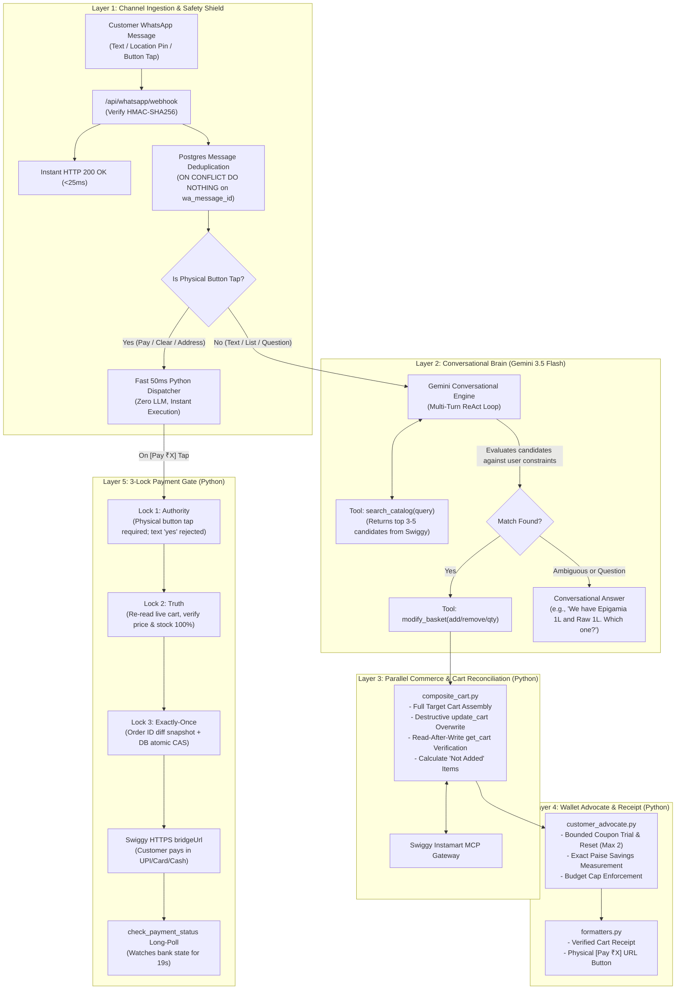
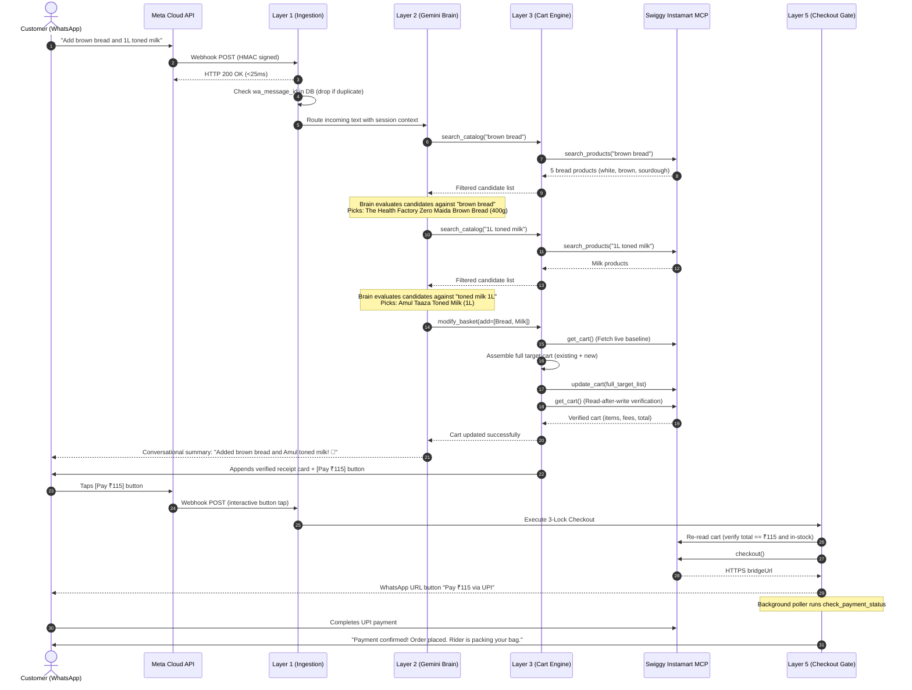

# ARCHITECTURE.md — Grocer Technical Architecture (Clean-Slate v5.0)

> **Status:** Agreed & Authoritative Technical Architecture (Single Source of Truth)  
> **Product Goal:** Production-Grade Swiggy Instamart Grocery Concierge on WhatsApp  
> **Stack:** Python 3.11 + FastAPI • Gemini 3.5 Flash • Swiggy Instamart MCP • Meta WhatsApp Cloud API • PostgreSQL (Supabase) • Render  

---

## 1. Executive Summary & Core Philosophy

Grocer is a conversational grocery concierge that operates over WhatsApp, backed by real-time Swiggy Instamart dark stores. 

It rejects two common software traps:
1. **The "AI Magic" Trap:** Letting an LLM autonomously calculate prices, call checkout endpoints, or invent products.
2. **The "Brittle Regex & Hardcoded Patch" Trap:** Writing custom keyword interceptors, ad-hoc rules, and mock dictionaries for every customer variation.

Instead, Grocer operates on a clean separation of responsibilities:

* **Gemini 3.5 Flash (The Conversational Brain):**
  - Reads full multi-turn conversation context.
  - Understands customer intent across natural phrasing, typos, Hinglish (*doodh, atta, pyaz, cheeni*), recipes, dietary limits, and brand preferences.
  - Searches the live Swiggy dark store and **evaluates search candidates intelligently** (matching variants against user constraints instead of blindly grabbing rank #1).
  - Answers questions naturally like a human concierge without constantly forcing a checkout receipt.
* **Python (The Muscle & Auditor):**
  - Manages deterministic state machines, full-cart target assembly, and read-after-write verification.
  - Computes exact rupee math using integer paise (`math.isclose` / float drift strictly forbidden).
  - Enforces the **3-Lock Checkout Gate**—an order can ONLY be paid for if the user taps a physical WhatsApp button. Text "yes" never spends money.
* **Swiggy Instamart MCP (The Source of Truth):**
  - Real dark-store catalog, inventory stock levels, real-time pricing, coupons, dynamic payment links, and GPS rider tracking.
* **Meta WhatsApp Cloud API (The Interface):**
  - Interactive buttons (up to 3 per message), list pickers (up to 10 rows), location pins, and HTTPS checkout buttons.

---

## 2. High-Level System Architecture



---

## 3. End-to-End Decision Flow



---

## 4. Layer-by-Layer Detailed Specifications

### Layer 1: Channel Ingestion & Safety Shield (`backend/channels/`)
- **HMAC Verification:** Computes SHA-256 HMAC of raw inbound payload using `WHATSAPP_APP_SECRET`. Compares with `X-Hub-Signature-256` using constant-time string comparison (`hmac.compare_digest`).
- **Immediate Acknowledgment:** Returns HTTP 200 to Meta in under 25 milliseconds. Never blocks on LLM or external network calls.
- **Durable Deduplication:** Inbound messages are inserted into `inbound_messages` table with `ON CONFLICT (wa_message_id) DO NOTHING`. If Meta retries an acknowledged webhook, the second invocation is safely ignored.
- **Stale Message Dropping:** Any message with a timestamp older than 15 minutes is discarded to prevent zombie replies after downtime.
- **Per-User Concurrency Lock:** All operations for a specific `user_id` are serialized using a per-user lock (PostgreSQL advisory lock `pg_advisory_xact_lock(user_id)`). Rapid double-taps are processed sequentially, never concurrently.
- **Fast 50ms Button Dispatcher (`button_router.py`):**
  - If the incoming message is a physical button payload (`pay:<approval_id>:<option>`, `clear_cart`, `select_address:<id>`), it bypasses Gemini completely.
  - Python deterministically runs the state change and responds in under 50ms.

---

### Layer 2: Conversational Brain (`backend/agent/`)
- **Multi-Turn ReAct Loop:** Up to 4 tool iterations per turn. Gemini has complete access to the last 12 turns of dialogue.
- **Two-Step Search & Candidate Evaluation (Kills Blind `res[0]`):**
  - Step 1: Gemini calls `search_catalog(query)`.
  - Step 2: Python queries Swiggy and returns the top 3-5 in-stock candidates with names, pack sizes, prices, and IDs.
  - Step 3: Gemini evaluates the candidates against the customer's request (e.g. brand, pack size, dietary restrictions).
  - Step 4: If a confident match is found, Gemini calls `modify_basket(add=[candidate_id])`. If ambiguous, Gemini asks the customer: *"We have X and Y. Which one would you prefer?"*
- **Conversational Question Support:**
  - If the user asks a question (e.g. *"What is the delivery fee?"*, *"Do you have gluten-free pasta?"*), Gemini answers conversationally.
  - The system does **not** force a receipt card or payment button when the user is simply chatting.
- **Strict English Voice & Indian Context:**
  - Understands Hindi/Hinglish terms (*doodh, dahi, atta, cheeni, tamatar, pyaz, chai patti*).
  - Understands colloquial quantities (*aadha kilo, ek packet, do litre*).
  - Always replies in clear, natural, warm English.
- **Dietary & Medical Guardrails:**
  - Catalog category `Pharmacy` or `Prescription` is strictly blocked in Python code.
  - First-aid items (Band-Aids, ORS, cotton) are permitted.
  - Zero regex keyword filters; decisions are backed by catalog metadata.

---

### Layer 3: Parallel Commerce & Cart Reconciliation (`backend/integrations/commerce/`)
- **Destructive Cart Overwrite Handling:**
  - Swiggy's `update_cart` tool replaces the entire cart.
  - Grocer fetches the baseline cart (`get_cart`), applies adds/removes locally, and submits the full assembled cart (`items=[{spinId, skuId, quantity}]`).
- **Read-After-Write Verification:**
  - Immediately following `update_cart`, Grocer calls `get_cart` and diffs the expected items against actual items.
  - If Swiggy dropped an item (due to instantaneous out-of-stock), Grocer calculates `requested - applied` and explicitly lists it under **"Not added (Out of stock)"** on the WhatsApp receipt.
  - Revert detection: If the cart reverts to its pre-write state, Grocer retries the write once. If it fails again, it alerts the customer honestly.
- **5-Day Token Expiry & Parked Message Replay:**
  - Swiggy v1.0 OAuth tokens expire after 5 days with no refresh tokens.
  - When an expired token is detected:
    1. The customer's incoming message is stored with status `awaiting_link`.
    2. A WhatsApp CTA URL button is sent: `Connect Swiggy`.
    3. The moment the user completes the OAuth callback on Vercel, the parked message is automatically replayed. The user never has to re-type their shopping list.

---

### Layer 4: Customer Advocate Engine (`backend/agent/customer_advocate.py`)
- **Bounded Coupon Trial & Reset:**
  - Swiggy `list_coupons` returns coupon codes with **no discount amounts**, and provides **no remove-coupon tool**.
  - Grocer measures savings directly:
    1. Record baseline payable amount: `toPay_baseline`.
    2. Test up to 2 applicable coupons sequentially: `apply_coupon(code)`.
    3. Measure `toPay_new` after each.
    4. If a coupon lowers the total, keep it. If none lower the total, reset the cart (`clear_cart` -> `update_cart`) to restore the uncouponed baseline.
  - **Critical Guardrail:** Never apply a coupon if the final total increases (e.g. if the discount pushes the cart below a free delivery threshold).
- **Exact Paise Math:**
  - All currency calculations use integer paise (`100 paise = ₹1.00`).
  - Floating point numbers are banned in the approval hash to eliminate IEEE 754 precision mismatches.

---

### Layer 5: The 3-Lock Safety Gate & Checkout (`backend/agent/approval.py` & `checkout_executor.py`)
An order can **never** be placed unless all 3 locks pass simultaneously:

```
+-----------------------------------------------------------------------------------+
|                            THE 3-LOCK CHECKOUT LATCH                             |
+-----------------------------------------------------------------------------------+
| Lock 1 (Authority)    : User physically tapped the WhatsApp button [Pay ₹X].      |
|                         Text "yes", "proceed", or "confirm" is strictly rejected.  |
+-----------------------------------------------------------------------------------+
| Lock 2 (Truth)        : Python re-reads live Swiggy cart & payment options:       |
|                         - Canonical SHA-256 fingerprint matches approved state    |
|                         - 100% items in stock, 0 unserviceable items              |
|                         - Total payable matches approved paise exactly            |
|                         - Total <= ₹1,000 (Default Safety Cap)                    |
+-----------------------------------------------------------------------------------+
| Lock 3 (Exactly-Once) : Atomic PostgreSQL CAS (status: 'shown' -> 'consuming').   |
|                         Guarded by UNIQUE constraint on checkouts.approval_id.    |
|                         Snapshot existing order IDs before checkout call.         |
+-----------------------------------------------------------------------------------+
```

- **Payment Link Delivery:**
  - Meta WhatsApp buttons **reject** `upi://` schemes (`https://` only).
  - Swiggy's `checkout` response provides an HTTPS `bridgeUrl`.
  - Grocer formats this into a WhatsApp CTA URL button: `[Pay ₹X (UPI / Card)]`.
- **Payment Lifecycle & Polling:**
  - `check_payment_status` is a ~19-second long-poll driven by Swiggy's hints (`pollingIntervalInMs`, `maxTimeToPollForInMs`).
  - A durable background poller running on PostgreSQL (`FOR UPDATE SKIP LOCKED`) monitors pending checkouts and notifies the customer the moment payment succeeds.

---

## 5. PostgreSQL Database Schema

```sql
create schema if not exists grocer;

-- 1. Users and WhatsApp Identifiers
create table grocer.users (
  id uuid primary key default gen_random_uuid(),
  wa_id text not null unique,                   -- Normalized phone number (e.g. '919876543210')
  swiggy_customer_id text,                      -- Mapped customer ID in Swiggy
  created_at timestamptz not null default now(),
  updated_at timestamptz not null default now()
);

-- 2. Durable Token Vault (AES-256-GCM Encrypted)
create table grocer.oauth_tokens (
  user_id uuid primary key references grocer.users(id) on delete cascade,
  key_version int not null default 1,
  encrypted_token bytea not null,               -- AES-256-GCM encrypted Swiggy bearer token
  nonce bytea not null,                         -- 12-byte fresh nonce
  expires_at timestamptz not null,
  created_at timestamptz not null default now(),
  updated_at timestamptz not null default now()
);

-- 3. Inbound Messages & Deduplication
create table grocer.inbound_messages (
  id uuid primary key default gen_random_uuid(),
  wa_message_id text not null unique,           -- Meta WhatsApp Message ID (wamid.HBg...)
  user_id uuid not null references grocer.users(id),
  raw_payload jsonb,                            -- Retained for 24h, then nulled
  status text not null default 'received',      -- received | processing | done | awaiting_link | dropped
  created_at timestamptz not null default now()
);
create index on grocer.inbound_messages (user_id, created_at desc);

-- 4. Customer Sessions & Dialogue State
create table grocer.sessions (
  user_id uuid primary key references grocer.users(id) on delete cascade,
  address_id text,
  address_label text,
  budget_cap_paise bigint,
  history jsonb not null default '[]',          -- Last 12 dialogue turns; pruned daily
  last_active_at timestamptz not null default now()
);

-- 5. Checkout Approvals (Lock 1 & 2)
create table grocer.approvals (
  id uuid primary key default gen_random_uuid(),
  user_id uuid not null references grocer.users(id) on delete cascade,
  fingerprint char(64) not null,                -- Canonical SHA-256 hash of basket items & paise
  to_pay_paise bigint not null,
  address_id text not null,
  snapshot jsonb not null,                      -- Receipt snapshot; deleted after 24h
  status text not null default 'shown',         -- shown | consuming | consumed | expired
  created_at timestamptz not null default now(),
  expires_at timestamptz not null               -- 10-minute TTL
);
create index on grocer.approvals (user_id, created_at desc);

-- 6. Checkouts & Payment Lifecycle (Lock 3)
create table grocer.checkouts (
  id uuid primary key default gen_random_uuid(),
  approval_id uuid not null unique references grocer.approvals(id),
  user_id uuid not null references grocer.users(id),
  payment_method text not null,                 -- upi | cod | swiggypay
  address_id text not null,
  known_order_ids jsonb not null default '[]',  -- Swiggy order IDs before checkout call
  status text not null,                         -- attempting | pending_payment | placed | failed | partial
  swiggy_order_id text,
  paas_id text,
  bridge_url text,
  approved_to_pay_paise bigint not null,
  response_total_paise bigint,
  created_at timestamptz not null default now(),
  updated_at timestamptz not null default now()
);
create unique index one_inflight_checkout on grocer.checkouts (user_id) 
  where status in ('attempting', 'pending_payment');
```

---

## 6. Directory Layout (High-Cohesion Architecture)

```
backend/
├── main.py                     # FastAPI application setup, lifecycle, and health routes
├── config.py                   # Strict environment variable settings & safety caps
├── database.py                 # Asyncpg pool connection & advisory lock helpers
├── identity.py                 # WhatsApp phone number normalization & user lookup
│
├── channels/                   # Transport & WhatsApp Business Platform
│   ├── whatsapp.py             # Webhook route & HMAC signature verification
│   ├── whatsapp_crypto.py      # HMAC-SHA256 & challenge verification
│   ├── whatsapp_formatter.py   # Meta interactive buttons & HTTPS bridgeUrl buttons
│   ├── whatsapp_parser.py      # Inbound payload parsing (text, location pins, button IDs)
│   └── payment_poller.py       # Durable ~19s long-poll worker using FOR UPDATE SKIP LOCKED
│
├── agent/                      # Conversational Concierge Engine
│   ├── engine.py               # Multi-turn coordinator & ReAct tool execution
│   ├── gemini.py               # Google GenAI SDK wrapper with structured output
│   ├── prompts.py              # System instructions & strict English contract
│   ├── schemas.py              # Gemini tool declarations (search_catalog, modify_basket)
│   ├── tools.py                # SwiggyAgentTools implementing two-step candidate search
│   ├── approval.py             # Canonical SHA-256 fingerprinting & 3-Lock latch
│   ├── button_router.py        # 50ms fast-path dispatcher for interactive button taps
│   ├── composite_cart.py       # Target assembly, destructive update_cart, read-after-write
│   ├── customer_advocate.py    # Bounded coupon trial-and-reset & paise savings measurement
│   └── formatters.py           # WhatsApp receipt cards & out-of-stock breakdowns
│
├── integrations/commerce/      # Swiggy Instamart Gateway
│   ├── swiggy_adapter.py       # Live Swiggy MCP client & tool router
│   ├── swiggy_client.py        # JSON-RPC 2.0 transport over HTTPS
│   ├── token_vault.py          # AES-256-GCM durable token encryption & JIT re-link
│   ├── cart_parsers.py         # Swiggy bill lines & item parsing
│   ├── catalog_parsers.py      # Swiggy product variants & categories parsing
│   └── order_parsers.py        # Checkout response & payment status parsing
│
└── tests/                      # Verification Test Suites
    ├── conftest.py             # Database fixtures & real staging test harnesses
    ├── fixtures/               # Recorded real Swiggy staging tool outputs (ZERO fake mocks)
    ├── test_invariants.py      # AST safety checks (no checkout in agent, no floats in hash)
    ├── test_channels.py        # Webhook deduplication & HMAC signature tests
    ├── test_catalog_search.py  # Two-step candidate search & variant matching tests
    ├── test_composite_cart.py  # Destructive update & read-after-write revert tests
    ├── test_checkout_locks.py  # 3-Lock safety latch & duplicate tap prevention tests
    └── test_e2e_staging.py     # End-to-end customer flows against staging fixtures
```

---

## 7. Phased Implementation Roadmap

### Phase 0: Ground-Truth Staging Fixtures (Zero Code First)
- Connect to Swiggy staging MCP endpoint.
- Call all 19 tools and commit raw JSON responses to `backend/tests/fixtures/`.
- Lock all parsers (`cart_parsers.py`, `order_parsers.py`) to these real fixtures.
- **Done Condition:** All parsers parse staging fixtures with 0 errors. `MockCommerceAdapter` is permanently deleted.

### Phase 1: Ingestion Shield & Deduplication
- Implement `POST /api/whatsapp/webhook` with HMAC verification (<25ms response).
- Add Postgres message deduplication (`ON CONFLICT (wa_message_id) DO NOTHING`).
- Add fast 50ms button router for interactive taps.
- **Done Condition:** Webhook replay attack tests pass; duplicate messages are dropped with zero double-processing.

### Phase 2: Conversational Brain & Intelligent Search
- Implement `search_catalog(query)` returning candidate lists.
- Implement Gemini candidate evaluation (matching variants against user constraints).
- Remove pre-flight text confirmation interceptor.
- Support natural Q&A without forcing receipt cards.
- **Done Condition:** Test matrix with 20 real customer phrases (typos, recipes, brand queries) picks the correct dark-store product 100% of the time.

### Phase 3: Safe Cart Engine & JIT Re-Auth
- Implement full target cart assembly and destructive `update_cart`.
- Implement read-after-write verification with revert detection.
- Implement JIT re-link with parked message replay for 5-day expired tokens.
- **Done Condition:** Adding an item preserves existing items; missing items appear under "Not added"; expired token retains the customer's shopping list after login.

### Phase 4: 3-Lock Payment Gate & Web Checkout
- Implement Lock 1 (physical button ID only), Lock 2 (re-verification of price & stock), Lock 3 (DB atomic CAS).
- Deliver Swiggy HTTPS `bridgeUrl` as a WhatsApp CTA URL button.
- Implement `check_payment_status` ~19-second durable background poller.
- **Done Condition:** Text "yes" fails to trigger payment; double-tap triggers exactly one checkout; successful payment pushes instant WhatsApp receipt.

### Phase 5: Wallet Advocate & Soft Launch
- Implement bounded coupon trial-and-reset (max 2 trials).
- Add 24-hour data retention scrubber (anonymize personal addresses and phone numbers).
- Lock order safety cap to ₹1,000.
- Soft launch with <10 real users.
- **Done Condition:** 7 consecutive days on staging with 0 duplicate orders and 0 cart drift errors.

---

## 8. Done Gate & Definition of Done

A task or phase is considered complete **ONLY** when:
1. `.\verify.ps1` (or `pytest`) exits 0 with pasted raw terminal output.
2. Zero fake in-memory mocks (`MockCommerceAdapter` does not exist in the codebase).
3. All commerce tests run against recorded staging fixtures or live staging endpoints.
4. Git working directory is clean.
