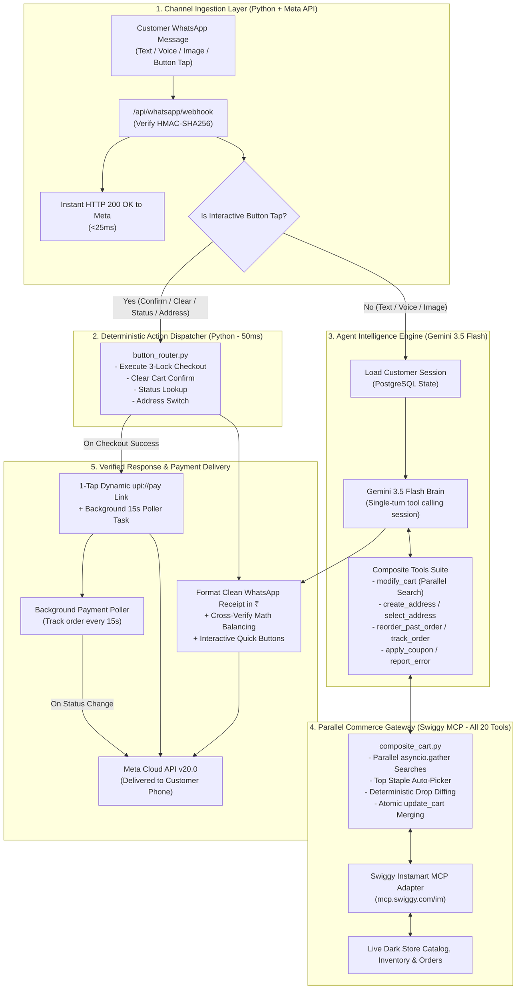

# ARCHITECTURE.md — Grocer Technical Architecture Blueprint (v2.0)

> **Status:** Agreed & Authoritative Technical Architecture (Single Source of Truth)  
> **Product Goal:** Complete Swiggy Instamart Concierge with a WhatsApp Interface  

---

## 1. Executive Summary

This document defines the production backend architecture for Grocer. It replaces legacy multi-model bouncer chains and fragile regex interceptors with a high-cohesion, low-latency, deterministic architecture designed specifically for real-world conversational grocery commerce.

### Core Philosophy
* **Gemini 3.5 Flash (The Brain)**: Interprets customer language, voice notes, and lists; resolves multi-item intent; deduces recipe ingredients; and drafts clear conversational summaries in strict, natural English.
* **Python (The Muscle & Auditor)**: Executes deterministic business logic, parallel Swiggy catalog searches (`asyncio.gather`), cart diffing, 50ms button routing, cross-verifies Swiggy bill math, and enforces the cryptographic 3-lock checkout latch.
* **Swiggy Instamart MCP (The Source of Truth)**: Authoritative provider for real-time dark store stock, prices, bill calculations, dynamic UPI payments, and rider tracking.

---

## 2. High-Level Subsystem Blueprint



---

## 3. Subsystem Breakdown & Flow Specifications

### Subsystem 1: Channel Ingestion Layer
* **Instant Acknowledgment**: Meta requires `200 OK` within 3 seconds. The webhook handler responds with HTTP 200 in <25 milliseconds.
* **Deterministic Button Router**: If the incoming message is an interactive button ID (`confirm_order:<fingerprint>`, `check_payment:<id>`, `clear_cart`, `select_address:<id>`), it is intercepted immediately by `button_router.py`. It executes the deterministic state transition in under 50ms without waking up Gemini or spending LLM tokens.
* **Multimodal Intake**: Audio voice notes and grocery list photos are transcribed directly through Gemini's native multimodal input without auxiliary pipelines.
* **Location Pin Grounding**: Handles WhatsApp GPS location pins (`msg_type == "location"`), extracting latitude, longitude, and address into `[LOCATION_PIN]` message text for in-chat address creation (`create_address`).

### Subsystem 2: The Agent Intelligence Engine (`backend/agent/engine.py`)
* **Single-Turn Model Invocation**: Multi-model bouncer chains are permanently purged. Gemini processes the input, calls composite tools, and writes a friendly conversational summary in strict, natural English.
* **Separation of Concerns**: The AI writes the natural conversational text (e.g. *"Added Amul Toned Milk and Britannia Bread! 🛒"*). The Python server deterministically builds and verifies the receipt card below it.

### Subsystem 3: Parallel Composite Commerce Engine (`backend/agent/composite_cart.py`)
* **Parallel Product Discovery**: When a customer requests multiple items, searches run concurrently via Python's `asyncio.gather`. A 5-item order searches the dark store in ~1 second instead of 10-15 seconds.
* **Staple Auto-Selection**: Vague requests (e.g. *"milk"*, *"bread"*) auto-select the dark store's #1 standard staple (e.g. Amul Toned 500ml) and provide a 1-tap "Change Items" button.
* **Zero Silent Drops**: Python deterministically computes `requested_items - found_items`. If an item is out of stock, it is explicitly flagged in the tool result, forcing the bot to report it honestly to the user with in-stock alternatives.
* **Safe Destructive Cart Merging**: Merges new additions into existing cart items so Swiggy's destructive `update_cart` never drops existing products.

### Subsystem 4: The Full 20-Tool Swiggy MCP Concierge (`backend/integrations/commerce/swiggy_adapter.py`)
Grocer unlocks all capabilities exposed by Swiggy Instamart's MCP:
1. **Catalog & Cart**: `search_products`, `update_cart`, `get_cart`, `clear_cart`, `get_go_to_items`.
2. **Address Management**: `get_addresses`, `create_address` (save new addresses directly in chat via text or GPS pin), `delete_address`, `recommend_address`.
3. **Reordering & History**: `get_orders` (past orders), `get_order_details` (1-tap re-order).
4. **Live Order Tracking**: `track_order` (live GPS rider location and ETA), `get_delivery_status`.
5. **Wallet & Checkout**: `list_coupons`, `apply_coupon`, `get_payment_options`, `checkout`.
6. **Support**: `report_error` (upstream Swiggy issue logging) + Swiggy Customer Care (`080-67466729`).

### Subsystem 5: The 3-Lock Safety Gate & Cross-Verification (`backend/agent/approval.py` & `checkout_executor.py`)
Physical checkout can ONLY execute if all 3 hard locks pass:
1. **Lock 1 (Explicit Confirmation)**: The customer explicitly tapped "Confirm Order" or confirmed this exact bill total.
2. **Lock 2 (Budget Cap)**: The live grand total is within the session's approved budget cap.
3. **Lock 3 (Cryptographic Cart Fingerprint & Serviceability)**: The live Swiggy cart matches the approved SHA-256 fingerprint normalized to 2 decimals (`f"{float(val):.2f}"`), and the dark store is confirmed serviceable.
* **Math Cross-Verification**: Before receipt display, Python verifies that `item_total + delivery_fee + packaging_fee + handling_fee + taxes - discount == grand_total` within ₹1. If Swiggy's bill lines do not explain the payable total, checkout is blocked.

### Subsystem 6: Customer Advocate Engine (`backend/agent/customer_advocate.py`)
* **Wallet Protection Guardrail**: Automatically evaluates available Swiggy coupons. Critical Guardrail: never applies a coupon if the final grand total increases (e.g. dropping below a free-delivery threshold).
* **Threshold Staple Suggestions**: Suggests 1-2 low-cost staples from `get_go_to_items` to cross free-delivery thresholds when it reduces net payable total.

---

## 4. Directory Layout

```
backend/
├── agent/                 # Core concierge engine, tools, wallet advocate, button router
│   ├── approval.py        # 3-lock checkout latch & 2-decimal SHA-256 fingerprinting
│   ├── button_router.py   # Deterministic fast-path dispatcher (50ms)
│   ├── composite_cart.py  # Parallel catalog search & atomic cart diffing
│   ├── customer_advocate.py # Coupon optimizer & fee-saving staple suggester
│   ├── engine.py          # WhatsApp concierge single-turn coordinator
│   ├── formatters.py      # WhatsApp receipt cards & 1-tap UPI deep links
│   ├── gemini.py          # Gemini API client
│   ├── prompts.py         # System prompt & strict English instructions
│   ├── schemas.py         # Swiggy MCP tool declarations
│   └── tools.py           # SwiggyAgentTools delegating to composite_cart & address_tools
├── api/                   # FastAPI endpoints (whatsapp webhook, health, simulator)
├── channels/              # Transport layers (Meta Cloud API, crypto, parser, formatter, poller)
│   ├── payment_poller.py  # 15s payment status poller & live rider tracking transition
│   ├── whatsapp.py        # Webhook route & HMAC signature verification
│   ├── whatsapp_formatter.py # Interactive buttons & UPI link formatting
│   ├── whatsapp_media.py  # Audio/image download from Meta Graph API
│   └── whatsapp_parser.py # Payload parser (text, button IDs, GPS location pins)
├── integrations/commerce/ # Swiggy Instamart MCP adapter & client
│   ├── cart_parsers.py    # Line item & fee extraction
│   ├── order_parsers.py   # Order & payment status parsers
│   ├── swiggy_adapter.py  # Swiggy Instamart MCP gateway implementation
│   └── token_vault.py     # Encrypted token storage & AES-GCM recovery
└── tests/                 # Verification test suites
```

---

## 5. Verification Gate & Done Condition

The system is verified and production-ready ONLY when `.\verify.ps1` exits 0 with pasted raw terminal output:
* Type checks & ESLint: Clean 0 exit.
* Python test suite: 100% passing across unit, customer flows, and webhook integration.
* Zero skipped tests and zero mocked project code.
