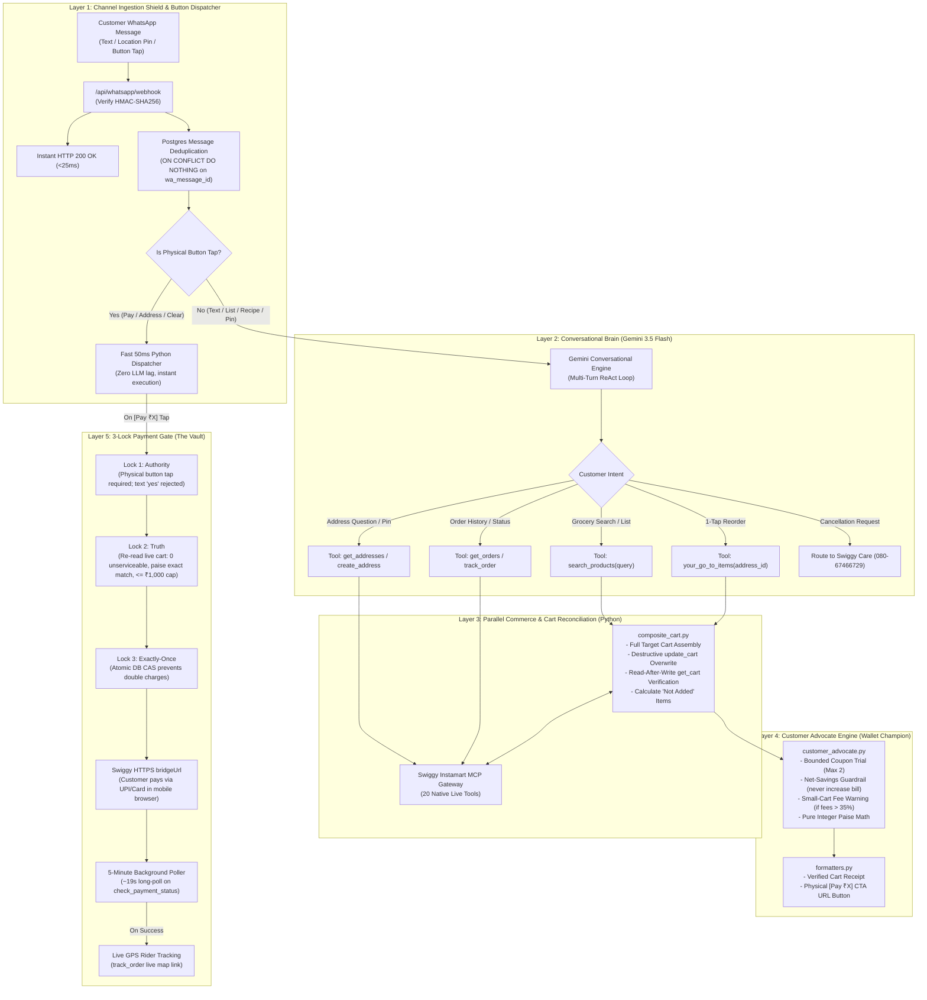
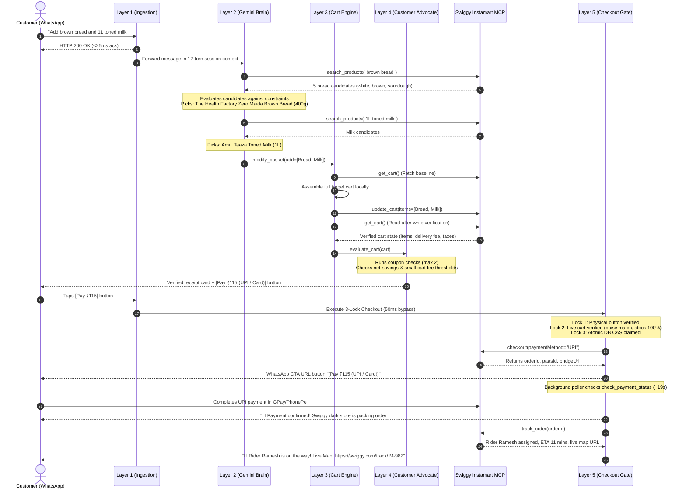

# ARCHITECTURE.md — Grocer Technical Architecture (Clean-Slate v1.0)

> **Status:** Agreed & Authoritative Technical Architecture (Single Source of Truth)  
> **Product Goal:** Production-Grade Swiggy Instamart Grocery Concierge & Account Manager on WhatsApp  
> **Stack:** Python 3.11 + FastAPI • Gemini 3.5 Flash • Swiggy Instamart MCP (20 Tools) • Meta WhatsApp Cloud API • PostgreSQL (Supabase) • Render  

---

## 1. Executive Summary & Core Philosophy

Grocer brings the complete Swiggy Instamart quick-commerce service directly into WhatsApp chat. It is not limited to pasting shopping lists—it manages the full Instamart shopping, address, and order tracking lifecycle.

It rejects two fatal quick-commerce software traps:
1. **The "AI Hallucination" Trap:** Letting an LLM calculate totals, guess inventory, or call checkout endpoints.
2. **The "Rigid Bouncer" Trap:** Writing brittle regex interceptors and sticky database state machines that gag the LLM and trap users in endless confirmation loops.

Instead, Grocer operates on a clean, decoupled **Brain vs. Muscle** architecture:

* **Gemini 3.5 Flash (The Conversational Brain):**
  - Reads full multi-turn conversation context (up to 12 turns).
  - Understands customer intent across natural language, typos, Hinglish (*doodh, atta, pyaz, cheeni*), recipes, and brand requests.
  - Searches the live Swiggy dark store and **evaluates candidates intelligently** (matching variants against user constraints instead of blindly picking rank #1).
  - Generates recipe checklists, guides address onboarding, and answers casual questions naturally without forcing unwanted shopping cart receipts.
  - **Strict Boundaries:** Gemini is FORBIDDEN from calculating prices, modifying database rows, or touching checkout endpoints.
* **Python (The Muscle, Accountant & Security Guard):**
  - Manages deterministic state machines, full-cart target assembly, and read-after-write verification.
  - Computes all math in **strict integer paise** (`100 paise = ₹1.00`). Floating-point math is banned.
  - Intercepts physical button taps (`pay:<id>`, `addr:<id>`, `cart:clear`) in under 50ms, bypassing the LLM completely for instant app-like speed.
  - Enforces the **3-Lock Checkout Gate**—an order can ONLY be paid for if the user physically taps a WhatsApp button. Text "yes" never spends money.
* **Swiggy Instamart MCP (The Source of Truth):**
  - All 20 native Instamart MCP tools running live over HTTPS JSON-RPC (`https://mcp.swiggy.com/im`). Zero fake mocks.
* **Meta WhatsApp Cloud API (The Interface):**
  - Interactive buttons (max 3 per message), list pickers (max 10 rows), location pins, and HTTPS payment buttons.

---

## 2. High-Level System Architecture



---

## 3. End-to-End Decision & User Flows

### Flow 1: Grocery Shopping, Out-of-Stock Honesty & 1-Tap Pay



---

## 4. Layer-by-Layer Detailed Specifications

### Layer 1: Channel Ingestion & Fast Button Router (`backend/channels/`)
- **HMAC Verification:** Computes SHA-256 HMAC of raw inbound payload using `WHATSAPP_APP_SECRET`. Compares with `X-Hub-Signature-256` using constant-time string comparison (`hmac.compare_digest`).
- **Immediate Acknowledgment:** Returns HTTP 200 OK to Meta in under 25 milliseconds. Never blocks on external network calls.
- **Durable Deduplication:** Inbound messages are inserted into `inbound_messages` table with `ON CONFLICT (wa_message_id) DO NOTHING`. Retried webhooks are safely dropped.
- **Stale Message Dropping:** Discards any inbound webhook with a timestamp older than 15 minutes.
- **Per-User Concurrency Lock:** Serializes operations per user using PostgreSQL advisory locks (`pg_advisory_xact_lock(user_id)`). Rapid double-taps are handled sequentially, never concurrently.
- **50ms Fast Button Dispatcher (`button_router.py`):**
  - If the incoming message is a physical interactive button tap (`pay:<approval_id>`, `addr:<id>`, `cart:clear`), it **bypasses Gemini completely**.
  - Python deterministically executes the state change or checkout gate and responds in under 50ms.

---

### Layer 2: Conversational Brain (`backend/agent/`)
- **Single-Turn ReAct Loop:** Gemini 3.5 Flash runs in a single pass with access to the last 12 dialogue turns, executing tools concurrently via `asyncio.gather`.
- **Two-Step Search & Candidate Evaluation (Kills Blind `res[0]`):**
  - Step 1: Gemini calls `search_catalog(query)`.
  - Step 2: Python queries Swiggy `search_products` and returns the top 3–5 in-stock candidates with pack sizes and prices.
  - Step 3: Gemini evaluates candidates against user constraints (brand, dietary, size).
  - Step 4: If confident match found, calls `modify_basket`. If ambiguous, asks the user conversationally: *"We have X and Y. Which one do you prefer?"*
- **Smart Kirana Defaults for Vague Staples (ADR 0004):**
  - Unqualified requests (*"milk"*, *"bread"*, *"eggs"*) auto-select the #1 dark-store bestseller and provide a 1-tap `[Change Items]` button.
- **Conversational Recipe Checklists (ADR 0009):**
  - Meal requests (*"Aglio Olio for 2"*) propose an ingredient checklist first, distinguishing fresh items from assumed pantry staples, with buttons: `[Add All Ingredients]` and `[Let Me Pick]`.
- **Zero Forced Cart Appends:**
  - If the user asks a question (*"What is my default address?"*, *"Is the store open?"*), Gemini answers conversationally. Python is strictly forbidden from appending old shopping carts.

---

### Layer 3: Commerce & Account Engine (`backend/integrations/commerce/`)
- **20 Native Swiggy MCP Tools:** All operations run directly against live Swiggy Instamart dark stores (`https://mcp.swiggy.com/im`). Zero fake mocks.
- **Full Address Lifecycle:**
  - `get_addresses`: Surfaces saved locations with pagination (10/page).
  - `create_address` & `recommend_address`: Two-step pin geocoding onboarding (pin provides coordinates; follow-up asks for flat/building number).
  - `delete_address`: Prohibited if active delivery is in flight; always requires WhatsApp confirmation button `[Confirm Delete: <Label>]`.
  - `recommend_address`: Geocodes free-text or WhatsApp pins to coordinates.
- **Destructive Cart Overwrite Handling:**
  - Swiggy's `update_cart` replaces the entire cart. Grocer reads `get_cart`, merges items locally, and submits the full assembled cart (`items=[{spinId, quantity}]`).
- **Read-After-Write Verification:**
  - Following `update_cart`, Grocer calls `get_cart` and diffs requested items against actual items. Dropped items are explicitly flagged under **"⚠️ Not added (Out of stock)"**.
- **Address Switching Mid-Basket (ADR 0007):**
  - Switching delivery address with an active basket warns the user that dark-store inventory differs, clears the cart via `clear_cart`, and attempts to rebuild available items at the new store.
- **Order Cancellation Escalation (ADR 0007):**
  - Swiggy MCP does not support automated cancellation. Inbound cancellation requests lookup the active order ID and reply with Swiggy Care's phone number (`080-67466729`).
- **5-Day Token Expiry & JIT Re-Auth Latch (ADR 0010):**
  - When a 5-day Swiggy OAuth token expires mid-flight, Grocer parks the active basket or checkout in PostgreSQL, sends a 1-tap `[Reconnect Swiggy]` button, and immediately replays the request upon OAuth callback.

---

### Layer 4: Customer Advocate Engine (`backend/agent/customer_advocate.py`)
- **The Wallet Champion Promise (ADR 0003):**
  - Tests up to 2 applicable coupons via `list_coupons` and `apply_coupon`.
  - **Net-Savings Guardrail:** If applying a coupon drops the order below free delivery and triggers a delivery fee that increases the net bill, Grocer cancels the coupon, restores baseline prices, and explains why on the receipt.
  - Highlights exact rupee savings: `🎉 *You saved ₹X on this order!*`.
- **Small-Cart Fee Shock Protection (ADR 0009):**
  - When delivery, handling, or small-order fees exceed 35% of the item total, Grocer warns the customer and suggests common essentials to unlock free delivery.
- **Pure Integer Paise Math:**
  - All currency calculations use integer paise (`to_pay_paise: int`, ₹1 = 100 paise). Floating-point math is banned.

---

### Layer 5: The 3-Lock Safety Gate & Checkout (`backend/agent/approval.py` & `checkout_executor.py`)
An order can **never** be placed unless all 3 locks pass simultaneously:

```
+-----------------------------------------------------------------------------------+
|                            THE 3-LOCK CHECKOUT LATCH                             |
+-----------------------------------------------------------------------------------+
| Lock 1 (Authority)    : User physically tapped the WhatsApp button [Pay ₹X].      |
|                         Text "yes", "proceed", or "confirm" is strictly rejected.  |
+-----------------------------------------------------------------------------------+
| Lock 2 (Truth)        : Python re-reads live Swiggy cart:                         |
|                         - Canonical SHA-256 fingerprint matches approved state    |
|                         - 100% items in stock, 0 unserviceable items              |
|                         - Total payable matches approved paise exactly            |
|                         - Price drift check: aborts if store price shifted by ₹1  |
|                         - Total <= ₹1,000 (Default Launch Safety Cap)             |
+-----------------------------------------------------------------------------------+
| Lock 3 (Exactly-Once) : Atomic PostgreSQL CAS (status: 'shown' -> 'consuming').   |
|                         Guarded by UNIQUE constraint on checkouts.approval_id.    |
|                         Snapshot existing order IDs before checkout call.         |
+-----------------------------------------------------------------------------------+
```

- **Payment Link Delivery:**
  - Swiggy's `checkout` response provides an authoritative HTTPS `bridgeUrl`.
  - Grocer delivers this link as a WhatsApp CTA URL button: `[Pay ₹X (UPI / Card)]`. Tapping opens Swiggy's web payment screen where the customer taps to open GPay, PhonePe, Paytm, or cards.
- **Payment Lifecycle & Polling:**
  - `check_payment_status` is a ~19-second long-poll monitored by a background PostgreSQL poller (`FOR UPDATE SKIP LOCKED`) up to the 5-minute cap (`maxTimeToPollForInMs`).
  - Upon confirmed settlement, Grocer transitions immediately to live GPS tracking (`track_order`) and sends 3 milestone updates (Packed, On the Way with Live Map Link, Delivered).
- **Post-Payment Session Reset (ADR 0010):**
  - Once payment confirms, the basket is reset to empty in PostgreSQL, ensuring the next shopping trip starts fresh with zero state leakage.

---

## 5. PostgreSQL Database Schema

```sql
create schema if not exists grocer;

-- 1. Users and WhatsApp Identifiers
create table grocer.users (
  id uuid primary key default gen_random_uuid(),
  wa_id text not null unique,                   -- Normalized phone number (e.g. '919876543210')
  swiggy_customer_id text,                      -- Mapped customer ID in Swiggy
  created_at timestamptz not null default now(),
  updated_at timestamptz not null default now()
);

-- 2. Durable Token Vault (AES-256-GCM Encrypted)
create table grocer.oauth_tokens (
  user_id uuid primary key references grocer.users(id) on delete cascade,
  key_version int not null default 1,
  encrypted_token bytea not null,               -- AES-256-GCM encrypted Swiggy bearer token
  nonce bytea not null,                         -- 12-byte fresh nonce
  expires_at timestamptz not null,
  created_at timestamptz not null default now(),
  updated_at timestamptz not null default now()
);

-- 3. Inbound Messages & Deduplication
create table grocer.inbound_messages (
  id uuid primary key default gen_random_uuid(),
  wa_message_id text not null unique,           -- Meta WhatsApp Message ID (wamid.HBg...)
  user_id uuid not null references grocer.users(id),
  message_type text not null default 'text',    -- text | button_reply | location
  raw_payload jsonb,                            -- Retained for 24h, then purged (DPDP)
  status text not null default 'received',      -- received | processing | done | awaiting_link | dropped
  created_at timestamptz not null default now()
);
create index on grocer.inbound_messages (user_id, created_at desc);

-- 4. Customer Sessions & Dialogue State
create table grocer.sessions (
  user_id uuid primary key references grocer.users(id) on delete cascade,
  active_address_id text,                       -- Primary active delivery address
  one_time_destination_id text,                 -- Temporary destination for remote orders
  budget_cap_paise bigint not null default 100000, -- ₹1,000 launch safety cap in paise
  history jsonb not null default '[]',          -- Last 12 dialogue turns; pruned daily
  last_active_at timestamptz not null default now()
);

-- 5. Checkout Approvals (Lock 1 & 2)
create table grocer.approvals (
  id uuid primary key default gen_random_uuid(),
  user_id uuid not null references grocer.users(id) on delete cascade,
  fingerprint char(64) not null,                -- Canonical SHA-256 hash of basket items & paise
  to_pay_paise bigint not null,                 -- Integer paise strictly
  address_id text not null,
  snapshot jsonb not null,                      -- Receipt snapshot; deleted after 24h (DPDP)
  status text not null default 'shown',         -- shown | consuming | consumed | expired
  created_at timestamptz not null default now(),
  expires_at timestamptz not null               -- 10-minute TTL
);
create index on grocer.approvals (user_id, created_at desc);

-- 6. Checkouts & Payment Lifecycle (Lock 3)
create table grocer.checkouts (
  id uuid primary key default gen_random_uuid(),
  approval_id uuid not null unique references grocer.approvals(id),
  user_id uuid not null references grocer.users(id),
  payment_method text not null,                 -- upi | cod | swiggypay
  address_id text not null,
  known_order_ids jsonb not null default '[]',  -- Swiggy order IDs before checkout call
  status text not null,                         -- attempting | pending_payment | placed | failed | partial
  swiggy_order_id text,
  paas_id text,
  bridge_url text,
  approved_to_pay_paise bigint not null,
  response_total_paise bigint,
  created_at timestamptz not null default now(),
  updated_at timestamptz not null default now()
);
create unique index one_inflight_checkout on grocer.checkouts (user_id) 
  where status in ('attempting', 'pending_payment');
```

---

## 6. Directory Layout (High-Cohesion Architecture)

```
backend/
├── main.py                     # FastAPI application setup, lifecycle, and health routes
├── config.py                   # Strict environment variable settings & safety caps
├── database.py                 # Asyncpg pool connection & advisory lock helpers
├── identity.py                 # WhatsApp phone number normalization & user lookup
│
├── channels/                   # Transport & WhatsApp Business Platform
│   ├── whatsapp.py             # Webhook route & HMAC signature verification
│   ├── whatsapp_crypto.py      # HMAC-SHA256 & challenge verification
│   ├── whatsapp_formatter.py   # Meta interactive buttons, lists, and HTTPS bridgeUrl
│   ├── whatsapp_parser.py      # Inbound payload parsing (text, location pins, button IDs)
│   ├── command_router.py       # Deterministic administrative and DPDP privacy command router
│   └── payment_poller.py       # Durable ~19s long-poll worker using FOR UPDATE SKIP LOCKED
│
├── agent/                      # Conversational Concierge Engine
│   ├── engine.py               # Multi-turn coordinator & ReAct tool execution
│   ├── gemini.py               # Google GenAI SDK wrapper with structured output
│   ├── prompts.py              # System instructions & strict English contract
│   ├── schemas.py              # Gemini tool declarations (20 native Instamart tools)
│   ├── tools.py                # SwiggyAgentTools implementing two-step candidate search
│   ├── approval.py             # Canonical SHA-256 fingerprinting & 3-Lock latch
│   ├── checkout_executor.py    # 3-Lock Payment Safety Gate & Checkout Executor
│   ├── delivery_tracker.py     # Milestone-only delivery push notifications (anti-spam)
│   ├── dpdp.py                 # 24-hour DPDP compliance data scrubber & user account wipe
│   ├── button_router.py        # 50ms fast-path dispatcher for interactive button taps
│   ├── composite_cart.py       # Target assembly, destructive update_cart, read-after-write
│   ├── customer_advocate.py    # Bounded coupon trial & small-cart fee warning
│   └── formatters.py           # WhatsApp receipt cards & out-of-stock breakdowns
│
├── integrations/commerce/      # Swiggy Instamart Gateway (20 Tools)
│   ├── swiggy_adapter.py       # Live Swiggy MCP client & tool router
│   ├── swiggy_client.py        # JSON-RPC 2.0 transport over HTTPS
│   ├── token_vault.py          # AES-256-GCM durable token encryption & JIT re-link
│   ├── address_parsers.py      # Address book, geocoding, and pin parsing
│   ├── cart_parsers.py         # Swiggy bill lines, item totals, and fees
│   ├── catalog_parsers.py      # Swiggy product variants & categories parsing
│   └── order_parsers.py        # Checkout response, payment status & GPS tracking parsing
│
└── tests/                      # Verification Test Suites
    ├── conftest.py             # Database fixtures & real staging test harnesses
    ├── fixtures/               # Recorded real Swiggy staging tool outputs (ZERO fake mocks)
    ├── test_invariants.py      # AST safety checks (no checkout in agent, no floats in hash)
    ├── test_channels.py        # Webhook deduplication & HMAC signature tests
    ├── test_catalog_search.py  # Two-step candidate search & variant matching tests
    ├── test_composite_cart.py  # Destructive update & read-after-write revert tests
    ├── test_checkout_locks.py  # 3-Lock safety latch & duplicate tap prevention tests
    ├── test_address_lifecycle.py # Address listing, pin geocoding, and deletion guardrails
    └── test_e2e_staging.py     # End-to-end customer flows against staging fixtures
```

---

## 7. Phased Implementation Roadmap

### Phase 0: Ground-Truth Staging Fixtures (Zero Code First)
- Connect to Swiggy staging MCP endpoint (`https://mcp.swiggy.com/im`).
- Call all 20 tools and commit raw JSON responses to `tests/fixtures/`.
- Lock all parsers (`cart_parsers.py`, `order_parsers.py`, `address_parsers.py`) to these real fixtures.
- **Done Condition:** All parsers parse staging fixtures with 0 errors. `MockCommerceAdapter` is permanently eliminated.

### Phase 1: Ingestion Shield & Fast Button Router
- Implement `POST /api/whatsapp/webhook` with HMAC verification (<25ms response).
- Add Postgres message deduplication (`ON CONFLICT (wa_message_id) DO NOTHING`).
- Add fast 50ms button router for interactive taps.
- **Done Condition:** Webhook replay attack tests pass; duplicate messages are dropped with zero double-processing.

### Phase 2: Conversational Brain & Intelligent Search
- Implement `search_catalog(query)` returning candidate lists from Swiggy.
- Implement Gemini candidate evaluation (matching variants against user constraints).
- Implement recipe checklist proposals and smart Kirana defaults for vague staples.
- Support natural Q&A without forcing receipt cards.
- **Done Condition:** Test matrix with 20 real customer phrases (typos, recipes, brand queries) picks the correct dark-store product 100% of the time.

### Phase 3: Commerce & Account Lifecycle
- Implement full target cart assembly and destructive `update_cart`.
- Implement read-after-write verification with revert detection and out-of-stock honesty cards.
- Implement address lifecycle (`get_addresses`, two-step pin geocoding, deletion guardrails).
- Implement JIT re-auth with parked message replay for 5-day expired tokens.
- **Done Condition:** Adding items preserves existing basket; missing items appear under "Not added"; address deletion blocked during live delivery.

### Phase 4: 3-Lock Payment Gate & Web Checkout
- Implement Lock 1 (physical button ID only), Lock 2 (re-verification of price, stock, and ₹1 price-drift abort), Lock 3 (DB atomic CAS).
- Deliver Swiggy HTTPS `bridgeUrl` as a WhatsApp CTA URL button.
- Implement `check_payment_status` ~19-second durable background poller (up to 5 min).
- Implement live GPS rider tracking transition on payment confirmation.
- **Done Condition:** Text "yes" fails to trigger payment; double-tap triggers exactly one checkout; successful payment pushes instant WhatsApp receipt and live map link.

### Phase 5: Wallet Advocate & Production Hardening
- Implement bounded coupon trial-and-reset (max 2 trials) with net-savings guardrail.
- Implement small-cart fee shock warning (fees > 35% of total).
- Add 24-hour DPDP data retention scrubber and `"delete my data"` purge command.
- Lock order safety cap to ₹1,000 with interactive raise button.
- **Done Condition:** 7 consecutive days on staging with 0 duplicate orders and 0 cart drift errors.

---

## 8. Definition of Done

A task or phase is considered complete **ONLY** when:
1. `.\verify.ps1` (or `pytest`) exits 0 with pasted raw terminal output.
2. Zero fake in-memory mocks (`MockCommerceAdapter` does not exist in the codebase).
3. All commerce tests run against recorded staging fixtures or live staging endpoints.
4. Git working directory is clean.
