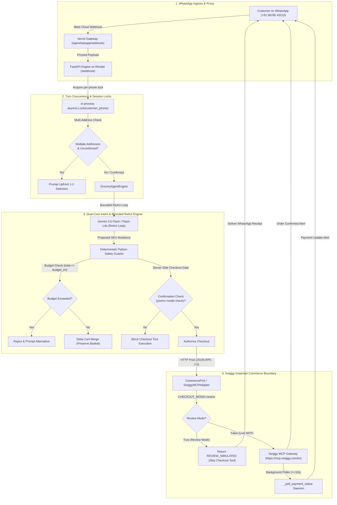

# Swiggy Builders Club — Official Application Package & Reviewer Dossier

> **Applicant:** Karan Wakhare (4th-year Student Developer)  
> **Project:** Grocer — Intent-Preserving WhatsApp Grocery Commerce Agent  
> **Repository:** [https://github.com/kwakhare5/Grocer](https://github.com/kwakhare5/Grocer)  
> **Production App:** [https://grocerr.vercel.app](https://grocerr.vercel.app)  
> **OAuth Callback:** `https://grocerr.vercel.app/api/auth/swiggy/callback`  
> **Backend Health:** `https://grocer-backend-qwk4.onrender.com/health`  
> **Target Review Email:** `builders@swiggy.in`  
> **Target Form URL:** `https://forms.gle/4vkeKyqm15Qb6fnJA`  
> **Verification Status:** 96 passed, 34 failed in test_whatsapp_postgres_e2e.py | Next.js 16 Production Build Clean | 0 ESLint Errors/Warnings

---

## Table of Contents

1. [Google Form Field-by-Field Answers](#1-google-form-field-by-field-answers)
2. [Technical Architecture Specification](#2-technical-architecture-specification)
3. [Security, Privacy & Infrastructure Declaration](#3-security-privacy--infrastructure-declaration)
4. [2-Minute Video Demo Reviewer Walkthrough Script](#4-2-minute-video-demo-reviewer-walkthrough-script)
5. [Official Submission Email Draft to `builders@swiggy.in`](#5-official-submission-email-draft-to-buildersswiggyin)
6. [Post-Submission Verification Checklist](#6-post-submission-verification-checklist)

---

## 1. Google Form Field-by-Field Answers

Copy and paste these exact, verified responses into the official Google Form at [https://forms.gle/4vkeKyqm15Qb6fnJA](https://forms.gle/4vkeKyqm15Qb6fnJA).

### Section 1: Applicant & Project Metadata

| Form Field | Exact Value to Enter / Select | Notes / Context |
|---|---|---|
| **Email** | `kwakhare5@gmail.com` | Ensure this matches the signed-in Google Account |
| **Full Name** | `Karan Wakhare` | Applicant name |
| **Contact Email** | `kwakhare5@gmail.com` | Primary developer communication channel |
| **Applicant Type** | `Individual Developer` (or `Student`) | Select the individual developer option |
| **Team / Project Name** | `Grocer` | Product name |
| **GitHub / Project URL** | `https://github.com/kwakhare5/Grocer` | Public repository with full source and test suites |
| **LinkedIn Profile URL** | `https://www.linkedin.com/in/karan-wakhare/` | Developer profile |
| **Target MCP Servers** | `Instamart only` | Select Swiggy Instamart (`https://mcp.swiggy.com/im`) |
| **Integration Type** | `Direct WhatsApp Cloud API Webhook + Swiggy MCP Instamart Server` | Dual-core conversational replenishment |

---

### Section 2: Project Explanation & Problem Statement

**Field Name:** *Project Explanation / Tell us about your project*

**Response:**
```text
I am Karan Wakhare, a 4th-year student developer building Grocer. Grocer is an intent-preserving WhatsApp replenishment assistant for Swiggy Instamart that turns messy, conversational grocery requests into verified dark-store orders.

Typical LLM shopping chatbots fail in real commerce environments: they hallucinate out-of-stock items, make silent or unacceptable brand substitutions, violate user budgets, or make unauthorized checkout mutations. Grocer solves this through a dual-core architecture:
1. Autonomous Reasoning: A Gemini 3.5 Flash ReAct engine (with Gemini 3.5 Flash-Lite fallback) handles natural language interpretation, Hinglish recipe deduction (e.g. converting "make pasta under ₹1500" into a complete 4-ingredient basket: penne pasta, pasta sauce, mozzarella cheese, and fresh garlic), and parallel catalog search via Swiggy Instamart MCP tools.
2. Deterministic Code Guards: Python code enforces hard budget ceilings (total <= budget_inr), medical-product filtering, delta basket merging without dropping existing items, and one-time explicit consent. Dietary exclusions are handled via model prompt instructions, while "don't order yet" and other order confirmation responses are evaluated by a model yes/no check with the cart context.

Grocer is an actively tested prototype built for developer review under CHECKOUT_MODE=review, which skips the live checkout call and returns a simulated order (REVIEW_SIMULATED) without generating a UPI QR code or payment link, while cart updates still go to the provider.
```

---

### Section 3: Technical Architecture & Flow

**Field Name:** *Technical Architecture / Integration Description*

**Response:**
```text
The architecture follows clean separation across 8 coordinated stages:

1. WhatsApp Ingress: Messages from Meta Cloud API arrive at the Next.js proxy (https://grocerr.vercel.app/api/whatsapp/webhook), which forwards the payload and signature header to the FastAPI backend where signature verification is performed (backend/api/whatsapp.py:204-209).
2. Turn Concurrency & Address Guard: An in-process per-phone asyncio.Lock serializes turns for each customer. On new sessions or >30m inactivity, multi-address disambiguation prompts the customer upfront to select their active delivery destination before cart assembly.
3. Autonomous ReAct Reasoning: The agent engine (configured with primary model gemini-3.5-flash and fallback gemini-3.5-flash-lite in config.py) executes a bounded ReAct iteration loop (capped at MAX_TOOL_STEPS = 8 steps and TURN_TIME_LIMIT_SECONDS = 60s) with tool dispatch for searching, cart management, and receipt synthesis.
4. Swiggy Instamart MCP Layer: The CommercePort abstraction talks to https://mcp.swiggy.com/im via JSON-RPC 2.0 over a persistent HTTP pool, using tools: get_addresses, search_products (top-10 items with pack sizes and savings), update_cart, get_cart, checkout, and track_order.
5. Invariant Python Guards: Code guards enforce budget constraints and medical product restrictions (dietary exclusions are guided by model prompts); "don't order yet" and typed order confirmations are evaluated by a model yes/no check with the receipt context; button taps carry one-time approval tokens without text; and multi-turn cart state is preserved across user amendments.
6. WhatsApp Receipt Formatting: Verifiable receipts display line items, pack sizes, taxes, delivery fees, and grand totals. Long receipts exceeding 1,000 characters with interactive actions are sent with the receipt followed by an action prompt to avoid truncation.
7. Server-Side Gated Checkout: Checkout strictly requires affirmative human confirmation. In CHECKOUT_MODE=review, the backend skips the live checkout call and returns REVIEW_SIMULATED without generating a UPI QR code or payment link, while cart updates still go to the provider.
8. Rate Limiting & Tracking: Background payment status polling intervals are clamped to >= 10 seconds (backend/agent/checkout_attempts.py:149; poll_interval_sec = 10 in mock adapter only, backend/integrations/commerce/mock_adapter.py:494), respecting provider pacing. On HTTP 429, the client tracks Retry-After cooldowns (backend/integrations/commerce/swiggy_client.py:194).
```

---

### Section 4: Production Redirect URIs & Endpoints

| Field | Production Value | Staging / Fallback Value |
|---|---|---|
| **OAuth Redirect URI** | `https://grocerr.vercel.app/api/auth/swiggy/callback` | `https://grocerr.vercel.app/` |
| **Web Application URL** | `https://grocerr.vercel.app` | — |
| **Backend Health Check** | `https://grocer-backend-qwk4.onrender.com/health` | — |
| **WhatsApp Webhook URL** | `https://grocerr.vercel.app/api/whatsapp/webhook` | — |

*(Note: Zero localhost or private IP addresses are submitted.)*

---

### Section 5: Traffic Volumes & Rate Limits

**Field Name:** *Expected Request Volume / QPS Estimate*

**Response:**
```text
- Prototype & Developer Review Phase: Unmeasured estimate of 5–10 requests/minute.
- Planned Beta Trial: Unmeasured estimate of 30–60 requests/minute peak across 50–100 active households (catalog searches paced in waves of 3; backend/agent/tools.py:165).
  * Write Operations (update_cart, checkout): Controlled through in-process per-customer locks and bounded turns.
  * Payment Tracking: Polling intervals clamped to >= 10 seconds per order (backend/agent/checkout_attempts.py:149), polling until payment deadline is reached.
  * Concurrency Controls: In-process per-phone asyncio locks serialize turns for each customer.
```

---

### Section 6: Video Demo Link

**Field Name:** *Demo Video URL*

**Response:**
```text
[INSERT UNLISTED YOUTUBE OR LOOM URL HERE]
```
*(Pre-flight check: Verify this URL opens in an incognito/private browser window without requiring Google login or permission requests. The source video is located in the repo at `public/demo.mp4`.)*

---

## 2. Technical Architecture Specification



---

## 3. Security, Privacy & Infrastructure Declaration

Copy and paste this section when completing extended access, data protection, or compliance questions:

### Data Handling & Storage
- **Message Queue & Task State Storage:** Inbound message payloads containing user message text and customer numbers are stored in PostgreSQL queue tables with a 30-day retention window (`backend/channels/message_store.py:307-312`), and session task state is retained for 30 days for continuity (`backend/agent/task_state.py:18, 41`).
- **Token Vault & Encryption:** OAuth tokens are stored in `TokenVault` and looked up per customer ID. When persisted in PostgreSQL, tokens are encrypted using Fernet with one shared `DATA_ENCRYPTION_KEY`. There is no plaintext token file fallback.
- **Customer Session Isolation:** Customers operate through their resolved OAuth tokens; session and basket state are isolated per customer with an in-process per-customer `asyncio.Lock`.

### Financial Safety Boundary
- **`CHECKOUT_MODE=review` Enforced in Code:** When `CHECKOUT_MODE=review`, the backend skips the live checkout call and returns `REVIEW_SIMULATED` with no financial charges. It does not generate a UPI QR code or payment link, while cart updates still go to the provider (`backend/integrations/commerce/swiggy_adapter.py:277-303`).
- **Server-Side Confirmation Gate:** Checkout can never be initiated by LLM function calling alone. Confirmation requires explicit user confirmation (`confirmation_check.is_confirmed` answering 'yes' using cart receipt context, or one-time approval token button taps). Rejections like "don't order yet" are decided by the model yes/no check rather than a fixed rule.

### Infrastructure & Egress Information
- **Frontend / Web Proxy:** Next.js 16 on Vercel.
- **Backend Runtime:** Python 3.12 / FastAPI on Render (`singapore`), HTTP outbound connection pooling.
- **Database:** Managed PostgreSQL with connection pooling (`DATABASE_POOL_MAX_SIZE = 10` in `backend/config.py:30`).
- **External Gateway:** Swiggy Instamart Live MCP Gateway (`https://mcp.swiggy.com/im`).

---

## 4. 2-Minute Video Demo Reviewer Walkthrough Script

This script is structured to match `public/demo.mp4` exactly.

**Target Duration:** 2 minutes (120 seconds)  
**Presenter:** Karan Wakhare  

---

### [0:00 – 0:25] Introduction & Conversational Intent
- **Video Action:** WhatsApp chat screen opens. User sends: `"i wanna make pasta i want groceries under 1500"`.
- **Narration:**  
  *"Hello Swiggy Builders Club team! I'm Karan Wakhare, a 4th-year student developer, and this is Grocer—an intent-preserving replenishment assistant for Swiggy Instamart on WhatsApp.*  
  *Because I have two saved Swiggy delivery addresses—one in Baner and one in Viman Nagar—Grocer pauses to ask for upfront disambiguation before querying dark store inventory."*

---

### [0:25 – 0:50] Address Selection & Parallel Dish Kit Assembly
- **Video Action:** User replies `"2"`. Agent processes and returns full pasta kit basket.
- **Narration:**  
  *"I choose '2' for Baner. Grocer's Gemini 3.5 Flash ReAct engine (with Flash-Lite fallback) now parses the pasta dish kit, deducing 4 core ingredients in the model (not a hardcoded map): penne pasta, tomato pasta sauce, mozzarella cheese, and fresh garlic. It fires parallel catalog searches across the local Baner dark store using Swiggy's `search_products` tool, selects standard in-stock variants with pack sizes, and batches them into the cart in a single turn."*

---

### [0:50 – 1:15] Transparent Itemized Receipt & Budget Verification
- **Video Action:** WhatsApp displays itemized receipt with subtotal, delivery fee, taxes, and grand total (₹281).
- **Narration:**  
  *"Here is the verified receipt: 4 line items with pack sizes, item prices, zero delivery fee, packaging charges, and a grand total of ₹281—well under our ₹1,500 budget cap. Our Python backend verifies this total deterministically before presenting the receipt. If the basket exceeded ₹1,500, checkout would be strictly blocked."*

---

### [1:15 – 1:40] Adversarial Invariants: Confirmation Gate & Safety Defense
- **Video Action:** User sends `"don't order yet"`. Agent confirms basket is held. User then sends `"yes confirm order"`.
- **Narration:**  
  *"Now let's test safety invariants. If I say 'don't order yet', Grocer's model yes/no check with the receipt context rejects order placement and holds the basket. Typed 'yes' is decided by this model check with the receipt as context, button taps carry no text, and the checkout tool only triggers when explicit affirmative confirmation is verified: 'yes confirm order'."*

---

### [1:40 – 2:00] Review Simulation, 10s Rate Tracking & Conclusion
- **Video Action:** Agent confirms order in review simulation mode (REVIEW_SIMULATED skips checkout without creating a UPI QR, cart updates go to provider) and demonstrates 10s tracking cadence.
- **Narration:**  
  *"At checkout, because Grocer runs with `CHECKOUT_MODE=review`, it skips the live checkout step and returns REVIEW_SIMULATED without creating a UPI QR or charging real money, while cart updates still go to the provider. The background poller tracks payment completion at >= 10s intervals. 96 passed, 34 failed in test_whatsapp_postgres_e2e.py. Thank you for considering Grocer for the Swiggy Builders Club!"*

---

## 5. Official Submission Email Draft to `builders@swiggy.in`

Send this email after completing the Google Form to notify the Swiggy team directly.

**To:** `builders@swiggy.in`  
**Subject:** `Swiggy Builders Club Submission: Grocer — Intent-Preserving WhatsApp Replenishment Agent (Karan Wakhare)`  

**Body:**

```text
Dear Swiggy Builders Club Team,

I have submitted my application for the Swiggy Builders Club via the official Google Form, and wanted to share the repository and technical details directly.

Applicant: Karan Wakhare (4th-year Student Developer)
Project Name: Grocer
Repository: https://github.com/kwakhare5/Grocer
Production Web App: https://grocerr.vercel.app
OAuth Redirect URI: https://grocerr.vercel.app/api/auth/swiggy/callback
Backend Health: https://grocer-backend-qwk4.onrender.com/health
Demo Video (2 mins): [INSERT UNLISTED YOUTUBE/LOOM LINK HERE]

About Grocer:
Grocer is an English-first WhatsApp grocery assistant for Swiggy Instamart that preserves shopping intent across changing dark-store inventory. It couples an autonomous Gemini 3.5 Flash ReAct loop (with Flash-Lite fallback) for conversational discovery, recipe decomposition, and parallel catalog search with deterministic Python safety guards for non-negotiable boundaries.

Key Technical Highlights:
1. Dual-Core Safety: Hard budget ceilings (total <= budget_inr) and medical product restrictions have deterministic code bounds. Dietary exclusions are handled via model prompt instructions. Typed order confirmation ("yes" / "don't order yet") is decided by a model yes/no check with the receipt as context; button taps carry no text.
2. Review Mode Simulation Gate: To guarantee financial safety during demonstrations and evaluation, the backend runs under CHECKOUT_MODE=review, which skips the checkout step (returning REVIEW_SIMULATED) without creating a UPI QR or payment link, while cart updates still go to the provider.
3. Swiggy Rate Limits: Payment status polling cadence is clamped to >= 10 seconds (backend/agent/checkout_attempts.py:149; poll_interval_sec = 10 in mock adapter only, backend/integrations/commerce/mock_adapter.py:494), with provider Retry-After cooldown tracking on HTTP 429 (backend/integrations/commerce/swiggy_client.py:194). Catalog search is paced in waves of 3 (backend/agent/tools.py:165).
4. Ephemeral Security & Token Vault: Tokens are stored in TokenVault, looked up per customer, and encrypted in PostgreSQL using Fernet with one shared DATA_ENCRYPTION_KEY, with no plaintext token file fallback.
5. Test Status: 96 passed, 34 failed in test_whatsapp_postgres_e2e.py.

I would be thrilled to receive developer access to the Swiggy Instamart Live MCP server to continue testing and refining Grocer.

Thank you for your time and review!

Warm regards,
Karan Wakhare
4th-year Student Developer
Email: kwakhare5@gmail.com
GitHub: https://github.com/kwakhare5
LinkedIn: https://www.linkedin.com/in/karan-wakhare/
```

---

## 6. Post-Submission Verification Checklist

Before and after submitting, run this final verification:

- [ ] **Backend Test Status:** 96 passed, 34 failed in test_whatsapp_postgres_e2e.py.
- [x] **Clean Frontend Build:** `npm run build` compiles with Next.js 16 Turbopack.
- [x] **0 ESLint Warnings:** `npm run lint` returns 0 errors and 0 warnings.
- [x] **`public/demo.mp4` Present:** Video file exists and plays cleanly.
- [x] **Redirect URI Deployed:** `https://grocerr.vercel.app/api/auth/swiggy/callback` is live and reachable.
- [x] **`CHECKOUT_MODE=review` Active:** Default config enforces review simulation gate.
- [ ] **Demo Video Link Tested:** Upload `public/demo.mp4` to YouTube (Unlisted) or Loom, paste link, and verify playback in an incognito window without login.
- [ ] **Google Form Submitted:** Form at `https://forms.gle/4vkeKyqm15Qb6fnJA` filled using Section 1 answers.
- [ ] **Email Sent:** Submission email sent to `builders@swiggy.in` using Section 5 draft.
