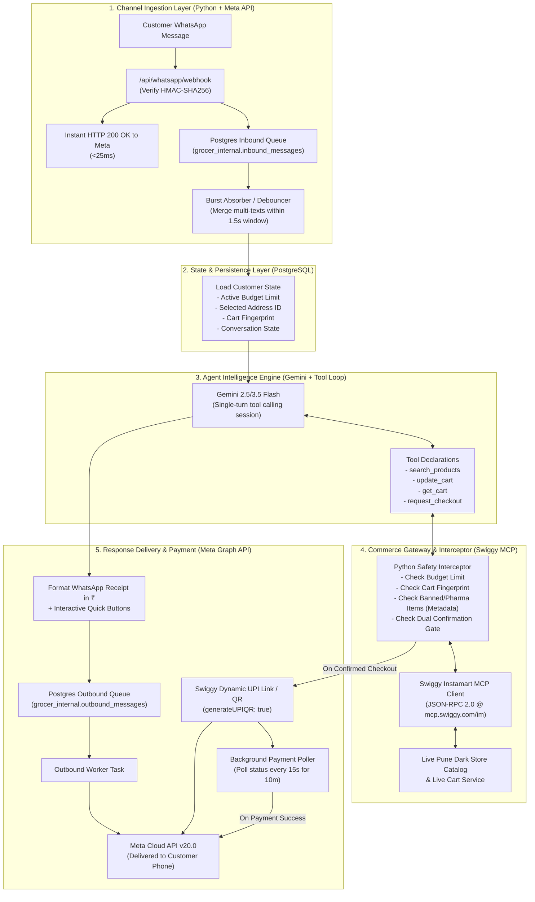

# GROCER Target Backend Architecture (v1.0)

> Status: Agreed & Finalized Target Architecture  
> Product Goal: Swiggy Instamart with a WhatsApp Interface  

---

## 1. Executive Summary

This document defines the production backend architecture for Grocer. It replaces the legacy multi-step ReAct FSM with a clean, low-latency, deterministic architecture designed specifically for real-world conversational grocery commerce.

### Core Philosophy
* **Gemini (The Brain)** handles the fuzzy, ambiguous human language: recipe deduction, context, conversational tweaks, and smart variant selection.
* **Python (The Muscle & Gatekeeper)** handles the plumbing, network protocols, deterministic math, database persistence, and physical checkout security gates.
* **Swiggy Instamart (The Provider)** calculates all authoritative bill amounts (item prices, surge, GST, packaging, delivery fees), manages dark-store inventory, and issues dynamic UPI payment links.

### 1.1 Universal Non-Negotiables & Invariants
1. **Real Data Over Speed**: Never chase speed with hardcoded shortcuts, fake heuristics, or temporary caching. Every catalog search, price, stock check, address, and coupon MUST use real Swiggy MCP data.
2. **Zero Assumptions About Customer Purchases**: Never assume customers only buy milk, bread, or staples. Search the real Swiggy dark-store catalog for whatever item the user asks for.
3. **Zero Assumptions About Geography (The Sangvi Principle)**: Never assume customers live in famous hubs (BKC, Indiranagar, Powai). Match delivery locations strictly against the user's real saved Swiggy addresses (`session.saved_addresses`). If an address contains "Sangvi", use that real address. If multiple match, present 1-tap quick buttons. If zero addresses exist, ask the user to add one in Swiggy.
4. **Customer Advocate Engine (Champion the Wallet)**: Always auto-apply the best valid Swiggy coupon (`list_coupons`). Proactively suggest 1-2 small real staples to cross free-delivery thresholds if it saves net fees. Critical Guardrail: Never apply a coupon if the final grand total increases (e.g. dropping below free-delivery cutoff without adding a staple). Proudly show `Total Saved: ₹...` on receipts.
5. **Sensible Defaults on Vague Requests**: When a request is completely unqualified (e.g., "milk" or "bread"), pick the store's #1 standard staple (500ml toned milk / standard white bread) and provide a 1-tap "Change Items" button. Never substitute specific requests (e.g., "almond milk", "Amul Gold 1L", "gluten-free bread").
6. **1-Tap Mobile UPI Checkout**: Default to clickable `upi://pay` deep links formatted into WhatsApp interactive buttons so users can pay with 1 tap in GPay/PhonePe directly on the same phone.
7. **Zero Regex & Zero Keyword Dictionaries for Domain Logic**: Absolutely NO regex word-lists, hardcoded drug lists, symptom dictionaries (`bukhar`, `sirdard`), city arrays, or item name matchers anywhere in business logic. Product safety is governed strictly by Swiggy catalog metadata (`category == "Pharmacy"` / `"Prescription"`). OTC first-aid (Band-Aids, ORS, cotton) is allowed. Conversational symptom nuance is handled by Gemini without keyword interceptors. (Regex is permitted only for raw syntax format validation: phone numbers, UUIDs, stripping markdown fences).
8. **Python Muscle vs Gemini Brain**: Gemini handles fuzzy natural language, recipes, and user intent. Python deterministically enforces math, budget caps, cart SHA-256 fingerprints, and checkout gates. The LLM can never place an order or deduct money.
9. **Zero Silent Drops**: If an item is out of stock or restricted, never quietly omit it. Honestly explain the missing item and offer alternatives.
10. **High-Cohesion Architecture**: Code that changes together lives together. No duplicate modules, no obsolete adapters, no 30-file over-fragmentation, and no corrupted line-ending bloat (`\r\r\n`).

---

## 2. High-Level Subsystem Blueprint

---

## 3. Subsystem Specifications

### Subsystem 1: Channel Ingestion Layer
* **Instant Acknowledgment**: Meta requires `200 OK` within 3 seconds. The webhook handler writes the incoming message directly to PostgreSQL and returns HTTP 200 in ~20 milliseconds.
* **Burst Debouncing**: If a customer sends multiple rapid messages (e.g., *"milk"*, *"actually 2 milk"*, *"and brown bread"*), the worker absorbs all pending messages within a 1.5-second debounce window and processes them as a single consolidated turn.
* **Pseudonymous Identity**: Phone numbers are immediately hashed with the secret key (`cust_wa_{HMAC-SHA256(phone)}`). Raw phone numbers are never stored in database tables or logs.

### Subsystem 2: State & Persistence Layer
* **Durable Postgres Session**: State is never kept in Python RAM. State travels across turns in `grocer_internal.task_state`:
  * `budget_limit` (float | null): Persists across turns until updated or order completed.
  * `active_address_id` (str): Currently selected delivery dark store.
  * `active_cart_id` (str): Live Swiggy cart identifier.
  * `cart_fingerprint` (str): SHA-256 hash of current items, quantities, and prices.
  * `conversation_state`: `READY`, `AWAITING_CONFIRMATION`, `AWAITING_PAYMENT`, `ORDER_PLACED`.
* **Encrypted Token Vault**: Swiggy OAuth tokens are encrypted at rest with rotating encryption keys in `grocer_internal.oauth_tokens`.

### Subsystem 3: Agent Intelligence Engine
* **Single-Turn Model Invocation**: Replaces cascading multi-model calls. In a single turn, Gemini receives the customer message, current cart state, and tools.
* **Real Dark-Store Tooling**: Gemini calls `search_products(query)` to find live items, inspects the returned variants (pack sizes, prices, stock), and calls `update_cart(items)`.
* **Smart Defaults**: Defaults to popular, standard in-stock items (e.g. standard milk or white bread) rather than interrogating the customer.
* **Intent Preservation**: Never silently omits missing items. Explains any out-of-stock items honestly in plain English.
* **Zero-Regex Restricted Items Policy**: Absolutely NO regex word lists (no hardcoded drug lists, no symptom dictionaries like `bukhar` or `headache`). Product restriction is governed strictly by Swiggy catalog metadata (`category == "Pharmacy"` / `"Prescription"`). Daily OTC first aid (Band-Aids, ORS, cotton) is allowed. Conversational requests where a customer describes feeling unwell are handled naturally by Gemini (recommending soothing groceries like honey, ginger, or soup) without regex code intercepting.

### Subsystem 4: Commerce Gateway & Tool Interceptor
* **Physical Checkout Gate**: Python deterministically intercepts every call to `checkout`. Checkout can ONLY execute if all 5 hard locks pass:
  1. The session is in `AWAITING_CONFIRMATION`.
  2. The customer explicitly confirmed (Track 1 Button Token or Track 2 Text Intent).
  3. The grand total is within the session's `budget_limit`.
  4. The live Swiggy cart matches the approved `cart_fingerprint` (SHA-256 hash).
  5. The cart contains zero restricted medical products based strictly on Swiggy metadata (`category == "Pharmacy"` / `"Prescription"`).
* **Swiggy MCP Fidelity**: Communicates over HTTP/2 JSON-RPC 2.0 with `https://mcp.swiggy.com/im` adhering strictly to [docs/SWIGGY_INSTAMART_MCP_SPEC.md](SWIGGY_INSTAMART_MCP_SPEC.md).
* **UPI Defaulting**: Automatically passes `paymentMethod: "UPI"` and `generateUPIQR: true` for on-demand WhatsApp checkout, providing direct `upi://pay` deep links.

### Subsystem 5: Dual Confirmation Engine
* **Track 1 (Interactive Button)**: Tapping "Confirm Order" passes a random cryptographic single-use token (`confirm_order:<token>`) matching the exact cart state.
* **Track 2 (Natural Language Text)**: If the customer replies *"yes"*, *"haan book karo"*, *"done"*, or sends a 👍, Gemini evaluates the intent as `CONFIRM`, and Python triggers the fingerprint validation check before executing checkout.

### Subsystem 6: Real-Data Customer Advocate Engine
* **Proactive Customer Advocacy**: Always champions the customer's financial best interest on every interaction (no speed shortcuts at the expense of accuracy or savings).
* **Auto-Coupon Hunter**: Queries live dark-store coupons (`commerce.list_coupons()`) and auto-applies the highest discount coupon meeting minimum order criteria (`commerce.apply_coupon()`).
* **Free Delivery Threshold Saver**: Calculates the distance to the store's free delivery threshold. If adding a small pantry staple (e.g. ₹15 Maggi or salt) costs less than the delivery fee (e.g. ₹35), Grocer proactively alerts the user and suggests real staples from the customer's frequent items (`get_go_to_items`), saving them net money.
* **Transparent Total Savings Badge**: Formats total rupees saved on items, coupons, and delivery directly into the cart receipt (`🎉 *Total Saved:* ₹...`).
* **Zero-Assumption Address Resolution**: Grounds address selection strictly in the customer's real saved addresses from Swiggy (`session.saved_addresses`). Never uses hardcoded city lists or keyword dictionaries.
* **Frictionless Mobile UPI**: Generates native `upi://pay` deep links formatted into WhatsApp interactive URL buttons so users can complete payment with 1-tap in Google Pay or PhonePe on the same device.

---

## 4. Edge-Case & Operational Protocols

### 4.1 Address & Dark Store Selection (Decision 1A)
* **Automatic Defaulting**: For returning users, Grocer defaults to their primary/last-used address immediately. The catalog search runs against that store, and the receipt clearly notes: *"Delivering to Home. Reply 'change address' to switch."*
* **First-Time Users**: If no address is linked or known, the bot stops before searching items and presents an address selection prompt.

### 4.2 Payment Lifecycle & Asynchronous Verification (Decision 2A)
* **15-Second Background Poller**: Once a dynamic UPI QR code is sent, a background worker polls Swiggy's order status every 15 seconds.
* **Instant Reassurance**: The moment the payment clears on UPI, the worker pushes a WhatsApp confirmation message: *"Payment received! Order #123 is confirmed and packing at your local store."*
* **10-Minute Expiration**: If 10 minutes elapse without payment, the poller marks the payment session expired and notifies the user with a single-tap button to generate a fresh QR code.

### 4.3 Cart Drift & Out-of-Stock at Checkout (Decision 3A)
* **Zero Silent Drift**: If an item goes out of stock or rain surge increases the delivery fee between bill generation and confirmation, the SHA-256 cart fingerprint mismatch halts checkout.
* **Graceful Re-Sync**: Grocer automatically re-syncs the live cart and sends a plain, one-line explanation with an updated total: *"Amul Butter just went out of stock at your local store. Your updated bill is ₹170. Tap below to place this updated basket, or tell me what substitute to add."*

### 4.4 Session History Windowing (Decision 4A)
* **Session Boundaries**: The active conversation history passed to Gemini is bounded strictly to the *current active shopping session*.
* **Automatic Reset**: History resets to clean state when an order is placed, or after 2 hours of inactivity.
* **Persistent Profile**: Saved user settings (primary address ID, dietary preferences, and budget preference) persist durably across all sessions in PostgreSQL.
